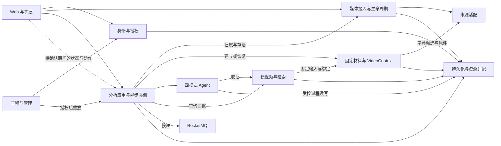

# FrameRead V1 模块与交付路线图

Label: wayfinder:map

## Destination

本地图维护模块职责、权威状态、逻辑依赖及 Wayfinder Decision Ticket 追溯。正式 S0～S12 编号、范围、真实阻塞、需求覆盖和阶段执行说明统一保存在[正式交付计划](delivery-plan.md)，本地图只保留入口。

## Notes

[PRD V3](../../docs/prototype/PRD.v3.md) 定义 R3 和 A3，[全局 SPEC 1.0.0](../../docs/prototype/SPEC.md) 定义技术契约，[术语表](../../GLOSSARY.md)与 [ADR](../../docs/adr/) 给出领域名称和正式决定。[设计基线审查](baseline-audit.md)提供源码差距和测试接缝；源码存在不表示运行验收通过。

已冻结的关键边界在 [Q1～Q6](../../docs/prototype/SPEC.md#spec-scope)、[分析作用域](../../docs/prototype/SPEC.md#spec-identity)、[数据与删除](../../docs/prototype/SPEC.md#spec-data)和[受理与恢复](../../docs/prototype/SPEC.md#spec-execution)。每个媒体首次固定采用材料，重新导入得到新媒体。分析按媒体、规范化目标、实际模式寻址，受理与执行代次以持久 Checkpoint 为据。报告结果与媒体摘要分写。片外补充仅用于追问，未知模型用量在有限重试中保持未知。[ADR 0002](../../docs/adr/0002-keep-background-knowledge-in-qa.md) · [ADR 0003](../../docs/adr/0003-retry-an-unconfirmed-model-call.md) · [ADR 0004](../../docs/adr/0004-bound-video-task-admission.md)

开始模块设计或实施前读取[交付计划的当前阶段与真实依赖](delivery-plan.md#delivery-dependencies)，按[项目 AI Coding 工作流](../../AGENTS.md#ai-coding工作流)推进。只对当前切片未决设计处理 [Decision Ticket](issues/)，已冻结契约直接复用。

### 模块责任矩阵

沿用 [SPEC §3](../../docs/prototype/SPEC.md#spec-architecture) 的 10 个模块。Interface 一栏列调用方需要知道的输入、结果和约束。各模块的当前入口及测试见[源码接缝](baseline-audit.md#source-seams)，R3 与 A3 的完整要求见 [SPEC §11](../../docs/prototype/SPEC.md#spec-traceability)。

| 模块 | 主责与 Interface | 权威状态、提交与职责交接 | 直接依赖 | 主要 R3 / A3 与规格 | 源码现状和后续 Grill |
| --- | --- | --- | --- | --- | --- |
| 身份与授权 | 注册、登录、退出、校验 Bearer、判断管理员。调用者取得已确认的用户身份及权限。 | MySQL 用户与角色，Redis 会话。具体媒体归属从媒体模块取得，管理入口另校验角色。 | 持久化适配 | R3-01、R3-12 / A3-01、A3-19。[§4](../../docs/prototype/SPEC.md#spec-identity) · [§8](../../docs/prototype/SPEC.md#spec-api) | 已有入口。复核两账号隔离、过期会话及资源授权，沿用冻结权限。 |
| 媒体接入与生命周期 | 普通/分片上传或导入得到已保存媒体。提供归属、列表、播放、删除及独立转写、音频导出入口。 | MySQL 媒体行拥有归属、导入来源、`uploadId` 绑定、文件清单及删除标记，MinIO 持有视频/分片。文件准备在事务外，发布与删除共用媒体行条件。采用材料交给上下文，独立文字提取只更新兼容投影。 | 身份、来源适配、持久化、媒体工具 | R3-01～R3-03、R3-11、R3-12 / A3-01～A3-06、A3-18、A3-19。[§6](../../docs/prototype/SPEC.md#spec-data) | 已有上传/管理。P0 扩展来源发布，修复完成回执与删除竞争。先 Grill 共用媒体契约。 |
| 来源适配 | URL 到规范单视频和下载描述。已确认成员到可核对的字幕候选及原件。提供稳定错误和获取期限。 | 对成员判定负责，导入记录由媒体写入。字幕候选交给上下文确认与采用，分析由独立入口发起。 | 平台、专用 HTTP 客户端、受控 yt-dlp 及媒体工具出口 | R3-03、R3-04、R3-12 / A3-03～A3-08、A3-18、A3-19。[§5.1](../../docs/prototype/SPEC.md#spec-platform) · [§8](../../docs/prototype/SPEC.md#spec-api) | 已有通用工具路径。单视频、分 P、同成员字幕和出网属 P0 增量。Grill 来源/下载描述与部署交接。 |
| 固定材料与 VideoContext | 有效媒体与建立/恢复意图到固定材料、实际来源指纹和 VideoContext。统一选源、ASR 回退、OCR/帧、时间与材料匹配。 | 媒体行的采用信息、Checkpoint 的固定材料和 context、MinIO 原件/真实帧。媒体级协调后在同一短事务发布。跨媒体采用核对同用户及真实材料并本地化引用。结果适用性由分析协调判断。 | 有效媒体、来源适配、FFmpeg/ASR/OCR、持久化 | R3-04～R3-06、R3-09 / A3-07～A3-11、A3-14、A3-15。[§5](../../docs/prototype/SPEC.md#spec-source) | 已有 ASR 与 OCR/帧。固定和复制属 P0 增量。Grill 谁准备资源、谁提交，以及恢复/缺失的调用契约。 |
| 长视频与检索 | 已确认上下文与查询到兼容分块、摘要及可定位证据。支持混合检索和同源降级。 | 媒体级 chunks Checkpoint、Qdrant 派生向量和已发布版本，按媒体、指纹和派生版本隔离。通过固定材料 Interface 取得身份，供 Agent 和证据查询调用。 | VideoContext、模型/Embedding、持久化 | R3-06、R3-09 / A3-11、A3-13～A3-15。[§5.2–5.3](../../docs/prototype/SPEC.md#spec-source) | 已有检索。待补指纹/版本隔离和字幕时间证据。Grill 固定输入到索引的发布及降级。 |
| 四模式 Agent | 已固定输入、规范目标、实际模式和执行条件到 `AnalysisResult` 或明确失败。负责 AUTO 路由、Planner/Executor/Critic、取证、预算和追问生成。 | 产生计划、过程和结构结果，经受控 Checkpoint 写入。作用域终态、保存和对外报告由分析协调负责。 | 检索、模型、受控的过程持久化 Interface | R3-06～R3-10 / A3-09、A3-12、A3-13、A3-15、A3-17。[§7](../../docs/prototype/SPEC.md#spec-execution) · [§9](../../docs/prototype/SPEC.md#spec-delivery) | 四模式及校验入口已定位。Grill 字幕证据、受控过程写入和追问隔离。 |
| 分析应用与异步协调 | 已授权提交、修订、重放到受理/复用/拒绝，再提供回查、SSE、报告、追问及反馈。 | 目标级持久 Checkpoint 拥有当前工作条件、代次、过程、结果和完成。MySQL 持有失败台账及独立媒体摘要。Redis 活跃状态、通知、对话和反馈按协议使用。统一管理写回、恢复、重放并委托 Agent 和检索。 | 身份、媒体、VideoContext、Agent、检索、持久化、RocketMQ/Redisson | R3-07～R3-12 / A3-12～A3-17、A3-19、A3-20。[§4](../../docs/prototype/SPEC.md#spec-identity) · [§7](../../docs/prototype/SPEC.md#spec-execution) | 已有分析、消息和 SSE。兼容旧键与代次、安全回读和恢复待补。待确认的公共状态由本地图下的 Decision Ticket 处理。 |
| 持久化与资源适配 | 带媒体、指纹与代次条件的读写、资源存取、缓存与清理。执行业务所有者给出的提交条件。 | MySQL/Flyway、MinIO、Redis 和 Qdrant 按上游权威归属保存或派生数据。DB 提交后发布外部投影，业务模块判断结果、采用和复用。 | 数据库、对象存储、缓存、向量设施 | R3-02、R3-05、R3-06、R3-08、R3-10、R3-12 / A3-02、A3-14、A3-17～A3-19。[§6](../../docs/prototype/SPEC.md#spec-data) | 已有存储操作。迁移、条件写入与外部清理为兼容修复。随媒体/上下文/协调 Grill 接缝。 |
| Web 与扩展 | 共用 HTTP/SSE 协议。Web 手动启动，扩展导入后提交。按实际来源展示、定位、查看、重开和导出。 | 本地仅留交互状态和回查需要的作用域，业务状态读取后端。Web 承接上传、追问和导出。扩展仅在确认同视频、同 P 且可解析时码时跳转。 | 身份、媒体、分析协调的公共协议 | R3-02、R3-03、R3-06、R3-08～R3-11、R3-13 / A3-06、A3-13、A3-15、A3-16、A3-18、A3-20、A3-21。[§8](../../docs/prototype/SPEC.md#spec-api) · [§9](../../docs/prototype/SPEC.md#spec-delivery) | 已有操作入口。来源提示、错误区分和重开兼容随切片验证。A3-21 等设计文件。 |
| 工程与管理 | 复现启动、配置及诊断、离线评估、管理员核对失败和发起重放。 | 配置、启动/评估记录、可核对的运行证据。管理入口校验角色后委托协调，失败台账及工作代次归分析协调。 | 身份、协调、工程设施与各验收入口 | R3-01、R3-10～R3-12、R3-14 / A3-01、A3-17～A3-20、A3-22。[§8.3](../../docs/prototype/SPEC.md#spec-network) · [§12](../../docs/prototype/SPEC.md#spec-verification) | Compose、管理、评估与 CI 已定位。随来源 Grill 出网交接，实际运行与故障仍待验收。 |

### 模块依赖

实线表示已确认的逻辑依赖，方向为调用方或数据消费者到提供方。虚线标记待确认状态的消费契约。MQ 消费回调进入同一分析协调模块。当前代码与本图的差异见[源码接缝](baseline-audit.md#source-seams)。

平台和下载工具由来源适配调用，FFmpeg、ASR、OCR 由媒体处理和上下文使用。Agent 和检索各经适配调用外部模型。按媒体行统一控制采用、向量发布、Checkpoint、摘要和删除。外部调用在事务外，写回再核对来源与适用代次。[SPEC §3](../../docs/prototype/SPEC.md#spec-architecture) · [§6.2](../../docs/prototype/SPEC.md#spec-commit) · [§7.1](../../docs/prototype/SPEC.md#spec-admission)

### 正式交付计划入口

[正式 S0～S12 九字段交付表](delivery-plan.md#delivery-slices)是唯一阶段表。2026-11-19 从本地图迁移，编号、能力边界和依赖保持不变；版本与冻结记录见新文档。

[真实阻塞、公共契约、运行能力门禁与并行关系](delivery-plan.md#delivery-dependencies)

[切片由来、10 个候选及 HEAD 中 6 个集成边界映射](delivery-plan.md#candidate-mapping)

[R3-01～R3-14、A3-01～A3-22 阶段归属与最终验收](delivery-plan.md#delivery-coverage)

[切片使用方式与执行流程](delivery-plan.md#development-rules) · [项目通用执行规则](../../AGENTS.md#ai-coding工作流)

以上锚点保留用于旧引用；阶段内容在新文档维护。

## Decisions so far

本地 Decision Ticket 暂无已关闭记录。正式基线决策沿用 Notes 中的 ADR 0002～0004；交付计划冻结不构成对未决 Ticket 的裁决。

- [01 · 派发待确认期间如何回查与重提分析](issues/01-analysis-dispatch-pending-projection.md)：未决，文件尚无 `Status:` 和 `Answer`，不得推定 resolved。首次阻塞 S6/C-A 的状态、SSE、重复提交和两端动作契约；不阻塞媒体/来源/上传的独立工作。

## Not yet specified

待确认的是 Decision Ticket 01 的公共投影；模块 SPEC 中的 DTO/列/索引、编码、对象前缀、期限/租约及清理数值仍需按切片细化。E1 的真实网络/工具等价性、真实平台与模型行为、故障时序和性能结论等运行证据尚无；D1 前端设计文件尚未提供。以上均未被本次规划冻结代替，见[审查结论](baseline-audit.md#baseline-findings)。

## Out of scope

逐模块详细 SPEC、实现 Tickets、功能开发、代码重构、数据迁移、全产品运行验收。产品范围沿用 [PRD V3 §2.3](../../docs/prototype/PRD.v3.md#23-功能边界)。历史 Python 与独立文章发布架构、批量导入、新增任务运行时和中间件均在本路线之外。
