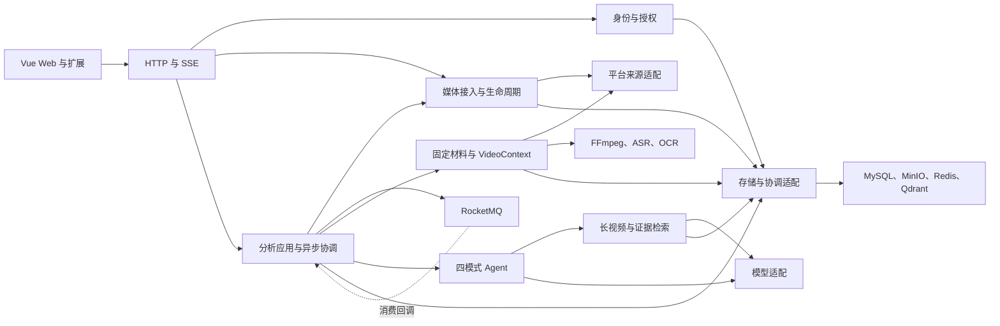
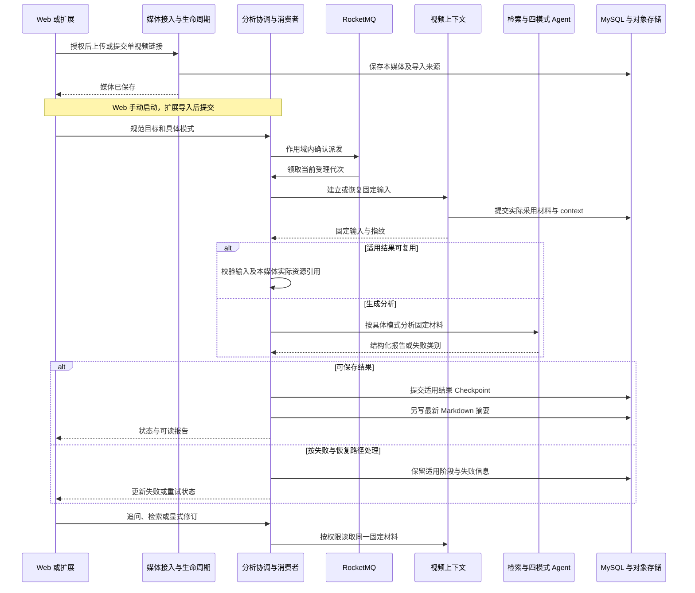

# FrameRead 全局技术规格

| 项目 | 基线 |
| --- | --- |
| SPEC 版本与日期 | 1.0.0 · 2026-11-18 |
| 状态 | **Final / Architecture Baseline** |
| 产品需求 | [PRD V3](PRD.v3.md)，2026-11-17 正式冻结 |
| 验收状态 | A3-01～A3-22 均待执行 |

[范围与材料契约](#spec-scope) · [实现索引](#spec-evidence) · [架构与模块](#spec-architecture) · [分析身份](#spec-identity) · [来源与复用](#spec-source) · [数据与事务](#spec-data) · [异步与恢复](#spec-execution) · [API 与网络](#spec-api) · [完整流程与范围](#spec-delivery) · [跨模块验收重点](#spec-decisions) · [需求与验收](#spec-traceability) · [后续验证](#spec-verification)

## 1. 产品范围与材料契约

FrameRead 支持注册、登录与管理员入口，本地普通上传与分片续传，Bilibili、YouTube 单视频和经安全校验的公网 HTTP(S) 导入，以及媒体管理。分析优先采用经过验证的平台字幕，必要时使用 ASR，结合 OCR、真实帧与证据检索生成四模式结构化报告。Web 和扩展提供各自的分析操作、Markdown 阅读及证据核对。Web 提供追问、反馈、计划修订和导出。服务端管理异步执行、状态、失败与恢复。功能及验收范围见 [PRD V3](PRD.v3.md)，工程入口见[实现索引](#spec-evidence)。

| 编号 | 来源与材料契约 |
| --- | --- |
| Q1 | 每个媒体固定首次分析真正采用的文本来源。重开、重发、追问、修订、重投沿用该来源。再次导入产生新媒体并重新尝试字幕。 |
| Q2 | 候选按人工、自动、未知分组，组内中文、英文、其他语言。候选失败尝试下一项。类型和语言仅依可证实的信息记录。 |
| Q3 | 保留旧成果与同媒体原有上下文。未知来源不得用于新媒体跨媒体复用，迁移不自动重跑。 |
| Q4 | MySQL 保存来源与采用信息及稳定引用，MinIO 保存原始字幕，Checkpoint 持久化上下文、过程、结果与相应来源指纹。 |
| Q5 | 字幕原件与引用帧归各自媒体所有。跨媒体复用须复制实际需要的对象，并将引用本地化。 |
| Q6 | 已有报告的旧媒体缺少可用上下文和完整固定材料时，保留阅读及导出，拒绝追问、检索、修订等依赖原来源的操作，并提示重新导入。 |

## 2. 实现索引

服务端类位于 `server/src/main/java/com/example/server/`，下表按该目录定位 Java 包。路径、符号与运行关注点用于实现和验收定位，验收状态见 [§11.2](#spec-traceability)。

| 能力 | 入口与符号 | 关键行为与验证重点 |
| --- | --- | --- |
| E01 身份 | `service/AuthService.java`、`config/AuthInterceptor.java`、`config/WebConfig.java` | 注册响应不签发会话，登录签发默认 24 小时的 Redis Bearer 会话。验证入口鉴权、媒体归属和管理员权限。 |
| E02 导入 | `controller/MediaController.java`、`service/MediaIngestService.java`、`utils/YtDlpUtils.java` | URL 同步下载，保存视频对象后登记媒体。核对来源、分 P、实际下载条目、字幕候选及实际网络出口。 |
| E03 分片 | `service/ChunkUploadService.java`、`client/src/chunkUpload.js` | Redis 管上传与回执，MinIO 保存分片，Redisson 协调合并。注入媒体落库后回执丢失并验证持久绑定与续传。 |
| E04 处理 | `service/VideoContextService.java`、`service/SegmentedTranscriptionService.java` | 并行处理文本与 OCR/帧，并按时间窗合并。验证部分 ASR 成功、粗时间来源和上传失败的帧降级。 |
| E05 检索 | `service/LongVideoContextService.java`、`service/VideoChunkingService.java`、`service/VideoEvidenceRetrievalService.java`、`service/QdrantVectorStore.java` | 执行分块、片段摘要、向量及关键词/OCR 混合检索和本地降级。验证向量查询的媒体、来源指纹和派生版本约束。 |
| E06 路由与 Agent | `dto/AnalysisMode.java`、`service/mode/ModeRouter.java`、`service/mode/ModeRegistry.java`、`service/AgentLoopService.java`、`utils/DeepSeekUtils.java` | 客户端提交前处理 AUTO，Agent 执行计划、工具检索、结果校验与预算。模型入口使用文本消息，画面按实际证据引用。 |
| E07 上下文与成果 | `service/AiService.java` 中的 `resolveContext`、`reuseResult`、`persistResult` | 核对同媒体 context、复用候选和报告写入。验证按实际选源和同用户检查决定复用。跨媒体复制真实图片且引用目标资源。最新摘要与结果 Checkpoint 分写。 |
| E08 Checkpoint | `service/AgentCheckpointService.java`、`repository/AgentCheckpointRepository.java`、`mapper/AgentCheckpointMapper.java` | context 与 chunks 属媒体，目标级状态按分析作用域保存。Redis 热读及 MySQL 持久回读须核对绑定。验证 upsert 检查媒体有效性和执行代次。 |
| E09 调度与重放 | `service/AnalysisDispatchService.java`、`consumer/VideoAnalysisConsumer.java`、`service/FailedAnalysisTaskService.java` | 使用 RocketMQ 投递与有限重投，Redis 保存活动投影并通过 Redisson 协调目标与媒体锁。验证确认不明、旧执行写回、重放前核对媒体存活、投递与台账分步故障。 |
| E10 状态 | `service/AnalysisStatusService.java`、`service/TaskEventService.java`、`dto/TaskStatus.java` | 有效修订排队优先，适用结果可完成。进程内订阅和 Redis Pub/Sub 传递事件，状态序列化报告 Markdown。验证断线后按同一作用域回查。 |
| E11 Web | `client/src/App.vue`、`client/src/useAnalysisWorkspace.js`、`client/src/api.js`、`client/src/taskEvents.js`、`client/src/videoTimestamps.js` | 验证手动分析、失败重发、另选产物、计划重跑、回查报告、SSE 重订阅和保存媒体时间定位。 |
| E12 扩展 | `extension/sidepanel.js`、`extension/lib/urlParser.js`、`extension/lib/sseParser.js` | 验证登录、导入、路由、分析和事件链。核对同视频、同分 P 及可识别时码的跳转，记录短链和时码限制。 |
| E13 配套 | `controller/MediaProcessingController.java`、`controller/AdminController.java`、`service/OfflineAgentEvaluationRunner.java`、`controller/HealthController.java`、`service/MediaService.java` | 核对独立文字提取、MP3、失败管理、离线评估和进程探针。验证媒体删除与持久化、资源清理以及并发写入的竞态。 |
| E14 工程 | `server/pom.xml`、`client/package.json`、`extension/manifest.json`、`docker-compose.yml`、`.env.example`、`scripts/dev-up.sh`、`.github/workflows/ci.yml` | 分别验证依赖与配置、构建、测试、应用和中间件。Flyway 路径 `server/src/main/resources/db/migration/` 包含核心表 `V1__create_core_tables.sql`、媒体内容哈希 `V2__add_media_content_hash.sql` 和失败任务模式 `V3__add_failed_task_mode.sql`。 |

## 3. 系统架构与模块接口

根目录下的 `server/` 采用 Java 21、Spring Boot 3.5.9 模块化单体，HTTP、RocketMQ 分析消费者、异步媒体操作和 SSE 同进程。`client/` 是 Vue 3/Vite Web 客户端，`extension/` 是 Manifest V3 浏览器扩展，两端通过相同的 HTTP 和 SSE 协议访问服务端。

`docker-compose.yml` 编排 MySQL、Redis、RocketMQ、MinIO 和 Qdrant。应用与工具在宿主机运行。服务端使用 MyBatis-Plus/Flyway、Redis/Redisson 和 LangChain4j，并调用 FFmpeg、ASR 与 Tesseract OCR。业务规则、事务和失败语义由表中的责任模块定义。

| 模块 | 接口、权威数据与依赖 | 失败、恢复与外部验证 |
| --- | --- | --- |
| 身份与授权 | 注册、登录、退出、用户/管理员判定。会话与角色由服务端判定，媒体归属以媒体记录为据。依赖 MySQL、Redis。 | 验证过期登录、两用户隔离、管理入口拒绝。 |
| 媒体接入与生命周期 | `上传/导入 → 已保存媒体`，按用户提供列表、播放和删除，拥有归属、导入来源、文件清单和删除事务。调用来源适配与存储。独立转写和音频下载从媒体处理入口进入。 | 通过普通/分片重试、保存失败、并发删除及播放授权验证。 |
| 来源适配 | `URL → 规范单视频与下载描述`，`已确认媒体来源 → 同成员字幕候选及原件`。封装平台、HTTP、yt-dlp、类别诊断及网络约束。 | 用长短链、重定向、错成员和下载失败样本验证。 |
| 视频上下文 | `有效媒体 + 建立或恢复意图 → 固定材料、VideoContext`。统一负责选源、实际材料指纹、复用资格及原文/区间、ASR/OCR/帧。依赖来源、媒体工具及资源持久化。 | 用不同语言、零重复 ASR、分支容错、并发首次采用和旧快照恢复验证。 |
| 长视频与检索 | `已确认的上下文 → 兼容分块/证据`，按查询返回真实时码。拥有块和索引版本及降级，依赖存储、模型与向量适配。 | 通过错来源无命中、向量失败降级和关键帧证据验证。 |
| 四模式 Agent | `已确认输入、目标、实际模式、执行上下文 → AnalysisResult`，协调 Planner/Executor/Critic、模式 Profile、工具、预算和追问生成。依赖检索、模型和受控的过程 Checkpoint 接口。 | 固定样本验证模式产物、结构修复、警告完成、预算失败及片外来源区分。 |
| 分析应用与异步协调 | 接受已授权提交、修订和重放，管理作用域、代次、报告保存、状态/SSE、交互与反馈；校验来源有效性后调用上下文和 Agent。 | 验证重复请求/投递、修订重置、丢失确认、晚到写回、重连和读取零模型。 |
| 持久化与资源适配 | MySQL/Checkpoint、MinIO、Redis 和 Qdrant 的读写、事务参与及清理。受调用方已验证的媒体、指纹及提交条件约束。 | 用真实设施故障验证缓存失效、孤立对象、条件写入、向量过滤。 |
| Web 与扩展 | 按同一协议消费受权的媒体、分析、状态和错误接口，并提供各自的交互与时码。导出由 Web 承接。 | 两端实际操作、断线重开、时码点击及错误状态。 |
| 工程与管理 | 维护配置、Compose、媒体工具的运行约束、健康诊断、离线评估和验收入口。失败重放由管理员入口授权，再委托分析协调。 | 重启读取、工具/依赖/平台故障、权限和性能基线。 |

MQ 的反馈箭头表示同一应用的异步入口。Agent 与检索只消费已确认的媒体材料，检索不回调 Agent。来源适配不启动分析或写 Checkpoint。上下文接口负责获取顺序、匹配和复制，分析协调与检索均经该接口取得或校验输入，禁止用 MD5 提示替代核验。媒体删除通过持久化与资源接口完成，不回调下载或生成。

## 4. 分析作用域和用户操作

### 4.1 唯一身份

媒体归属为 `(userId, mediaId)`。媒体 ID 在实例内唯一且不复用。分析作用域为 **`(mediaId, normalizedGoal, actualMode)`**，读写均先受媒体归属约束。服务端以 Java `String.trim()` 和文本校验规范化目标，保留内部空白、大小写和 Unicode。具体模式为 `GENERAL / LEARNING / REVIEW / CREATION`。AUTO 由 `POST /analysis/route` 在提交前确定，路由失败回退 GENERAL。客户端保留该次具体模式用于提交、重开、SSE、计划、评估、轨迹、修订和关联报告的追问。查询和重投不能再次路由。HTTP 缺省模式为 GENERAL，明确非法模式返回 400。仅确知属于旧协议且缺模式的消息按 GENERAL 读取，明确未知的模式走无效消息分支。

作用域采用有版本的编码。模式占独立字段或命名空间，目标摘要仅由规范目标生成，载荷携带或可核对完整作用域。Controller、Dispatch、Consumer、目标级 Checkpoint、Status 与 SSE 共用该规则。编码覆盖所有目标级持久记录、活动/锁/计数、事件、对话分域、复用结果和失败重放。上下文、分块与反馈按媒体保存。

兼容读取时，`server/src/main/java/com/example/server/utils/AnalysisTaskKeys.java` 的旧键对 GENERAL 取 `SHA-256(UTF-8(trim(goal)))`，其他模式取 `SHA-256(UTF-8(mode.name() + U+241F + trim(goal)))`。GENERAL 的目标文本允许包含该前缀，因此不同目标与模式可能具有相同的哈希输入。

升级使用仅供兼容的旧键读取。用该媒体旧结果载荷中的 `AgentState.goal` 重算四个模式的旧键，实际存储键必须唯一匹配其中一个模式，推得的完整作用域须与请求一致。无法证明归属的旧过程项或结果只保留诊断，不作为有效状态或迁入依据。新作用域首次写入可在同一提交边界迁入已核实的旧结果，开始修订或新一轮执行后禁止旧结果回源。先受控切换旧生产者和消费者，再启用新写入。旧在途消息只接续切换前已核实的受理及作用域，无法核对的留诊断。禁止清库或批量重算。

### 4.2 操作语义

| 操作 | 目标行为 |
| --- | --- |
| 重开/导出 | 受权读取原作用域的持久结果或既有媒体摘要入口。只读操作零模型、零外部取源。摘要与目标报告保持各自语义。 |
| 普通提交及失败页的“重新分析” | 都走 `/analysis/ai`。本作用域存在有效排队、运行或重试工作时返回活动冲突，客户端接续原状态。无活动且存在适用结果时返回 200，客户端读取报告。否则按原入口校验并受理。 |
| “更换产物” | Web 回到目标与模式编辑。目标或实际模式改变时寻址新作用域，沿本媒体固定来源。再次提交相同目标/模式仍遵循普通提交。 |
| 普通反馈 | 按原路径保存及评估，零新投递。 |
| “按新计划重跑” | 显式调用 `/analysis/agent-revise` 才暂存修订并投递。按 `correctedGoal`（有值时）或原目标确定实际目标，沿用户已选具体模式。客户端采用服务端返回的有效作用域。只有该作用域在实际开始时重置，若目标改变，原目标的结果仍按原键读取。 |
| 重新选源 | 再次导入得到新媒体，后续执行重新发现并验证字幕候选。 |

Web 上传或导入只进入工作区，由用户启动。扩展“提交分析”在导入成功后串接普通分析。结果按同作用域覆盖。

`server/src/main/java/com/example/server/controller/AnalysisController.java` 的提交、状态读取与修订统一遵守有效活动优先的规则。有旧报告且修订仍有效排队时返回活动冲突，Web 和扩展按 200 或活动 409 接续对应状态。同一目标与模式的并发受理和结果检查见 [§7.1](#spec-admission)。

## 5. 平台来源、固定材料与复用

### 5.1 单视频来源

| 输入 | 来源模块的权威判定 |
| --- | --- |
| Bilibili BV/av/b23 | BV 与 av 别名解析到可确认的 BVID。核对正整数 P（省略取 1）、该 P 对应的 cid 或等价的可证实成员标识及实际下载条目。短链在受控跳转后按同一规则判定。字幕仅从同一成员取得。 |
| YouTube watch/shorts/youtu.be | 归一至同一 `videoId`。视频带列表参数时只交给执行器该视频，纯列表、频道、合集及无法确认单视频的同平台输入明确拒绝。 |
| 本地与其他公网 HTTP(S) | 本地媒体经上传和 ASR。合法公网 HTTP(S) 使用通用下载路径，明确为纯批量的输入拒绝。通用来源不猜填双平台身份，标题和时长可标未知。 |

按解析后的主机名识别平台。播放时间和追踪参数保留必要的显示或定位语义，下载与分析使用完整选定成员。媒体导入阶段只确认来源、下载、提交文件与元数据。Bilibili 由 Java 侧确认成员，YouTube 可从经身份核对的同次元数据中取得候选描述。来源模块可以用已实测等价能力的执行器取得平台元数据，仍须独立核对实际下载与候选成员。`--no-playlist` 提供工具配置，成员正确性需要真实平台证据。网络在 [§8.3](#spec-network) 统一约束。

### 5.2 可提前确认的条件与实际材料

| 信息 | 所有者与比较条件 |
| --- | --- |
| 导入来源 | 媒体保存此次输入在去除凭据、签名参数及其他敏感值后的记录、规范来源、平台单视频成员或已知本地/通用类型、可验证的标题与时长，以及实际保存文件的 SHA-256。本地与明确的通用来源具有各自类型，历史未知为独立标记。现有 MD5 保留为兼容或查找线索。 |
| 处理前匹配条件 | 复用提示索引用视频字节摘要、平台成员或已知来源类型、文本支路和相应处理规则版本查询。有效字幕须先取得并验证其轨道和原件字节摘要，类型/语言可为未知。ASR 须先确认本次走 ASR，再按供应方、模型/配置、分段与时间规则版本匹配已有转写。查询不依赖尚未生成的 ASR、OCR 或最终指纹。 |
| 已采用文本 | 字幕记录实际轨道、原件摘要、原始 cue 与清洗对应关系，或 ASR 记录实际保存的原文、原分片区间及不足。类型为 `PLATFORM_SUBTITLE`、`ASR`、`NONE` 或 `LEGACY_UNKNOWN`。只有其他证据形成可用上下文时可以固定 `NONE`。字幕类型 `UNKNOWN` 仍可采用。 |
| 有效输入指纹 | 上下文模块用版本化、显式字段及空值编码确定 SHA-256。输入含导入字节/成员、实际文本种类、轨道/类型/语言、原件或 ASR 文本及区间/精度摘要、实际用到的 OCR/帧内容摘要与相关处理版本。对象地址、临时 URL、媒体 ID 和用户 ID 不进入内容指纹。所有方消费同一个已提交指纹，授权单独核对。 |
| 派生及结果身份 | chunks 和索引绑定 `mediaId + 有效输入指纹 + 派生规则版本`。结果额外绑定 [§4](#spec-identity) 的作用域，引用当前可用材料。派生版本包括分块、摘要及相应 Embedding 兼容性。旧结果重开读取保留的绑定。 |

### 5.3 首次采用、并发、复用与恢复

1. 上下文模块先核对媒体有效性并读持久材料。已固定则走恢复路径。尚未处理时，在媒体级锁下再查一次。不同目标可并行完成各自分析，首次材料构建通过同一媒体协调。
2. 在首次文本构建处，按 Q2 排候选，同优先级用可复现次序。验证可解析、非空、视频/分 P 一致、原时间区间可确认且无明显损坏、越界或可观察的截断。保留原始 cue。字幕时间覆盖率不作为语义完整性或报告完成判据。依次尝试直到采用或达到有界获取期限，记录“无可用字幕”“候选失败”“预算到期”等可证实的原因。语言、原语/译字幕或人工/自动未知时如实记录。
3. 对已验证字幕，使用该原件。无可用字幕或字幕不适用时，进入 ASR 支路。ASR 支路可以先找同用户满足处理条件的已持久化转写，核对材料及实际区间后采用其保存的摘要，无需先重新执行 ASR。候选不满足条件则走 FFmpeg 音频处理、分段与转写。部分 ASR 可依据容错规则固定在本媒体，跨媒体普通复用只择材料完整、可验证且符合本次条件的候选。字幕/ASR 支路均与 OCR、关键帧抽取和去重并行，支持分片及单支容错。有效字幕时分析链内同目的 ASR 为零。独立文字提取经媒体处理入口，仅可更新 `transcript_text` 兼容投影。
4. 复用提示索引按用户和匹配条件分域。由上下文模块核对源、目标均归同用户，源在读取时有效、材料和实际摘要一致、资源可校验，再决定采用哪些材料。整份上下文候选还须匹配画面/上下文规则，复制其实际使用的 OCR 片段和真实帧；否则仅采用可独立验证的文本或按本媒体处理。不同用户、不同分 P、已确认不同字幕轨道/语言或实际文本、`LEGACY_UNKNOWN`、`NONE`，均不能作为同一整份输入。索引过期、缺失或候选不存在时按未命中处理。跨媒体匹配无全库扫描或同步等待另一个媒体的要求。
5. 原件、真实帧和时间材料先按目标媒体准备在本次操作独占的对象前缀。**正式固定点**是短 MySQL 事务确认目标有效、尚无快照、当前提交者获准，同步提交采用元数据、可恢复的固定材料和同指纹 context。若并发落败，读取胜出的快照，清理本次未引用资源。文件/DB 故障、两支失败或无可用上下文时走错误流程，未提交的选材不能成为报告或复用依据。
6. context 提交后才允许结果复用。先查本媒体适用结果，再按同用户、已固定输入、目标、具体模式和兼容的普通分析规则查跨媒体完成候选。跨媒体只复用符合条件的已完成普通结果，人工修订、部分执行、预算与历史对话留在原作用域。报告中实际引用必须指向目标复制的资源。源在复制期间消失且材料未复制完整时舍弃候选。复制完成的目标媒体使用独立可验证的材料，源删除不影响它。
7. 已固定的媒体在重投、追问、修订及恢复时均读取持久快照，缓存命中须与其一致。上下文缺失时用已固定的原件、原时间、实际 OCR/帧材料及所记规则恢复原输入。旧媒体或无法恢复到相同内容时按 [§5.4](#spec-legacy) 处理。chunks/向量损坏或版本不匹配时从原输入重建或走同源降级。Qdrant 新数据查询必须限制媒体、指纹及该媒体已发布的派生版本。复用候选的 Redis TTL 为 7 天，持久材料按媒体生命周期管理。

原始字幕与清洗文本分开保存。时间保持非负、有限、有序，区分字幕原始区间、ASR 分片、实际帧时间及估算精度。只含成功分片的文本如实说明不足。保存帧地址不证明模型理解像素，视频定位地址不能用作图片证据。

### 5.4 旧数据与材料缺失

| 情形 | 可用操作 |
| --- | --- |
| 旧 context 仍可用 | 保持同媒体读取、分析、追问、检索和修订。产物仍标记 `LEGACY_UNKNOWN`。跨媒体索引不能使用该材料。 |
| 旧报告可读，原 context 与完整材料均不可用 | 报告/导出保留。新生成、追问、检索和计划修订在产生副作用前返回 409 和重新导入提示。维持可读报告的既有授权边界。 |
| 历史媒体从未建立上下文或报告 | 显式首次分析可处理现有视频文件，以原 ASR/OCR 建立快照。如平台成员未知，保留未知且不将其作为可匹配的平台来源。 |
| 新媒体已固定，context 失效或遗失 | 按 Q1 恢复相同固定输入。固定材料不足时，仍可读取已保存报告，依赖来源的处理返回 409。 |

读取旧报告不验证远端现状，不创建字幕或发起 ASR。新输入在比较之前统一经 [§5.3](#spec-adoption) 确定来源，不从旧报告、`transcript_text` 或任何缓存推断本次已采用材料。

## 6. 数据归属、提交与删除

### 6.1 存储责任

| 存储 | 持有的数据 |
| --- | --- |
| MySQL/Flyway | 用户、媒体归属和来源、采用元数据、稳定对象引用及最小删除状态。现有 Checkpoint 保存固定材料所需的 ASR 原分片和 OCR/帧清单、context、chunks、目标级阶段/计划/执行/结果、当前工作条件。媒体最新 `ai_summary` 独立保存。失败台账供管理员诊断和重放。 |
| MinIO | 视频、上传分片、原始字幕和真实帧。发布对象按媒体归属，使用稳定内部引用。播放经现有受权接口取得可读地址，新增原件或帧从本媒体引用受权访问。 |
| Redis/Redisson | 会话、活动投影、提示索引、热 Checkpoint、媒体列表缓存、锁、SSE 通知、对话/反馈/轨迹的原有临时状态。缓存超时不改变持久事实。 |
| Qdrant | 检索派生向量。只读指向当前媒体、固定指纹及已确认的索引。故障时对同源材料降级。 |
| RocketMQ | 分析与修订消息投递、有限重投及失败主题。 |

采用元数据及引用以媒体行扩展为主，最小固定材料及目标过程沿用 Checkpoint。变更用附加 Flyway 迁移，旧数据按 [§4](#spec-identity) 和 [§5.4](#spec-legacy) 读取。不要求全表补齐所有历史规范字段。若内部设计需要新表，应先证明已有表无法承担，并遵守项目的新表约定。

### 6.2 事务与资源发布

- **导入。** 媒体模块拥有提交事务。长时间下载、对象写入在事务外。媒体归属与导入来源在一个短事务落库，失败回收本次对象并记录可重试线索。上传或导入成功以持久媒体为准。
- **媒体行统一写入条件。** 在短 MySQL 事务中先以行锁或等价的条件更新确认同一媒体仍未删除，再验证适用的受理、执行代次和来源。采用元数据、Checkpoint、向量发布引用、摘要和独立转写投影均遵守该条件。锁顺序为媒体行后作用域，不同时持有两个媒体写锁。平台、文件、模型调用在锁外。删除与以上写入通过同一媒体行串行化。在事务外查询媒体存在不能授权后续提交。
- **删除。** 现有媒体行保留最小删除标记，事务内核验归属、使媒体不可读、封止所有有效写回，并取得待清理的本媒体持久引用，移除或失效业务 Checkpoint。列表/播放/来源、分析与导出、重放以及缓存回读统一核对有效性。该变更涉及所有媒体入口，用于保存可核对的清理清单和已完成上传绑定。清理后只需为存在分片完成绑定的媒体保留最小记录。
- **外部清理。** 媒体模块在提交后失效列表、Cache、活动和复用提示，清除该媒体的对象、向量与临时诊断状态。项目使用独立对象前缀、不可跨媒体引用的对象清单和有界重试。过时执行的 Redis/Qdrant/对象写入即使已到达外部设施，也因引用、归属或代次失效而不可读，由本次操作或媒体清理回收。无法证明归属的历史资源不猜测删除。既有播放签发的临时地址可能在有效期内仍可使用，删除后停止签发并按实际对象清除结果记录。
- **结果和摘要。** 分析协调在结果事务中按有效执行代次保存目标级结果，登记完成及媒体内提交顺序。摘要在另一个短事务写入，以媒体行锁或等价条件更新核对持久完成标记仍属该作用域当前有效成果，经媒体内提交顺序比较后更新。摘要或通知失败保留可读的结果。执行租约结束后仍可按此条件幂等补写摘要。对外状态以该作用域的结果为据。

### 6.3 上传完成和未完成分片

媒体表持久保存服务端发放的唯一 `uploadId`，与最终媒体插入同事务，普通上传和 URL 导入为空。分片入口先按当前用户核对已完成绑定。合并重试返回同一有效媒体，已删除返回资源失效，已完成会话不再写分片。新增绑定由唯一性约束决出并发胜者，落败回收本次对象。Redis 回执只作缓存。已完成上传删除后继续保留唯一绑定和删除标记，确保迟到重试不能再创建媒体。迁移时核对存量在途会话及可信回执，缺失的历史绑定不能凭文件名或 MD5 补造。

未完成分片按续传会话及闲置期限管理。清理按上传会话有界扫描，同上传/合并协调，复核是否仍活跃、已完成或有在途写入，并防止已关闭会话重新创建分片引用。若配置对象生命周期兜底，必须有强制的最长会话与在途保护窗口，超时对象期限方可证明安全。Redis TTL 滑动，单凭对象年龄无法作此证明。此流程独立于链接导入的来源发布事务，验收见 A3-02。

## 7. 异步执行、完成与恢复

### 7.1 受理、消息与写入条件

分析协调经 RocketMQ 投递，Redisson 限制并发，Redis 提供活跃状态与通知。**工作条件持久化在目标级 Checkpoint**，每作用域仅记当前受理代次、动作、确认/执行阶段与期限、持有者的执行代次，以及已确认的输入引用和恢复所需的过程。此范围排除独立任务运行时、Outbox、跨作用域任务 ID 与后台补发平台。

| 事件 | 约束 |
| --- | --- |
| 普通提交、修订、重放 | 由同一作用域的事务判定活动/可用结果/可受理，保留现有鉴权与配额。需派发时先写有界受理记录，修订计划或失败记录 ID 随对应动作绑定，随后在事务外发包含该代次、实际模式、目标及动作的消息。客户端无需持有代次。 |
| 投递与确认 | 202 需要同代次未被废止且 broker 确认或消费者已有持久领取。可确定未发送时仅撤销同代次未领取的受理，保留旧结果。发送异常且结果不明时返回现有 5xx 大类及稳定原因，保留该代次供状态核对或迟到确认。超出明确期限且未领取，可由用户重新提交，同一短事务废止过时代次。崩溃在保存受理至发送之间仍可能需要用户再次提交。 |
| 消费领取 | 校验消息、媒体存活以及作用域、动作与受理代次。领取/接管写入本次执行代次及有界租约，活跃执行续租，状态查询以持久期限和阶段为准。相同代次的确认、续租、释放与 Redis 清理均校验持有者。已完成、已失效或媒体已删的重复消息可结束消费。遇活跃持有者而成果未提交时只按有界重投协调，锁争用本身不能证明任务完成，也不能让其他媒体的消息代替本媒体完成。 |
| 源和过程绑定 | 未固定来源的新消息只需标识媒体与受理内容。由 [§5](#spec-source) 读取或建立权威材料，提交后将实际指纹绑定到本次工作。消息中的历史 MD5 或来源提示不改变数据库事实。 |
| 写回与终态 | 在 [§6.2](#spec-commit) 所定事务中核对媒体有效、当前受理代次、来源及仍有权提交的执行代次。检查涵盖上下文发布、目标级过程/结果及修订重置。锁失联、租约失效、工作被接管或媒体被删时，旧执行者停止有效写入。摘要与完成通知以有效持久结果为据。缓存及索引在提交后更新，并能识别并忽略早期代次。 |

受理与执行采用各自的有界期限。Redis active 的 6 小时 TTL 属缓存事实。需同时获取目标级和媒体级 Redisson 锁的路径统一先目标、后媒体，不在持有 SQL 行锁时等待 Redis 锁。适用的投递超时、续租周期和外部调用上限需在模块 SPEC 验证彼此匹配。耗尽、过期、恢复时的事实仍可查询。网络发送、数据库和 broker 间存在确认窗口，外部模型调用也可能已经发生，系统只保证有效结果提交的隔离和幂等。

工作先处于待确认，broker 确认转为排队，消费者可在首次领取期限内从这两个阶段转为处理中。确认晚于领取时只补确认信息，不能回退阶段。未领取且已逾期的受理不再接受确认或执行，后续显式提交可替换它。已领取的工作可在有界恢复期限内由重投接管，接管需前一执行租约已释放或过期，且事务中取得新执行代次。整个恢复期限耗尽后拒绝晚到写回，显示适用的旧结果或失败及原因。所有判断以持久工作记录和期限为据，客户端不自动重提。

### 7.2 修订、读取与通知

1. 普通首次分析可在未建上下文时受理。追问、检索、修订及有原上下文或报告的新生成按 [§5.4](#spec-legacy) 验证原上下文可用或可从固定材料恢复。修订在暂存投递前、Worker 开始重置前均核对，失败保留旧目标结果。确知缺少材料才返回重新导入提示。依赖故障无法判断时按暂不可用处理。
2. 修订有效排队时，对外优先显示 `QUEUED`，旧结果仍持久保存。按已确认工作或待确认期限及持久修订状态投影。已确认未入队或期限届满后，旧结果按原键可读，诊断保留实际派发结果。
3. 开始执行同代次修订时，原子地消费修订标记、重置实际目标/模式的 plan、executor、critic、result 等目标级状态，并安装修订计划（若有）和当前执行状态。重投已应用修订时从同代次过程恢复，不能再次清除。固定来源、其他作用域、历史摘要不因重置一起清除。
4. 在没有有效的新修订覆盖读取的情况下，适用的结果 Checkpoint 可返回 `COMPLETED`。摘要、缓存和通知各自更新。达到 Critic 轮次上限仍未通过可带警告完成。`TaskStatus.completed` 转换可含警告，`AnalysisResult.toMarkdown()` 和媒体摘要的转换不写入 Critic 警告。应以结果状态核对 Critic 是否通过。
5. 对外保持 `NOT_STARTED / QUEUED / PROCESSING / COMPLETED / FAILED`，细分采用现有 `TaskStage` 及必要诊断。SSE 订阅按有效作用域，注册后读取持久投影，事件按当前代次及状态校验，忽略晚到的旧通知。发生断线、刷新、终态竞争或重订阅时以同一作用域的状态回查收敛。Web 重订阅与扩展有限重连保留，客户端不因此提交新分析。Redis Pub/Sub 及 SSE 不提供永久游标或历史重放。

### 7.3 有限重试、预算与管理员重放

- 应用最多三次有效消费尝试，监听器另有重投配置，实际次数和异常组合待测。可重试的失败保留已提交且匹配本作用域、工作和输入的阶段。过时消息不可清掉新的 active 或写失败状态。永久失败或尝试耗尽进入台账、失败主题与失败状态处理。台账、主题和状态的分步故障须可诊断。
- 毒消息按既有可追溯路径处理，明确未知模式不得降成 GENERAL。无合法媒体或作用域可关联时只记安全诊断，禁止改变其他工作的状态。台账与失败主题均不可用时沿 broker 有限重投。
- 继续按现有 Agent 工作预算和模型/工具的有界调用约束执行。首次运行记录预算配置及版本，同一次受理的消费重试沿用固定来源、预算上限和已持久化阶段、轮次及已知用量。自动重试不清零可确认的消耗。消费次数、单次耗时、模型重试/结构修复调用、token 和费用估算分别计量。未确认的供应商用量标为未知，额外调用受剩余预算和有限重投约束。预算异常沿原 `BUDGET_EXHAUSTED` 路径结束，本分支未统一送死信或进入管理员重放。
- 管理员核对失败记录可重放、媒体仍有效、失败作用域及原动作与固定来源仍适用，再通过同一协调入口投递。受理事务以失败台账 ID 条件领取，并将重放代次与该记录互相绑定。再次请求同一重放先查该绑定，复用仍有效或已确认的工作，待确认窗口结束且旧代次作废后才可新受理。按原动作恢复适用过程，已应用的修订不能重复清除。已完成或被后续工作取代的旧记录不再启动。只有可确认的同一重放代次才可据条件更新 `REQUEUED`，台账更新失败可继续按该代次核对。重放 202 仍只是受理。

## 8. 客户端协议、诊断与网络

### 8.1 HTTP 兼容

保留各入口的 HTTP 方法、参数和返回语义。JSON 保持 `code/message/data`，`code == 0` 表示业务成功。鉴权延续 Bearer。SSE、音频沿各自流协议。缓存、资源下载、扩展和重放均受媒体有效与归属约束，路由/登录/新上传等无既有媒体的操作按各自入口校验。

| 入口 | 兼容契约 |
| --- | --- |
| `/user/register`、`/user/login`、`/user/logout` | 注册原响应无有效会话，登录签发 token，保留退出与过期行为。 |
| `/media/init-upload`、`/media/upload-status`、`/media/upload-chunk`、`/media/complete-upload` | 续传参数和上传归属不变，完成/重试按 [§6.3](#spec-uploads)。 |
| `POST /media/upload`、`POST /media/upload-url`、`/media/list`、`/media/playback`、`/media/delete` | 上传和导入同步返回原 `MediaSummary`。播放器/列表/删除沿原受权入口。同步响应丢失时，客户端先核对媒体列表等已保存事实，避免自动再次下载。当前无导入操作 ID，任意断线后不保证能唯一关联导入。 |
| `POST /analysis/route` | 按目标返回具体模式及理由，沿原 GENERAL 回退。 |
| `POST /analysis/ai` | 保持 `id/goal/mode`。200 表示适用成果已存在，报告经状态读。202 为受理，409 结合原因解释，429 为系统配额。派发失败保留原 5xx 大类，结果不明返回 `ANALYSIS_DISPATCH_UNKNOWN`。 |
| `/analysis/analysis-status`、`/analysis/analysis-events` | 确认同一目标与模式。报告沿 `TaskStatus.result` 返回 Markdown，结构化 `AnalysisResult` 在服务端持久化。 |
| `/analysis/follow-up`、`/analysis/evidence-search`、`/analysis/agent-feedback`、`/analysis/agent-plan`、`/analysis/agent-revise`、`/analysis/agent-evaluation`、`/analysis/agent-trace` | 兼容查询/提交、配额与归属规则。修订 202 及有效活动 409 在 `data` 返回 `mediaId/goal/mode`，客户端以有效作用域接续。对话历史最近 10 条、7 天。反馈按媒体最多 200 条、30 天。轨迹有限保留。 |
| `/analysis/transcribe`、`/analysis/transcription-status`、`/analysis/transcription-events`、`/analysis/download` | 独立文字提取、状态/SSE、MP3 按原入口。 |
| `/admin/failed-analysis`、`/admin/failed-analysis/{id}/replay` | 管理员鉴权，沿用失败查询及重放，按 [§7.3](#spec-recovery) 预检。 |

分析提交和修订仅在 409 原因为 `ANALYSIS_ACTIVE`（兼容旧服务的无原因活动 409）时接续同作用域状态。`SOURCE_CONTEXT_UNAVAILABLE` 时提示重新导入。派发结果未知时先查同一作用域。

### 8.2 来源说明与业务错误

受权的 `GET /media/source?id=...` 提供单媒体来源概览。返回原始输入的安全显示值、规范来源、平台/视频/分 P、可取标题和时长，以及采用状态、来源种类、已知语言、字幕类型、时间精度、可展示的采用/回退原因。区分尚未固定、已固定和历史未知。字段体积及查询有界，媒体列表保持原契约。普通公开输入可回看原 URL，敏感值须删减并如实标明。签名 URL、凭据、请求头、对象键、完整来源指纹及内部工具输出仅供服务端核验或受控诊断，禁止放入用户响应。

保留原件和原始区间以供受权核对。V3 的必需公开面是来源说明与报告时码。`GET /media/source-text` 属按需原件读取方案，若模块设计确需提供原件交互，通过已授权 `mediaId` 选择已经采用的材料并保证内容/响应有界，禁止接受任意 URL、对象键或路径。新增真实帧读取同理，须验证关联媒体和对象有效性。客户端渲染沿 Web 安全处理和扩展 DOM 构造流程，来源文本与诊断按数据处理。

导入错误在 `code/message` 之外返回 `data.reason` 与 `data.stage`。阶段区分输入、解析、下载与持久化。错误信息须可安全展示。

| 情形 | HTTP / 业务码 | 稳定原因 |
| --- | --- | --- |
| URL/协议错误或非法目标 | 400 / 40000 | `INVALID_SOURCE_URL` / `NETWORK_TARGET_REJECTED` |
| 无法确定单视频、短链循环或最终目标不符 | 400 / 40000 | `NOT_SINGLE_VIDEO` / `INVALID_SHORT_LINK_TARGET` |
| 支持能力已证实缺失、平台明确限制 | 422 / 42200 | `UNSUPPORTED_SOURCE` / `PLATFORM_ACCESS_RESTRICTED` |
| 短链/来源解析或媒体下载失败 | 503 / 50300 | `SOURCE_RESOLUTION_FAILED` / `MEDIA_DOWNLOAD_FAILED` |
| 来源/下载到达期限、部署获取不可用 | 503 / 50300 | `SOURCE_TIMEOUT` / `SOURCE_FETCH_UNAVAILABLE` |
| 确认原上下文不可恢复 | 409 / 40900 | `SOURCE_CONTEXT_UNAVAILABLE` |
| 依赖故障导致原上下文暂时无法核验 | 503 / 50300 | `SOURCE_CONTEXT_CHECK_UNAVAILABLE` |

大小、媒体格式、认证、归属、资源失效仍走相应 413/415/401/403/404 语义。平台限制需有可靠响应证据，未知错误按发生阶段返回。平台响应不得冒充本系统的会话失败或限流。字幕失败及 ASR 回退归来源采用诊断，既有媒体保存事实不受影响。

### 8.3 网络和媒体工具的执行边界

Java 源服务用专用 HTTP 客户端取得短链、元数据和字幕。仅接受合法 HTTP(S) URL、主机与有效端口，拒绝用户信息及私网、回环、链路本地、保留地址与部署者网段。关闭自动跳转和环境代理，限制跳数及总期限。每跳解析并验证实际候选连接地址，连接只能使用该次批准的地址，TLS 校验仍使用原主机名。使用 OkHttp 已有可指定的 DNS 接口及隔离连接复用的专用 client，代理和跨主机连接不得绕开该检查。部署验证需证明实际连接而非只验证解析结果。参考 [OkHttp 4.12.0 的 DNS 接口](https://raw.githubusercontent.com/square/okhttp/parent-4.12.0/okhttp/src/main/kotlin/okhttp3/Dns.kt)。

yt-dlp、它调用的下载器和 FFmpeg 子进程可能自行解析、跟随重定向或读取分片清单。**本版 URL 导入的参考部署**使用 Linux 宿主机上的独立下载 network namespace，经专用 veth 和宿主机 nftables 规则出网。部署者预置命名空间和规则，由固定的受限启动入口进入后降权运行，无需常驻新服务。下载环境只接收受控参数、任务临时目录和明确需要的工具输入，清理环境与文件访问范围，隔离应用配置和其他用户授权材料。经审核的专用 DNS 才开放解析，访问对象须为公网目标。覆盖 IPv4/IPv6、到宿主机的入站路径、转发及 NAT 后的目标，拒绝私网、环回、管理/元数据/Compose 网络和受保护的部署地址。来源仍支持经安全验证的其他公网 HTTP(S)。参考 [ip-netns 手册](https://man7.org/linux/man-pages/man8/ip-netns.8.html)及 [Netfilter hooks](https://wiki.nftables.org/wiki-nftables/index.php/Netfilter_hooks)。

该配置不迁移 Spring Boot 或 Compose。原依赖 Compose 和宿主机本地处理入口继续适用。Windows/WSL2 等运行环境提供经实测等价的下载隔离时，可走相同来源接口；当前 Compose 未给宿主工具提供该约束。新链路在边界不可用时对 URL 获取返回 `SOURCE_FETCH_UNAVAILABLE`。Java 层能做每跳校验，进程边界负责阻止工具直接访问拒绝目标。

对获取、字幕候选、临时输出和进程树设置可证明的总期限、单次期限、大小、重试和资源上限。继承现有文件/下载限制，并验证工具实际限制与落盘大小。仅使用部署者显式配置、限定用途的已有凭据。短链、站点响应、原始输入与工具错误经脱敏后进入日志，不留含凭据的请求材料。来源与工程模块用受控出网夹具和真实平台分别验收地址核查、下载行为、进程回收与普通兼容样本。此处冻结执行机制，真实网络和版本验证见 A3-19。

## 9. 完整业务流程与交付范围

GENERAL 生成结论、时码和建议，LEARNING 生成知识点、自测和易错点，REVIEW 审查逻辑、夸大和遗漏，CREATION 生成片段、标题、简介与脚本。模式化 Section 转换为 Markdown。分析通过 Planner/Executor/Critic、结构校验与工具取证完成，可按上下文和检索契约降级。追问在对话保留期内区分视频事实、推断和片外补充。

Web 工作区显示规范来源、字幕或 ASR 及采用诊断，点击报告时码定位保存媒体。扩展提供登录、当前页或手动链接、模式选择、进度及报告，呈现实际导入和分析阶段及错误。仅在可确认当前页视频和分 P 对应且时码可解析时跳转原平台。未展开的 b23 链接和部分长分钟时码受限。分片上传与追问由 Web 承接。导出包括 Markdown、TXT 和 MP3。

| 交付类别 | 范围 |
| --- | --- |
| 产品主链与配套 | 从账号、媒体输入、处理与四模式分析验证到报告回读、追问、异步恢复、诊断和管理、导出及部署复现，覆盖 Web 和扩展。 |
| P0 来源与材料 | 验证双平台单视频和分 P、元数据、字幕候选与原件、采用和回退、来源说明、稳定错误与平台出网。 |
| 持久化与恢复 | 验证作用域编码、同用户及同源复用、Q6 修订保护、真实资源与写入条件、同作用域重试及状态兼容。删除竞争覆盖链接、固定材料路径及其调用的保存入口。 |
| 分片上传 | 验证完成绑定、回执与合并故障、非活跃分片回收。分片生命周期独立于链接处理。媒体列表无分页，健康探针用于检查进程是否响应。 |
| 设计与实测依赖 | 完整前端改版依赖设计文档。性能改动依实际主链基线及可复现瓶颈选择。 |

产品边界见 [PRD V3 §2.3](PRD.v3.md#23-功能边界)。模块接口和跨模块集成契约须覆盖上述业务流程。

## 10. 跨模块验收重点

| 场景 | 核对事项 |
| --- | --- |
| 重发、修订与旧键读取 | 提交、读取、SSE、消费和重放使用同一作用域。验证带模式前缀的目标、未知显式模式，以及旧键须能唯一匹配的条件。修订前和执行前校验 Q6，仅重置实际目标和模式。[分析身份](#spec-identity) · [修订状态](#spec-status) |
| 选源与证据 | 验证先选源再复用，素材从同一提交点发布。核对同用户、同分 P 和指纹，报告只引用目标媒体的实际可读资源。[固定材料](#spec-source) |
| 受理与并发写回 | 验证确认不明、晚到消息、已应用修订的重投、重放与删除竞争。上传完成以持久绑定为准，摘要失败时适用结果仍可读取。[事务与删除](#spec-data) · [异步恢复](#spec-execution) |
| 外部输入与客户端 | 分别核对 Java 每跳验证和宿主机出网隔离。验证保存媒体与字幕失败各自可诊断，客户端仅对活动冲突接续同一分析，并向用户区分来源缺失和暂不可用。[来源说明和错误](#spec-api) · [下载网络](#spec-network) |

## 11. PRD 需求与验收追踪

### 11.1 需求责任

| 需求 | 主责模块与规格 | 验收关注点 |
| --- | --- | --- |
| R3-01 | 身份、媒体 · [§4](#spec-identity)、[§8](#spec-api) | 会话与角色、同用户复用、来源与资源授权。 |
| R3-02 | 媒体、资源 · [§6](#spec-data) | 普通上传、分片续传、实际完成与绑定、清理及删除竞争。 |
| R3-03 | 来源、媒体 · [§5.1](#spec-platform)、[§8](#spec-api) | 通用同步导入、双平台身份、下载成员、元数据和稳定错误。 |
| R3-04 | 来源、上下文 · [§5](#spec-source) | 平台候选、排序、同源验证及候选失败继续。 |
| R3-05 | 上下文、媒体 · [§5](#spec-source)、[§6](#spec-data) | ASR/OCR 容错、原文与区间、固定材料及采用字幕后同目的 ASR 零调用。 |
| R3-06 | 上下文、检索 · [§5](#spec-source)、[§9](#spec-delivery) | OCR、真实帧、分块和混合检索，证据和输入隔离及时间精度。 |
| R3-07 | Agent、分析协调 · [§4](#spec-identity)、[§7](#spec-execution)、[§9](#spec-delivery) | 四模式产物、AUTO、预算和警告，作用域及恢复。 |
| R3-08 | 分析协调、报告 · [§6](#spec-data)、[§7.2](#spec-status) | 结构结果与 Markdown、按来源读取、作用域重置及分步保存。 |
| R3-09 | 分析协调、Agent、检索 · [§4](#spec-identity)、[§5.4](#spec-legacy)、[§7.2](#spec-status) | Q6、修订作用域、反馈和使用固定材料的追问。 |
| R3-10 | 分析协调 · [§7](#spec-execution)、[§8](#spec-api) | MQ、Checkpoint、Redis/SSE、失败管理、确认、过时写回和恢复。 |
| R3-11 | Web、扩展、媒体、管理 · [§8](#spec-api)、[§9](#spec-delivery) | 导出、扩展和管理交互、离线评估。 |
| R3-12 | 各业务模块、持久化、工程 · [§6](#spec-data)、[§7](#spec-execution)、[§8](#spec-api) | 事务、错误与网络、资源边界、鉴权和预算。 |
| R3-13 | Web、扩展 · [§8](#spec-api)、[§9](#spec-delivery) | 工作区与来源交互，A3-21 依据设计文档验收。 |
| R3-14 | 工程和各模块 · [§12](#spec-verification) | Compose、脚本、测试、CI、实际运行及性能证据。 |

### 11.2 待执行验收

下表依 [PRD V3 §9](PRD.v3.md#9-验收矩阵) 映射主责与证据。全部条目为待执行，A3-21 还需设计输入。

| 验收 | 对应需求 | 主责及通过证据 |
| --- | --- | --- |
| A3-01 | R3-01、R3-12 | 身份/媒体。真实 API 与两个账号验证登录/退出/过期、他人媒体/成果/原件/图片、管理员拒绝，确认同视频不跨用户复用。 |
| A3-02 | R3-02 | 媒体。真实 DB/MinIO/Redis 验证普通、缺片、续传、合并/回执失败、完成响应丢失和删除重试。记录相同绑定、无重复媒体及清理与活动竞争。 |
| A3-03 | R3-03 | 来源。契约及真实 Bilibili 样本，比对 BV/av/b23、缺省/指定 P、实际下载成员与字幕，视频不裁剪或成组下载。 |
| A3-04 | R3-03 | 来源。真实 YouTube watch/shorts/短链和带列表的视频身份一致，只下载目标完整视频。 |
| A3-05 | R3-03 | 来源。受控/真实输入验证纯列表、频道、合集、非法、短链失败与限制，归类稳定，未生成媒体时无分析派发。 |
| A3-06 | R3-03、R3-10、R3-12 | 媒体/来源/客户端。比对安全原始输入、规范身份、实际元数据、错误阶段和持久事实。同步响应丢失先核对已保存媒体。 |
| A3-07 | R3-04 | 来源/上下文。多轨用例及真实样本核对人工/自动/未知、中文/英文/其他及候选失败继续。 |
| A3-08 | R3-04、R3-05 | 上下文。受控坏格式、空白、错源/分 P、坏时间、获取失败，检查后续候选或 ASR 及诊断，媒体仍可读。 |
| A3-09 | R3-05 | 上下文/Agent。双平台新样本无可复用上下文或结果，保存采用原文和模型输入，实际进入分析与追问，同目的 ASR 为零，OCR/帧继续处理。 |
| A3-10 | R3-05、R3-06、R3-10 | 上下文/分析协调。无字幕、ASR 分片失败、任一分支失败及双支失败故障。核对实际文本和区间、继续或错误分支。 |
| A3-11 | R3-02、R3-06 | 媒体/检索。实际文件、关键帧/OCR、分块摘要、Embedding、Qdrant 与本地降级。核对真实图与时码精度。 |
| A3-12 | R3-07 | Agent/分析协调。固定样本验证四模式和 AUTO、单独计划/报告/状态，以及旧键别名用例和升级读取。 |
| A3-13 | R3-06、R3-07、R3-08 | Agent/两客户端。核对结构和 Section、Markdown 与警告边界，实际点击 Web 及扩展时码，记录定位与已有限制。 |
| A3-14 | R3-06、R3-08 | 分析协调/上下文/检索。重开零模型，实测摘要与结果分写、修订重置、来源/语言/P 变化、旧数据及 chunks/向量/报告各层隔离。 |
| A3-15 | R3-07、R3-09 | 交互/Agent。真实追问和检索用同一固定材料，反馈零投递，按有效修订作用域重跑。验证 Q6 无副作用、片外补充与保留期。 |
| A3-16 | R3-10 | 分析协调/两客户端。真实 SSE 断线、重订阅、乱序与刷新，状态和成果归同一作用域，无自动提交，区分媒体保存与报告可读。 |
| A3-17 | R3-07、R3-10、R3-12 | 分析协调/Agent。实际 MQ 验证普通重发/活动冲突、修订、确认未知、重投、执行失联及管理员重放。核对 Checkpoint、过时写入阻止、警告完成、预算与调用计数。 |
| A3-18 | R3-02、R3-03、R3-11、R3-12 | 媒体/客户端/管理。操作媒体管理、Markdown/TXT/MP3、扩展、失败管理及其他 HTTP(S) 入口。竞态验证资源副本存活及删除无复活。 |
| A3-19 | R3-01、R3-12、R3-14 | 来源/工程/持久化。受控验证每跳及实际进程出口、路径、渲染、凭据、限流、DB/对象失败和兼容迁移，记录可复现的真实依赖证据。 |
| A3-20 | R3-11、R3-13、R3-14 | 工程/两客户端。Maven/Node 检查及构建，应用与依赖实际启动，Web 手动启动/追问与扩展自动串接，实际时码、页面记录及重启后读取。 |
| A3-21 | R3-13 | Web。待实际设计文件，确认版本及差异清单后逐项核对布局、导航、组件、视口和交互。 |
| A3-22 | R3-14 | 工程。保留真实主链耗时和资源数据。如有可复现瓶颈，记录同条件前后数据、波动和回归。 |

## 12. 后续验证与实现细节

| 工作 | 责任与证据 |
| --- | --- |
| 模块设计 | 模块 SPEC 细化类/DTO、迁移列与索引、对象前缀、规范编码、格式解析和工具参数、Redis Key、MQ Topic、超时数值及清理频率。事务归属、身份、阶段、访问与复用遵守本文契约。 |
| 平台与工具 | 来源和工程模块记录部署选用的 yt-dlp、FFmpeg、Tesseract 版本及配置，验证真实双平台字幕及分 P、通用导入、下载网络隔离及所有子进程的回收。 |
| 受理与数据 | 分析协调、上下文和媒体模块在真实设施验证首次采用、旧键迁移、确认未知、锁失联、摘要分写、删除、分片及资源清理。故障注入保留 DB、MQ、对象、缓存与调用计数。 |
| 应用与性能 | 工程与两客户端验证实际运行，分别记录受控平台和模型、真实依赖、真实平台与用户操作，完成对应 A3 条目并记录实际缺口。 |
| 前端设计 | A3-21 等待前端设计文档，登记版本、范围和验收清单。产品流程及来源交互可独立执行 A3-20。 |

工程入口为 `docker-compose.yml`、`scripts/dev-up.sh`、`server/mvnw.cmd` 和 `.github/workflows/ci.yml`。服务端用 JDK 21 在 `server/` 执行 `./mvnw.cmd test`（Unix 用 `./mvnw test`），`client/` 按 lockfile 安装后执行 `npm test`、`npm run build`，`extension/` 执行 `node --test tests/*.test.js`。

服务端测试在 `server/src/test/java/com/example/server/`，包括 `controller/AnalysisControllerTest.java`、`consumer/VideoAnalysisConsumerTest.java` 和 `service/AnalysisStatusServiceTest.java`。Web 工作区测试为 `client/src/useAnalysisWorkspace.test.js`。真实设施的时序与故障需运行验证。

实际验收记录工程版本、OS、工具和依赖、配置键和迁移版本、样本、操作、预期与实际结果、脱敏日志和未消除的故障窗口。API 使用实际地址并分别保留请求及响应证据，异步检查终态和持久结果。浏览器按登录、导入、手动或串接分析、查看或追问及点击时码的实际路径记录页面、网络和截图。健康入口仅检查进程响应，各底层设施分别验收。
