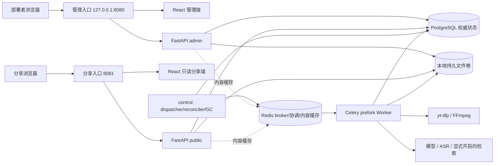
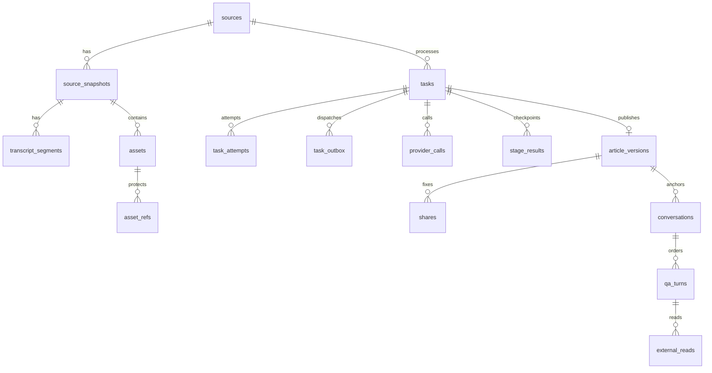
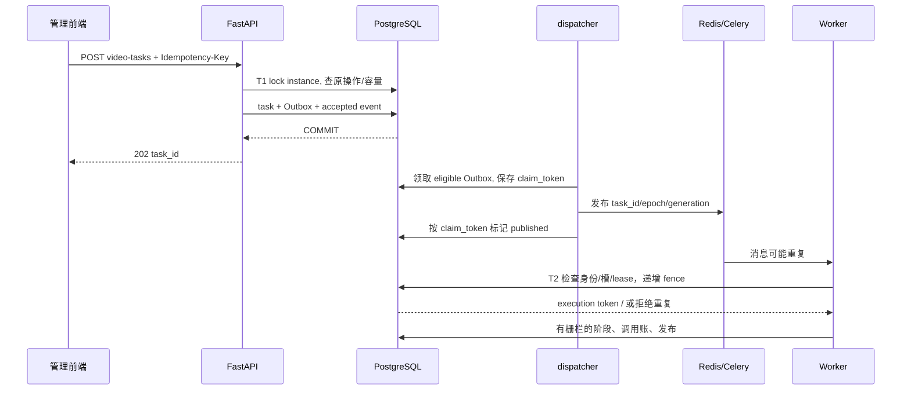
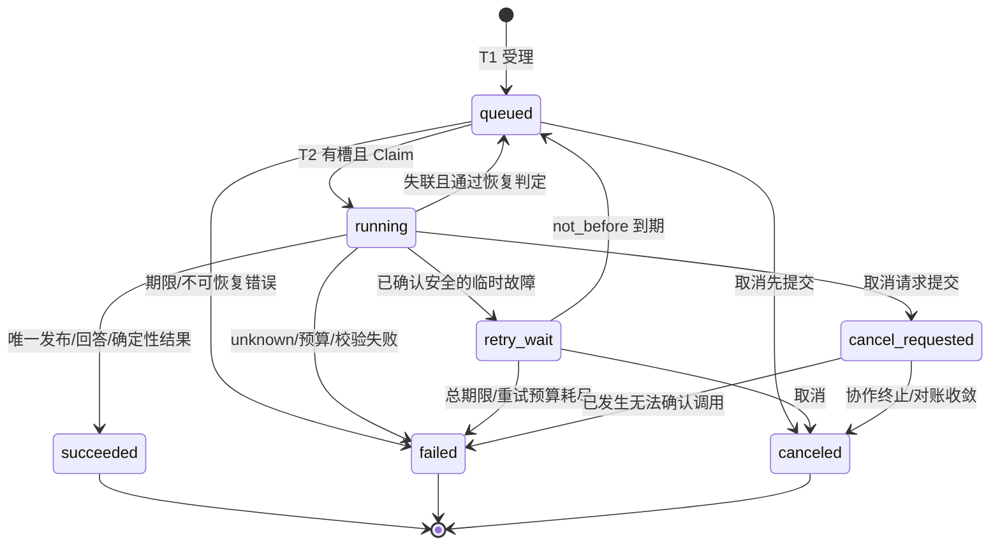
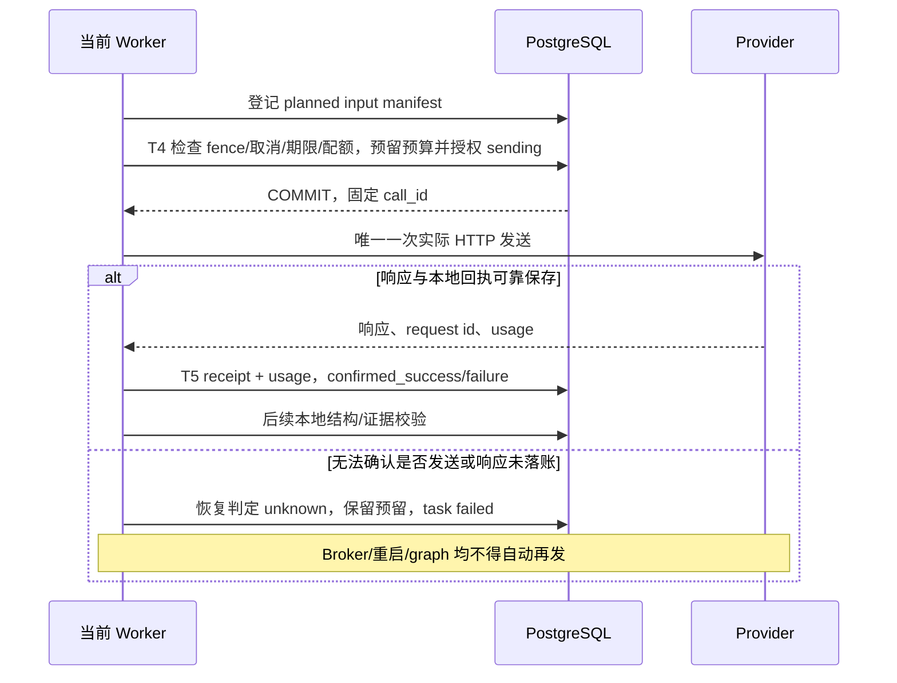
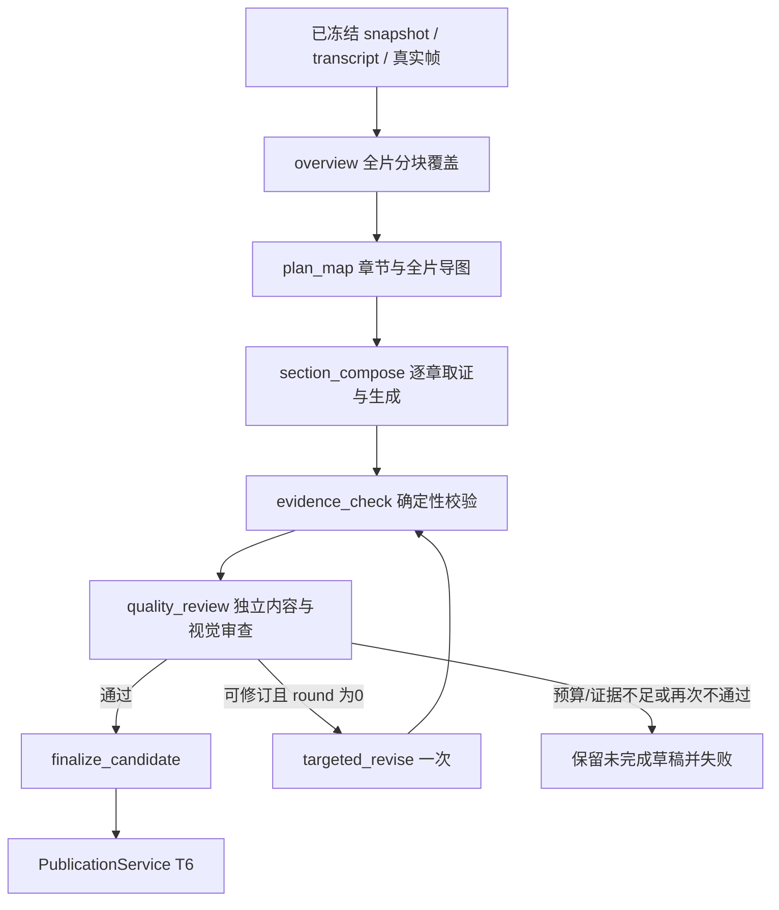
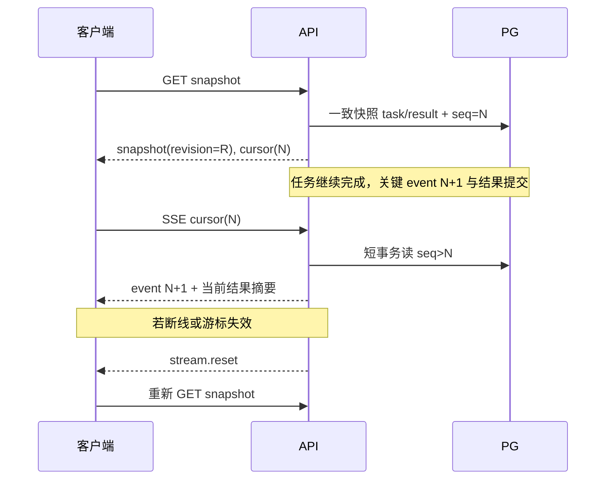
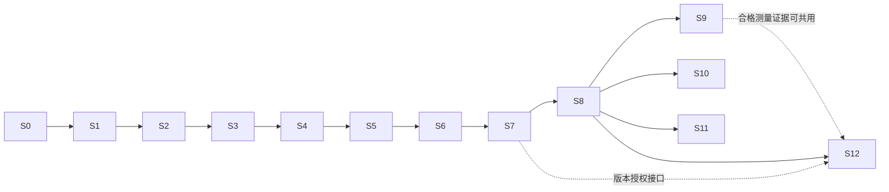

# FrameRead V1 技术 SPEC

日期：2026-11-15。状态：技术设计基线，供后续任务拆解和实现。本文没有实现业务代码，没有运行真实模型、媒体、故障或性能验收。

唯一需求依据为[正式 PRD](PRD.md)及 [ADR 0001](../adr/0001-share-a-fixed-article-version.md)、[0002](../adr/0002-keep-background-knowledge-in-qa.md)、[0003](../adr/0003-retry-an-unconfirmed-model-call.md)、[0004](../adr/0004-bound-video-task-admission.md)。需求修订 V2 不代表新增产品版本；完整 V1 包含全部 P0 和三项 P1，P2 不进入默认依赖。逐项映射见[追踪矩阵](PRD_SPEC_Traceability.md)，冻结过程见[变更记录](../reviews/PRD_V2_ChangeLog.md)。

## 导航

| 主题 | 章节 |
| --- | --- |
| 拓扑、目录、实体身份 | [1](#spec-01)、[2](#spec-02)、[3](#spec-03) |
| API、Schema、数据库、事务 | [4](#spec-04)、[5](#spec-05)、[6](#spec-06)、[7](#spec-07) |
| Redis、投递、执行恢复 | [8](#spec-08)、[9](#spec-09)、[10](#spec-10) |
| 媒体、文件、模型、文章编排 | [11](#spec-11)、[12](#spec-12)、[13](#spec-13)、[14](#spec-14) |
| 阅读问答、导出分享、安全、事件同步 | [15](#spec-15)、[16](#spec-16)、[17](#spec-17)、[18](#spec-18) |
| 部署、观测、测试、恢复、实验 | [19](#spec-19)、[20](#spec-20)、[21](#spec-21)、[22](#spec-22)、[23](#spec-23) |
| 开发依赖、实现门禁、依据 | [24](#spec-24)、[25](#spec-25)、[26](#spec-26) |

<a id="spec-01"></a>
## 1. 架构与服务拓扑

采用模块化单体、独立 Celery Worker 和独立控制进程。FastAPI 处理短请求、查询和 SSE；同步媒体处理与外部调用在 Worker 中执行。控制进程直接扫描 PostgreSQL 投递、对账和清理，不依赖 Redis 才能运行恢复循环。React/TypeScript 构建管理端和只读分享端两个入口，复用无权限的文章展示组件。

默认管理方案为**单一管理员凭据**。没有注册、用户表、团队或角色平台。管理页面 `/manage/` 通过管理员会话调用 `/api/v1/admin/`；分享页面 `/s/{token}` 只调用 `/api/v1/public/shares/`。两个 FastAPI app、两个 ASGI 进程与两个反向代理监听分别注册路由，公开 app 根本不加载管理 router。默认管理端口绑定宿主机 loopback；即使部署者显式开放远程管理，仍必须通过同一管理员鉴权，不以网络来源代替凭据。



| 数据与通信 | 权威位置 | 使用方式 |
| --- | --- | --- |
| 配置语义版本、加密凭据、幂等身份、任务/轮次、执行权、调用账/预算、文章、引用、分享、恢复代次 | PostgreSQL | Service 显式事务，Repository 执行 SQL；API/Worker/control 共享领域规则 |
| 媒体、图片、响应正文、外部原文、导出文件 | 持久文件卷；PG 保存身份、校验和与可用状态 | 不可变对象、原子安装、受保护读取；禁止通过目录直接公开 |
| 消息、速率协调、缓存 | Redis | 消息仅为唤醒；速率历史在 PG 可重建；缓存只保存不可变正式内容 |
| 临时进度、SSE 连接 | API 内存与任务最新进度字段 | 有界缓冲，断线按 PG 快照重建，不保存逐 token 历史 |
| 模型/媒体网络交互 | Worker 到外部服务 | HTTP 或受控子进程；不得在数据库事务中等待外部结果 |

导出、能力检查和 QA 使用同一任务基础设施，`kind` 区分业务。容量按池配置：`video`、`qa`、`utility`；媒体与 Provider 配额跨池共享，utility 不能绕过付费调用约束。每个池都使用相同的幂等、Outbox、期限和栅栏实现。

<a id="spec-02"></a>
## 2. Python 目录与模块职责

以下为待建立的目录契约，不表示文件已存在。Python 使用 `uv` 管理依赖与 lockfile，后端代码位于 `backend/src/frameread`，前端使用 `pnpm` 与 lockfile。运行环境固定 Linux 容器；宿主机使用 Docker Compose。

```text
backend/
  pyproject.toml, uv.lock, alembic.ini
  src/frameread/
    api/                 admin_app.py, public_app.py, dependencies, errors
      routers/           settings, videos, tasks, articles, qa, exports, shares, overview
      schemas/           requests, responses, article, evidence, events
    domain/              enums, identities, fingerprints, policies, validators
    services/            admission, execution, publication, qa, export, share, restore
    repositories/        SQLAlchemy 查询和条件更新，不自行 commit
    db/                  models, session, migrations
    worker/              celery_app, entrypoint, heartbeat, task_runner
    control/             dispatcher, reconciler, gc, retention, scheduler
    media/               urls, downloader, transcript, asr, frames, process_guard
    storage/             local_store, asset_service, leases, manifests
    providers/           chat, transcription, search, web_reader, ledger, quota
    generation/          graph, nodes, prompts, state, evidence_validation
    security/            admin_session, crypto, csrf, egress, redaction
    observability/       logging, health, metrics, overview_queries
    cli/                 main, backup, restore, credentials
  tests/                 unit, api, integration, worker, faults, fixtures
frontend/
  src/admin/             配置、历史、任务、阅读/QA、概览
  src/public/            分享页面和公开 API client
  src/shared/            受限文章渲染器、导图树、时间链接
deploy/                  Dockerfile.backend, Dockerfile.web, compose.yaml, gateway/
scripts/                 验收与实验入口
docs/validation/         实现阶段的验收记录、样本索引与脱敏原始数据
```

依赖方向为 `router/worker/control → services → domain/repositories/provider/storage ports`。`domain` 不导入 FastAPI、Celery、LangGraph；Repository 不调用外部服务；graph 节点只能通过业务 Service 调用模型和写阶段。具体适配器由进程入口注入，不建立通用插件平台。事务由 Service 的 Unit of Work 所有，禁止嵌套 Service 擅自提交。配置、日志和错误格式只实现一份；公开 response 使用独立 allowlist Schema。

<a id="spec-03"></a>
## 3. 实体身份、规范化与阶段复用

| 身份 | 规则 |
| --- | --- |
| HTTP 操作 | `Idempotency-Key` 为客户端生成 UUIDv4；持久唯一键为 `(operation_scope, key)`，scope 包含操作类型和目标实体，不包含 session ID |
| 视频来源 | `(platform, platform_video_id, part_id)` 唯一；Bilibili 默认单分 P1，显式 `p` 固定对应分段；YouTube 取单个 video ID，列表参数不展开 |
| 内容快照 | UUID；媒体 SHA-256、字幕规范化 hash、获取策略与时间线 hash 构成来源指纹；URL/时长相同不代表内容相同 |
| 任务 | 服务端 UUIDv4，`kind`、`retry_of_task_id`、`intent=new/reinterpret/retry`、受理时间固定；重试任务不复用原 ID |
| 执行尝试 | `(task_id, attempt_no)`，每次领取递增 fence；投递 generation 与 attempt 不相等 |
| 阶段 | `(task_id, stage_key, input_hash)`；分章键含稳定 chapter ID，修订含 `revision_round` |
| 外部逻辑调用与发送 | `logical_key` 标识一次业务节点；每次可能发送使用新的 `provider_call.id` 和 `send_no`，幂等账防止节点重放重复发送 |
| 正式版本 | UUID，`generation_task_id` 唯一；同一 source 可有多个正式版本，版本不可变 |
| QA | conversation 固定版本/快照；turn 序号单调，`retry_of_turn_id` 关联显式重问，不回插旧位置 |
| 分享 | 独立随机 capability；不使用任务、版本或会话 ID 作凭据 |

operation_scope由服务端固定为`video:new`、`video:reinterpret`、`task:retry:{task_id}`、`qa:turn:{conversation_id}`、`qa:retry:{turn_id}`、`probe:{config_id}`、`export:{version_id}`、`share:create:{version_id}`或`share:reissue:{share_id}`；作用域字段不接受调用方自定义。任务类操作保存在tasks，分享同步操作保存在shares，两者均使用scope+key唯一约束。

### 3.1 两类指纹

`request_digest` 对原始请求 DTO 的规范 JSON 计算 SHA-256：键排序、UTF-8、Unicode NFC、固定枚举、链接去无关追踪参数、关注点只去首尾空白。省略默认配置以固定 sentinel 表示；同键重发先比较原始 digest 并返回原任务，不能重新解析“当前默认”导致冲突。新受理时才解析默认项，保存 `effective_input_json` 与确切 `provider_revision_id`、ASR revision、生成规则版本和资源策略快照。密钥及 session 不进入 digest。

`result_match_hash` 包含规范来源 ID、模式、深度、关注点、模型/ASR 语义 revision、输出语言、prompt/workflow/schema/提取策略版本。历史匹配只查已发布版本，按 `published_at,id` 倒序取最近一个，返回标题、版本和生成时间；读取失败是查询失败，绝不转为“未命中后自动生成”。该匹配不声明视频未变化。

### 3.2 复用判定

阶段指纹包含 `stage_key + effective semantic config + source_snapshot fingerprint + dependency hashes + workflow/prompt/schema/renderer versions`。只复用 `completed` 阶段，验证全部依赖和资产 `ready`、hash 与大小。部分草稿可展示但不能作为已完成检查点。已确认 Provider 回执可继续本地解析，unknown 不可复用为成功。

| 情景 | 可复用 | 必须重新执行 |
| --- | --- | --- |
| 同任务崩溃恢复 | 完全匹配的完成阶段、可靠保存的响应 | 未完成本地计算；可能发送却无回执时按 unknown 结束，不重发 |
| 主动重新解读 | 经验证有效的媒体/字幕 | 全部文章生成、审查、正式发布；article graph 指纹加入新 task ID |
| 失败/取消主动重试 | 依赖一致的已完成阶段 | 失效阶段与新发送；新预算/期限，保留原 unknown 账 |
| 修复 ASR 配置后重试 | 同源媒体 | 使用新 ASR revision 的转写及其下游，不复用失败转写 |
| 普通配置密钥轮换 | 语义 revision 不变的有效产物 | 后续发送读取当前凭据；密钥无效时明确失败，不静默改模型 |

当前凭据另绑定credential_scope_hash（adapter+规范base_url/授权目标），T4必须与任务固定revision的目标匹配。管理员改变端点时不能自动把新端点密钥发给旧任务的旧端点；scope不匹配明确CREDENTIAL_SCOPE_MISMATCH，保留原配置选择和失败历史，部署者可按新配置主动重试。轮换同端点密钥不改变语义revision，也不要求保存失效明文。

新任务通过 `stage_results.reused_from_id` 引用原阶段，并登记必要资产 pin；费用仍归原调用，不把旧费用计成新发送或归零。重新解读不会从旧文章阶段生成这条复用关系。

<a id="spec-04"></a>
## 4. FastAPI 路由与 HTTP 契约

所有路由以 JSON UTF-8 通信，UTC RFC3339 时间；媒体时间用整数毫秒。下表管理路径均省略 `/api/v1/admin`。除会话创建外全部需要管理员 session；写请求还需要 CSRF 和 Origin 校验。列表采用 keyset cursor，默认 20、上限 100，不提供无界 `all`。

| 方法与路径 | 输入 / 返回 | 执行边界 |
| --- | --- | --- |
| `POST /session`；`GET /session`；`DELETE /session` | 凭据 → 会话 cookie 与 CSRF token；状态/退出 | 同步；不是注册账号，失败统一 `401` |
| `GET/POST /provider-configs`；`GET/PATCH /provider-configs/{id}` | 配置 DTO；PATCH 带 `If-Match: version` | 同步保存；语义修改新建不可变 revision，密钥字段 write-only |
| `POST /provider-configs/{id}/checks` | 检查类型、幂等键 → `TaskAccepted` | Worker 显式小样本调用；展示可能费用，不在 GET 执行 |
| `POST /videos/matches` | 视频与解读选项 → 最近匹配的 `ArticleSummary` 或 `match:null` | 同步只读，零模型调用；失败不视为空 |
| `POST /video-tasks` | `VideoTaskCreate`、幂等键 → `TaskAccepted` | 短受理事务；默认 UI 先匹配，已有结果仅点“重新解读”才提交 |
| `POST /tasks/{id}/retries` | 确认的有效配置/原输入、幂等键 → 新任务 | 只接受原终态为 failed/canceled；新 ID 与 `retry_of` |
| `GET /tasks`；`GET /tasks/{id}` | 过滤/游标 → 列表或 `TaskSnapshot` | PG 当前快照，支持非关键进度 |
| `GET /operations/{scope}/{key}` | → 原 `TaskAccepted` 或 `404` | 找回已受理操作；DB 不可用为 `503`，不能证明没有任务 |
| `POST /tasks/{id}/cancel` | → 当前 `TaskSnapshot` | 重复取消幂等；运行中 `202`，终态/排队取消 `200` |
| `GET /tasks/{id}/events`；`GET /tasks/{id}/draft` | SSE cursor；未完成草稿 | 只读，不创建生成任务 |
| `GET /articles`；`GET /articles/{version_id}` | 摘要分页；固定版本 `ArticleView` | 正式版本，版本不可变 |
| `GET /assets/{id}/content` | 二进制图片/受保护资源 | 服务端授权与租约，不接受 storage path |
| `POST /articles/{id}/conversations`；`GET /conversations/{id}` | 新对话；历史分页 | 同步固定版本；不调用模型 |
| `POST /conversations/{id}/turns` | `TurnCreate`、幂等键 → turn ID 与 `TaskAccepted` | 单轮门禁事务；其后 Worker 处理 |
| `POST /conversations/{id}/turns/{turn_id}/retries` | 重问选项、幂等键 → 新 turn/任务 | 新序号、当前已完成历史；旧失败保留 |
| `POST /articles/{id}/exports`；`GET /exports/{id}`；`GET /exports/{id}/download` | `markdown/zip`、幂等键；状态；文件 | Worker 打包，同步受保护下载；无模型调用 |
| `POST /articles/{id}/shares`；`GET /articles/{id}/shares` | 固定版本 → 新 token 一次回显；状态列表 | 同步；普通列表不重新展示 token 明文 |
| `DELETE /shares/{id}`；`POST /shares/{id}/reissues` | 撤销；恢复核对确认与幂等键 → 新链接 | 同步；重新签发新记录与新 token，旧记录不启用 |
| `GET /overview`；`GET /health` | 脱敏运行概览；依赖状态 | 只读；P1 只组织已有数据 |

分享 app 仅有 `GET /api/v1/public/shares/{token}` 和 `GET /api/v1/public/shares/{token}/assets/{asset_id}`，以及分享 SPA 所需静态构建资源。无公开导出、原字幕、QA、任务或 SSE。分享页面 `/s/{token}` 的初始空壳不含私有数据；无效内容读取统一 `404 SHARE_NOT_AVAILABLE`，DB 不可用返回 `503`，不能用已缓存授权放行。

### 4.1 状态码与错误体

`TaskAccepted` 为 `202`，即使同键重发对应任务已结束也返回同一受理身份及当前状态。带 `Location` 和 `snapshot_url`，不声称已经运行。同步创建为 `201`；读取/更新为 `200`；删除会话为 `204`。错误体固定为：

```json
{
  "error": {
    "code": "ADMISSION_UNCONFIRMED",
    "message": "受理结果尚未确认，请使用原操作标识找回",
    "request_id": "uuid",
    "task_id": null,
    "action": "resolve_same_key",
    "retry_after_seconds": 2,
    "details": []
  }
}
```

| HTTP | 机器类别 | 客户端动作 |
| --- | --- | --- |
| `422` | `INVALID_INPUT/UNSUPPORTED_VIDEO/INVALID_ANCHOR` | 修正输入，未知字段拒绝 |
| `409` | `IDEMPOTENCY_CONFLICT/CONVERSATION_BUSY/VERSION_CONFLICT/INVALID_TRANSITION` | 不覆盖原操作；查询状态或处理冲突 |
| `429` | `RATE_LIMITED` | 按 Retry-After；不换键规避 |
| `503` | `QUEUE_FULL` | 明确未受理，无新增任务/Outbox；容量释放后可用原键再次申请 |
| `503` | `ADMISSION_UNCONFIRMED` | commit ACK 丢失或提交结果无法判断；保留原键重发/查询，禁止自动新键 |
| `503` | `DEPENDENCY_UNAVAILABLE/MAINTENANCE` | 显示依赖/维护原因；已受理任务仍可在恢复后查询 |
| `401/403` | `ADMIN_REQUIRED/CSRF_REJECTED/ORIGIN_REJECTED` | 不执行管理操作 |
| `404` | `NOT_FOUND/SHARE_NOT_AVAILABLE` | 无效、撤销、越界分享统一不可访问 |

显式已回滚的 DB 故障与提交不确定分开记录 `commit_outcome=rolled_back/unknown`。服务端尝试用新连接按幂等键确认已提交事实，仍未知才返回未确认。后台业务失败在查询中保持 `200` 和 task failed，而不是把 HTTP 受理改成失败。错误不返回 SQL、内部路径、上游 body、原始 URL 或异常栈。

<a id="spec-05"></a>
## 5. Pydantic 与产物 Schema

采用Pydantic v2，所有请求`extra='forbid'`，严格枚举/整数、长度/规模约束、判别联合；UUID、时间和URL使用对应类型。URL类型校验不能替代网络策略。OpenAPI由实际app导出，admin/public分开快照并在CI做契约差异审查；运行时关闭默认`/docs`、`/redoc`和公开`/openapi.json`，接口文档从CLI导出，不意外新增公开管理路径。ORM model不直接序列化到response。前端类型由OpenAPI生成，生成产物不手工改动。

| Schema | 必要字段与约束 |
| --- | --- |
| `VideoTaskCreate` | `url` ≤2048；`mode=complete/topic`；`depth=brief/standard/detailed`；`focus` ≤2000；`provider_config_id` 可空以解析默认；`asr_config_id` 可空；`intent=new/reinterpret`；topic 必须有非空 focus |
| `ProviderConfigWrite/View` | `name,kind=chat/asr/search,adapter,base_url,model,capabilities,limits`；写入含 write-only secret；读取仅 `has_secret,secret_hint,semantic_revision,version,last_check`；不回显可还原的凭据片段 |
| `TaskAccepted` | `task_id,kind,status,accepted_at,deadline_at,snapshot_url,replayed,operation_scope`；QA 另含 turn ID |
| `TaskSnapshot` | `id,kind,intent,status,stage,state_revision,event_seq,cursor,instance_epoch,attempt_no,progress,deadline_at,cancel_requested_at,result,error,draft_summary,allowed_actions,unknown_call_count`；`result` 按 kind 判别 |
| `TimeRange` | `start_ms>=0,end_ms>start_ms,precision=segment/window/frame`；必须在实际 duration 内，不能由客户端任意指定 precision |
| `VideoTextEvidence` | `kind=video_text,snapshot_id,first_segment_id,last_segment_id,time_range,quote`；片段连续、归属一致，quote 必须是所存文本的连续原文 |
| `VideoFrameEvidence` | `kind=video_frame,snapshot_id,asset_id,actual_ms,observation_id`；真实帧、对应视觉输入与观察均存在 |
| `ArticlePassageEvidence` | `kind=article_passage,article_version_id,block_id,start_offset,end_offset,quote`；offset 采用 Unicode code point，前端转换 UTF-16；必须逐字匹配 |
| `ExternalEvidence` | `kind=external,read_id,url,title,read_at,quote_start,quote_end,quote`；只有实际成功读取的正文可引用 |
| `KnowledgeStatement` | `kind=general_knowledge,text`；不能携带视频时间或伪原片引用 |
| `ArticleCandidate` | `schema_version,title,mode,coverage,included_topics,omitted_topics,chapters,map,limitations,no_image_reason`；每章有稳定 ID、blocks、evidence；正式文章不接受 external/general_knowledge 引用 |
| `MapNode` | `id,label,children,chapter_ids,time_ranges`；无环有界树，节点至少关联存在章节或有效视频时间，不指向被专题省略的虚构章节 |
| `TurnCreate` | `question` 1～4000；`anchor=none/passage/frame`；`external_enabled=false` 默认；选段/帧必须归固定版本与快照 |
| `AnswerCandidate` | `schema_version,blocks,evidence,limitations,outcome=answered/insufficient_evidence/out_of_scope`；每种来源分别标记，不能将文章解释当原片证据 |
| `ExportManifest` | `schema_version,article_version_id,content_hash,renderer_version,files[{path,sha256,size,mime}],created_at`；相对路径、路径唯一，不含私人 QA |
| `CriticalEvent` | `task_id,seq,state_revision,instance_epoch,type,occurred_at,projection`；projection 是状态 allowlist，不含 Prompt/原文/密钥 |

章节/blocks/evidence/map 最大数量、单字段长度与 JSON 总字节都由资源策略限制。原始模型回复先存为私有 receipt，再 parse 成候选；parse 或业务校验失败保留费用与错误。发布校验报告保存逐条 rule code、引用路径与结果，不能只保存一个 `passed=true`。

<a id="spec-06"></a>
## 6. PostgreSQL 数据模型

采用 PostgreSQL 17 系列、SQLAlchemy 2.0 系列和 Alembic。所有业务表共享：`id uuid PK`（单例/槽表另有自然键），`created_at/updated_at timestamptz NOT NULL`，`deleted_at timestamptz NULL`，`version bigint NOT NULL DEFAULT 1 CHECK(version>0)`。`version` 是乐观锁，更新用 `WHERE version=:expected` 并加一；任务另有对外单调 `state_revision`，不因心跳递增。不可变证据/版本表禁止更新内容，逻辑删除只改变可见性元数据；历史引用仍可解析。外键默认 `ON DELETE RESTRICT`，删除不物理级联破坏证据。

以下列出common字段之外的全部核心字段；`?`表示可空，未标可空即NOT NULL。JSON使用`jsonb`，金额/估算使用`numeric(20,8)`，字节和毫秒用`bigint`，计数`integer`。未另标类型的`*_at/*_until`为`timestamptz`，`*_json`为`jsonb`，其余枚举/名称/标识文本为`text`。状态文本带CHECK，迁移集中维护取值。业务唯一性不能因软删除而重用幂等键、分享hash或历史版本身份。

### 6.1 实例、配置与身份

| 表 | 业务字段 | 关系、约束与索引 |
| --- | --- | --- |
| `instance_state` | `singleton_key smallint=1, installation_id uuid, instance_epoch uuid, restore_state text, restore_id uuid?, restore_confirmed_at?, restore_audit_json, maintenance_mode text, policy_json, config_revision bigint, last_backup_id uuid?` | singleton_key UNIQUE CHECK=1；maintenance_mode=normal/draining/frozen，restore_state=normal/backup_image/restoring/review_required；epoch 在显式恢复时更新，普通重启不变；接单/维护串行化行 |
| `admin_sessions` | `token_hash bytea, csrf_hash bytea, credential_generation text, expires_at, last_seen_at` | hash UNIQUE，expires_at 索引；密码轮换后 generation 不匹配即失效；恢复清空会话 |
| `provider_configs` | `kind,name,active_revision_id uuid?,credential_ciphertext bytea?,credential_key_id text?,credential_scope_hash char(64)?,credential_generation bigint,is_default bool,disabled bool` | 每kind一个有效默认项的部分唯一索引；有密文则必须有key_id/scope；当前凭据单份密文，不保存旧明文；revision归属由FK/Service核对；配额组固定在具体语义revision |
| `provider_revisions` | `config_id uuid,revision_no int,adapter text,base_url text,quota_group text,model text?,semantic_json,semantic_hash char(64),capabilities_json,last_check_task_id uuid?` | FK config；UNIQUE(config_id,revision_no)；quota_group/规范base_url索引用于同服务归组；能力检查结果关联任务，固定语义字段不可改；端点不放公开DTO |
| `sources` | `platform text,platform_video_id text,part_id text,canonical_url text` | UNIQUE(platform,platform_video_id,part_id)；source 仅是平台身份 |
| `source_snapshots` | `source_id uuid,media_hash char(64),media_bytes bigint,duration_ms bigint,stream_identity_json,transcript_hash char(64),ingestion_version text,metadata_json,fingerprint char(64),acquired_at` | FK source；UNIQUE(source_id,fingerprint)；hash/时长正值 CHECK；保存取得媒体/时间线身份，不保存平台 cookie |
| `transcript_segments` | `snapshot_id uuid,ordinal int,start_ms bigint,end_ms bigint,text text,text_origin text,precision text` | FK snapshot；UNIQUE(snapshot_id,ordinal)；CHECK 时间合法；(snapshot_id,start_ms,ordinal) 查询时间窗口 |

### 6.2 任务、执行、事件与调用账

| 表 | 业务字段 | 关系、约束与索引 |
| --- | --- | --- |
| `tasks` | `kind,pool,intent,status,stage,accepted_instance_epoch uuid,operation_scope,idempotency_key uuid,request_digest char(64),effective_input_json,input_hash char(64),source_id uuid?,snapshot_id uuid?,provider_revision_id uuid?,asr_revision_id uuid?,retry_of_task_id uuid?,deadline_at,not_before_at,admission_class text,dispatch_generation int,attempt_no int,fence bigint,lease_token uuid?,lease_until timestamptz?,worker_id text?,cancel_requested_at timestamptz?,state_revision bigint,event_seq bigint,progress_json,budget_json,reserved_usage_json,known_usage_json,result_json,error_json?,restore_original_json?` | UNIQUE(operation_scope,idempotency_key)，不可因软删失效；FK source/snapshot/revisions/retry；(pool,status,not_before_at,created_at,id)、活动 lease_until、deadline_at 部分索引；(created_at DESC,id DESC) 历史分页 |
| `task_attempts` | `task_id uuid,attempt_no int,fence bigint,lease_token uuid,worker_id text,started_at,ended_at?,outcome text?,last_stage text,error_json?` | FK task；UNIQUE(task_id,attempt_no) 与 UNIQUE(task_id,fence)；不覆盖旧尝试 |
| `task_outbox` | `task_id uuid,instance_epoch uuid,generation int,queue text,available_at,claim_token uuid?,claim_until?,delivery_status text,publish_attempts int,delivered_at?,last_error_code text?,last_publish_at?` | UNIQUE(task_id,generation)；待投递/重试 available_at 部分索引；claim token 防旧 dispatcher 回写 |
| `task_events` | `task_id uuid,seq bigint,state_revision bigint,instance_epoch uuid,event_type text,payload_json,occurred_at` | UNIQUE(task_id,seq)；(task_id,seq) 查询；occurred_at 清理索引；只存关键事件，不按事件重建任务 |
| `stage_results` | `task_id uuid,stage_key text,input_hash char(64),output_hash char(64)?,status text,output_json,produced_fence bigint,reused_from_id uuid?,workflow_version text,prompt_version text,schema_version text,completed_at?` | UNIQUE(task_id,stage_key,input_hash)；FK task/self；完成后内容不可变；同任务 section/round 用独立 stage_key |
| `provider_calls` | `task_id uuid,attempt_id uuid,stage_result_id uuid?,logical_key text,send_no int,provider_revision_id uuid,quota_group text,operation text,state text,intent_at,send_authorized_at?,call_deadline_at?,response_at?,provider_request_id text?,input_manifest_json,request_hash char(64),response_asset_id uuid?,usage_status text,usage_json?,reservation_json,error_code text?,latency_ms bigint?,retry_class text?,reconciled_from_epoch uuid?` | UNIQUE(task_id,logical_key,send_no)；(task_id,logical_key)、(state,intent_at)、(quota_group,send_authorized_at) 索引；FK 关联确切 receipt asset；unknown 用量 NULL/partial，不能默认 0 |
| `resource_slots` | `resource_key text,slot_no int,assigned_task_id uuid?,assigned_fence bigint?,owner_token uuid?,lease_until?,slot_state text` | UNIQUE(resource_key,slot_no)；execution 槽在受理时持久保留，处理/Provider 槽短租约；同 task 的槽受 fence 保护 |
| `worker_heartbeats` | `worker_id text,instance_epoch uuid,process_generation uuid,last_seen_at,capacity_json,active_count int` | worker_id UNIQUE；last_seen_at 索引；未知不显示为健康 |

`budget_json` 保存受理时上限及版本；预留和已知用量是任务行锁内更新的汇总，调用账为明细。测试重算两者一致；unknown 预留保持占用。不新增独立计费系统。执行槽使用 resource_slots 复用，不再另建容量计数表。

### 6.3 资产、文章、QA、导出与分享

| 表 | 业务字段 | 关系、约束与索引 |
| --- | --- | --- |
| `assets` | `snapshot_id uuid?,producer_task_id uuid?,producer_fence bigint?,kind text,storage_key text,sha256 char(64)?,bytes bigint?,mime text,state text,requested_ms bigint?,actual_ms bigint?,retain_class text,expires_at?,install_token uuid,gc_token uuid?,gc_retry_at?,last_error_code text?` | storage_key UNIQUE；(state,expires_at,gc_retry_at) 部分索引；时间与字节 CHECK；ready 必须有 hash/size/mime |
| `asset_refs` | `asset_id uuid,article_version_id uuid?,qa_turn_id uuid?,stage_result_id uuid?,provider_call_id uuid?,external_read_id uuid?,export_id uuid?` | 六种 owner 恰有一项非空 CHECK；每项明确 FK；每种 `(asset_id,owner_id)` 部分 UNIQUE；asset_id 索引，禁止仅用无 FK 的通用 owner 字符串 |
| `asset_leases` | `asset_id uuid,owner_token uuid,task_id uuid?,fence bigint?,purpose text,lease_until` | FK asset/task；UNIQUE(asset_id,owner_token)；(asset_id,lease_until)，lease_until 清理索引 |
| `article_versions` | `generation_task_id uuid,source_id uuid,snapshot_id uuid,result_match_hash char(64),schema_version text,renderer_version text,content_json,map_json,content_hash char(64),published_at` | generation_task_id UNIQUE FK；(result_match_hash,published_at DESC,id DESC)；(source_id,published_at DESC,id DESC)；不可变 |
| `conversations` | `article_version_id uuid,snapshot_id uuid,next_turn_no int,active_turn_id uuid?` | FK version/snapshot；(article_version_id,created_at,id)；active_turn FK 使用 DEFERRABLE，事务结束前完整 |
| `qa_turns` | `conversation_id uuid,turn_no int,task_id uuid,retry_of_turn_id uuid?,question text,anchor_json,external_enabled bool,context_manifest_json,answer_json?,answered_at?` | task_id UNIQUE FK；UNIQUE(conversation_id,turn_no)；FK retry self；状态查询以 task 为准，不另复制权威状态 |
| `external_reads` | `qa_turn_id uuid,url text,title text,read_at,body_asset_id uuid?,body_hash char(64)?,state text,error_code text?` | FK turn/asset；(qa_turn_id,read_at,id)；搜索摘要与读取正文分开，只有 ready 可引用 |
| `exports` | `article_version_id uuid,task_id uuid,format text,renderer_version text,manifest_json?,asset_id uuid?,expires_at?` | task_id UNIQUE；FK version/task/asset；版本/格式/renderer 查询索引；状态以 task 与文件状态为准 |
| `shares` | `article_version_id uuid,token_hash bytea,token_schema_version smallint,status text,issued_epoch uuid,revoked_at?,restore_processed_id uuid?,reissued_from_id uuid?,operation_scope text,create_operation_key uuid,create_request_hash char(64)` | token_hash UNIQUE；UNIQUE(operation_scope,create_operation_key)同步创建/重签幂等；FK version/self；(article_version_id,created_at,id)；status=active/revoked/disabled_after_restore，失效记录永不重新active |

配置凭据和分享的响应重发不得依赖服务器保留 token 明文。[16](#spec-16) 定义分享创建的安全幂等协议。没有用户、组织、向量库或多租户表。正式文章和 map 用版本 JSON 保存，段落稳定 ID 支持 QA 锚点；字幕用关系行支持窗口查询；可读内容不为形式上的规范化拆成逐词表。



<a id="spec-07"></a>
## 7. 事务、SQLAlchemy、迁移与查询

API 每请求一个独立 `AsyncSession`，控制进程每次扫描一个短 Session；Worker 在 prefork 子进程初始化后创建同步 Engine/Session，heartbeat 线程另有 Session。统一使用 psycopg 3 驱动，API 使用其 async 接口。不得跨进程继承活连接或跨协程共享 Session，遵循 [SQLAlchemy Session 并发模型](https://github.com/sqlalchemy/sqlalchemy/blob/rel_2_0_55/doc/build/orm/session_basics.rst)与[连接池的 fork 边界](https://github.com/sqlalchemy/sqlalchemy/blob/rel_2_0_55/doc/build/core/pooling.rst)。

默认隔离级别 READ COMMITTED；多查询一致快照使用 REPEATABLE READ。`expire_on_commit=False`，显式 DTO/selectinload，避免序列化触发隐式 lazy load。配置每进程 `pool_size/max_overflow/pool_timeout`，各进程连接预算总和小于 PG max_connections 减运维保留；初始 API 5+0、Worker 子进程 2+0、control 3+0，SSE 不常驻占用连接。连接获取超时明确失败，rollback/close 在 finally/context manager 完成。

### 7.1 全局锁顺序

写事务首先锁 `instance_state`：受理、领取、结束、取消、槽分配/释放、恢复使用 `FOR UPDATE`；仅写阶段/心跳/资产时用 `FOR SHARE` 检查 maintenance/epoch。事务开始时确定级别，禁止先 SHARE 后升级 UPDATE。其后需要多对象时依次锁：provider config（按 UUID）→ conversation → tasks（按 UUID）→ resource_slots（按 resource_key,slot_no）→ assets（按 UUID）→ 子记录。可先无锁查询定位父 ID，入锁后必须重新验证关系。GC 仅锁 instance/asset，不反向锁 task；没有跨阶段持锁或持锁等待 HTTP/文件 I/O。

SQL 死锁/序列化冲突只可在尚无外部副作用的整个短事务上有界重试；幂等身份不变。不可把已发送调用外层整个函数交给数据库重试装饰器。

统一`instance_write_gate`在实例行锁内判定`maintenance_mode='normal' AND restore_state='normal'`，T1新受理、主动重试、新Claim/阶段、T4发送授权、T6正式发布、配置修改及T9创建/重签均调用，不能只检查其中一个normal。幂等找回/只读查询可先执行；会话/读取租约可在review_required下用于管理核对。draining只允许原有效执行者保存已获准调用的T5回执、当前阶段检查点、续租/资源释放和失败/取消收敛，不允许开始新业务副作用；frozen仅维护CLI写入。所有例外仍检查epoch/fence/期限，不能绕过restore门禁。

| 事务 | 原子写入与裁决 |
| --- | --- |
| T1 受理 | 幂等查重 → 输入/固定配置 → 容量/执行保留或等待位 → task + 初始 Outbox + accepted event；失败全部回滚 |
| T2 Claim | 任务/epoch/期限/取消检查 → 槽与有效 lease → fence/attempt 递增 + attempt + running event |
| T3 阶段检查点 | 栅栏检查 → stage completed/草稿引用 + 资产 pin + 可见进度 revision；模型/文件 I/O 已在事务外完成 |
| T4 发送授权 | task/fence/取消/期限 + Provider 配额 → reserve budget + provider_call intent + 输入引用 + 发送授权；无可证明未发送回执即保守 unknown |
| T5 回执 | 重新验证执行栅栏，固定 call ID 的结果/用量/receipt asset + 明细/汇总结算；过期回执仅记拒收日志，不能改变调用账或任务结果，见 [13](#spec-13) |
| T6 发布/回答 | 重验 task/fence/取消及候选 hash/引用 → 固定正式版本或 answer + 长期引用 + 成功 task + conversation 解锁/槽释放 + critical event |
| T7 取消/终止 | 同一任务行裁决 → cancel request 或终态 + Outbox 失效/槽处理 + event；终态不可退回 |
| T8 清理 | 资产锁下核查 pin/lease → deleting/gc_token；事务外删除后以同 token 确认 deleted |
| T9 分享 | 固定版本检查 → 新 token hash 或撤销/重签记录；每次读取重新查 PG，缓存不裁决有效性 |

### 7.2 Alembic 与 SQL 验证

初始迁移先创建实例/配置/来源，再创建快照/字幕、任务/槽/事件、资产/阶段/调用、文章/QA/引用、导出/分享。tasks与snapshot、asset与producer、config与active_revision等前向/循环FK在相关表齐备后由同一迁移事务补上，最后创建索引/触发器；迁移完成前不开放业务写入。迁移进程持PG advisory lock，API/Worker只允许兼容的Alembic head，失败阻止相关进程写入。迁移包含CHECK/UNIQUE/FK/部分索引和不可变内容保护触发器；updated_at/version更新规则统一实现。schema变更必须有空库与旧样本升级测试，不以清库解决。

历史分页使用 `(created_at,id)<(:time,:id)`，版本匹配使用复合索引，证据一次窗口查询，资产引用按 `IN` 批量取。列表行与关联摘要限定为固定数量 SQL，不循环读取每条任务。`EXPLAIN (ANALYZE, BUFFERS, FORMAT JSON)` 只针对可回滚测试环境/代表样本采集，记录行数、扫描、排序、buffers、查询次数和端到端延迟；顺序扫描在小表可以合理，不机械强求索引。每条重要修改同时检查影响行数与最终持久状态。

<a id="spec-08"></a>
## 8. Redis、共享配额与资源限制

V1 使用同一 Redis 服务的独立命名空间：Broker DB 0，协调与缓存 DB 1；DB 编号不代表故障或内存隔离。Redis 配置 AOF、`maxmemory-policy=noeviction`，避免内容缓存驱逐 Broker 消息。应用对缓存单独设置最大对象/总配额；Broker 写失败由 Outbox 恢复。应用不配置 Celery result backend，业务结果始终查 PG。

Redis按进程用途配置独立ACL用户/secret：public-cache仅授权`fr:*:article:*`缓存键及必要GET/SET/TTL/受限缓存预算操作，客户端固定连接DB1，但权限不依赖DB编号；禁止Broker队列、rate、login、Pub/Sub、FLUSH、CONFIG和任意其他键。使用独立`PUBLIC_REDIS_URL_FILE`，不挂Broker/协调凭据。ACL键规则也约束预算Lua的KEYS/可调用命令，缓存计量元数据放同一article命名空间；总字节在Lua原子预留，TTL过期计量可保守多算并由control重算，不能并发超预算。control/worker的Broker和协调权限另授，不把不同DB编号当ACL替代。AT-18/25直接用public角色验证越界命令/键被拒。

| 用途 / Key | 内容与生命周期 | 故障行为 |
| --- | --- | --- |
| Celery 队列 `fr.video/fr.qa/fr.utility` | 只含 task ID、epoch、generation；ACK/visibility 控制投递，不能证明业务完成 | 接单可在 PG 容量内继续；control 退避、PG 记录积压，恢复后受限补投 |
| `fr:{epoch}:rate:{quota_group}` | Lua 原子 rolling-window ZSET，成员为发送授权 call ID，score 为协调时间；TTL 为窗口+保护时间 | 不可确认时暂停新的受限调用，进入 retry_wait；PG 快照/已发布内容仍可读 |
| `fr:{epoch}:login:{source_hash}` | 无明文来源的短期失败计数，TTL 有界 | 凭据入口限流不可用时 `503`，不无界接受密码尝试；已有会话读取不依赖此键 |
| `fr:{epoch}:article:{version}:{content_hash}:{renderer}` | 正式内容 JSON/安全渲染结果；默认 TTL 1h、单对象≤2MiB，应用总预算默认64MiB | 显式回源 PG/文件并记录 cache_degraded；不缓存授权，默认开关关闭直到实验 |

### 8.1 配额申请协议

执行并发由PG execution槽最终约束；FFmpeg/下载/Provider处理并发由resource_slots短租约约束。Redis key、PG窗口计数和Provider槽统一使用任务固定的provider_revision.quota_group。配置创建/修改在instance锁下按规范服务地址查已有归组，同地址不同config/model/revision必须沿用同组；密钥轮换不新开配额池。新端点产生新语义revision并解析其服务组，旧任务仍使用旧revision/旧组；不同端点属于同一供应商共享额度时由部署配置显式归同组。组身份首次发送后不可直接重置，需要改组时停新发送并等待原窗口/活动调用收敛，保留旧账再迁移，不能由单个进程自建计数。

限流顺序为：事务外向 Redis 申请短有效期预许可 → T4 锁实例、配置和任务 → 再按 PG 调用账核查过去窗口的全部发送授权数、并发槽和预算 → 持久化发送授权。Redis 只做快速协调，PG 账是恢复与跨进程约束的最终依据。许可过期则放弃本次发送，重新取得许可；预许可占用但未发送可以保守浪费，不能反向超发。PG 窗口计数包括 unknown 和尚不能证明确未发送的授权。Redis 重启后用 PG 窗口重建；重建完成前禁止新的受限发送，不用空 ZSET 认定配额归零。

Provider 槽在 HTTP 完成/明确失败时释放；失联只在本地调用 deadline 加 guard 到期后回收，UNKNOWN 费用预留不释放。这里约束本实例发送/处理，不保证远端后台终止。相同 task 的总调用次数、输入/输出 token、图片字节、ASR 秒数、外部检索次数在 T4 统一校验，各次修订和安全重试共用上限。

### 8.2 时间与磁盘

`deadline_at = accepted_at + total_timeout` 永不因重投/自动重试重置。每个阶段/HTTP/子进程 timeout 取自身上限与剩余期限的较小值，资源等待也受同一期限约束。control 对未领取/等待任务执行 deadline 扫描。初始配置示例为 video 总期限 2h、单次模型120s、媒体阶段20min、lease 60s/heartbeat10s；均为待测起点，不能称性能承诺。

下载前检查声明大小，流式累计实际字节并监控目录占用；FFmpeg 限进程数、输出字节和运行时间，文件系统保留最低空闲阈值。Docker 卷通常没有可移植的 per-directory 硬配额，所以需监控实际工作区和容器资源，超限立即停止子进程组并清理非保留临时产物。达到磁盘安全线暂停新媒体受理/处理并报告，不能继续创建无界工作。已发布数据不会因腾空间被自动删除。

<a id="spec-09"></a>
## 9. 受理、Outbox、投递与领取

### 9.1 有界受理

每个池配置执行槽 E 和等待位 Q。执行槽是 PG 中的持久保留位：受理时有空 execution 槽则绑定该 task，状态仍 queued，表示可立即领取；没有空槽才占等待位。这样 Worker 暂不可用时也不能无限受理，且页面排队数量与执行保留位/真正等待位分开显示。等待数由活动 task 的 `admission_class=waiting` 查询，不另维护易漂移计数。

T1 锁实例后先查询幂等绑定，再校验新请求、解析配置与容量。有空execution槽则受理并保留该槽；槽已满但waiting<Q时受理占等待位；只有execution=E且waiting=Q才返回503，不写任务、初始事件或Outbox。成功时新任务与 Outbox 同事务写入；等待位的 Outbox 为 `blocked`，有执行保留位则为 `pending`。task 结束释放槽后，control 按 `(created_at,id)` 将最早 waiting 任务提升、绑定空槽并激活其初始 Outbox；同一实例锁保证计数、提升与并发受理一致。相同幂等键在容量和当前默认配置前找回。

已受理同键返回后，其余新操作先通过instance_write_gate再创建记录，restore_state=review_required即使maintenance_mode=normal也拒绝新建；主动重试、QA轮次和export/probe同样受此门禁约束。



### 9.2 Dispatcher

control周期默认1s，使用`FOR UPDATE SKIP LOCKED LIMIT batch`领取pending到期记录，设置delivery_status=claimed及claim_token/claim_until/publish_attempts后提交，再事务外apply_async。Celery task_id为`fr:{epoch}:{task_id}:{generation}`，仅作观测身份，不假定Broker按ID去重。发送retry=False，由dispatcher一层控制退避；成功/失败回写均要求delivery_status=claimed且匹配claim_token/generation/epoch和有效claim_until，影响行数0仅记录stale callback，不恢复旧状态。取消/终态/换代标superseded时清空claim_token和claim_until。发送成功但回写前退出允许重复消息。

失败记录错误类别和下次 available_at，指数退避加 jitter，最大间隔60s。一次消息发布和一次业务执行分别计数。到任务 deadline 或明确的投递重试预算耗尽时，以可观察原因失败，而不是无限积压。数据库不可用时不能假定投递记录已保存。

### 9.3 Broker 数据丢失与对账

不能通过 Celery task ID 查询可靠地断言“消息不存在”。reconciler 从 PG 查：非终态、有执行保留位、没有有效执行租约、没有pending或有效claimed Outbox，并且最近投递尝试已超过宽限。短事务按全局顺序锁实例、task、当前generation的Outbox；仅在claim_until已过期且宽限满足、条件仍成立时，将旧generation标superseded，递增dispatch_generation并新建唯一Outbox。dispatcher回写须同时匹配claim_token/generation/epoch，过期发送者写回失败；其迟到消息也不能Claim。原ID、预算、期限不变。

宽限初始60s，随重复未领取指数扩展至5min；每任务最多一个有效待投递 generation，总 generation 上限由资源策略设置并受 deadline 限制。正常队列等待不按每次扫描补投，waiting 位不补投；Broker 即使重复投递也只唤醒，PG Claim 才授权执行。收到旧 generation 的消息直接 ACK；新消息已领取后，迟到的旧消息不能接管。

### 9.4 Celery 配置与边界

选择 Celery 5.6 系列、prefork pool，Worker 镜像包含 FFmpeg、ffprobe、yt-dlp；每个 child 同步执行一个 task，图内部默认串行分章。关键配置：`task_acks_late=True`、`worker_prefetch_multiplier=1`、`task_ignore_result=True`、`task_serializer='json'`、`accept_content=['json']`；禁用任务 `autoretry_for`、SDK 自动重试和业务 `self.retry`。`task_reject_on_worker_lost=False`，失联由 PG reconciler 有界恢复，避免 poison message 循环。

Redis `visibility_timeout` 与 `app.conf.visibility_timeout` 配成同一值，高于本地最大硬运行时间加宽限；无 result backend 不设置其连接。普通延迟重试只保存 PG not_before，不用长 countdown/ETA。实际 ACK、prefetch 与 visibility 行为按[Celery 文档](https://github.com/celery/celery/blob/v5.6.3/docs/getting-started/backends-and-brokers/redis.rst)和[Worker 配置](https://github.com/celery/celery/blob/v5.6.3/docs/userguide/configuration.rst)验证；它们不能替代业务幂等。Worker 无法 Claim、DB 不可用或消息过时时不执行副作用，记录后结束该消息，由 PG 调度继续恢复。

<a id="spec-10"></a>
## 10. 状态机、租约、栅栏、取消与恢复



`stage` 与状态分开：`acquire/transcribe/overview/plan/compose/review/revise/validate/publish/answer/export/probe`。恢复可以重新进入早期计算阶段，但 `state_revision` 永远递增；UI 不按枚举大小推断进展，不把 retry_wait 解释为终态倒退。

### 10.1 Claim 与 fence

T2 检查 `instance_epoch`、task current generation、执行槽绑定、deadline、取消与终态。有效 lease 存在直接拒绝并 ACK；没有有效 lease 时先运行调用恢复判定，再增 `fence/attempt_no`，生成随机 lease_token，创建 attempt、设置 lease_until 和 running 事件。lease 判定用数据库时间，禁止工作进程本地时钟决定接管。

每次写阶段、资产登记、草稿、发送授权、结果或续租，均在锁 task 后检查：`epoch=current AND fence=claimed_fence AND lease_token=claimed_token AND lease_until>clock_timestamp()`，并检查允许状态。发布/新阶段/新发送额外要求无 cancel_requested。租约已过期不能靠旧 heartbeat 复活，必须重新 Claim。heartbeat 使用独立 Session，不等待主任务同步 HTTP；一旦续租失败，立刻停止本地工作，不再写结果。heartbeat 还检查阶段最大时限，不能无条件给卡死子进程续命。

不可变文件使用独立 install_token/storage_key，旧执行者永远没有“覆盖当前正式文件”的路径。栅栏拒绝旧数据库提交；目录清理、rename 和模型完成都不能单独证明阶段成功。

### 10.2 Reconciler 的优先次序

每次扫描分批、短事务、SKIP LOCKED，顺序为：

1. epoch 不符/恢复冻结的旧工作只失效，不执行。
2. 已有正式结果或 task 终态，确保 Outbox superseded、lease/槽释放，不恢复运行。
3. 仅对所属执行lease已过期、或调用call_deadline_at加guard已过的sending调用进行失联判定；处理前锁task并重查fence/lease/call状态。有效lease且未超时的正常在途调用不得被扫描器提前标unknown。符合失联条件而无法证明确未发送且供应商不提供可靠查询/幂等时，标unknown，原task failed；不因deadline、取消或重新领取改变成“未发送”。
4. cancel_requested 无新发送，停止/等待本地资源收敛；已授权的未确认调用按第3项处理，其他转 canceled。
5. 总期限/预算耗尽转 failed；waiting/retry_wait 同样检查。
6. 失联lease关闭旧attempt、使fence失效，检查完成阶段依赖；可恢复时queued并保留原执行保留位，否则明确失败。只有不存在有效pending/claimed Outbox、旧投递满足9.3宽限时才创建下一generation；已有有效Outbox则等待该消息，不因每次扫描重复创建。
7. not_before 到期和等待提升；最后执行受限补投。

unknown 必须结束本地任务，不留无限 running。任务进入 failed/canceled/succeeded 后由消息/恢复再次写 running 的条件更新必须失败。新主动重试执行 T1 并创建 retry_of，生成新的预算与期限；历史用量不消失。

### 10.3 取消与发布

取消 API 锁实例及 task。queued/retry_wait 且无活动发送可以直接 canceled、废弃 Outbox、释放执行保留位。running 则写 cancel_requested_at、状态与关键事件；不以 Celery revoke/terminate 作为数据库取消。Worker 在阶段、工具、子进程和调用授权边界检查，取消停止新阶段、新配额和新发送。已经在 T4 获得授权的发送可能在取消后实际到达供应商，UI 保留此说明。

取消与发布的两种赢家断言针对没有unknown调用的正常竞争；若已授权调用在取消期间结果变为unknown，REQ-05/ADR 0003优先要求原task failed，错误指明未知调用并保留cancel_requested_at、费用预留与草稿。该分支同样无发布/新发送，由AT-07与AT-13联动验证，不把结果未知伪装为外部调用已取消。

T6 与取消锁同一 task，数据库提交次序裁决。发布先完成后取消只返回成功快照；取消先提交后禁止发布，即使候选和文件齐全。有效执行者可为已授权调用保存取消后的回执与用量，然后取消；失联/未确认则按 unknown 失败原因展示取消请求历史。资源槽需在本地处理停止或安全超时后释放，不能先让替代 Worker 超出并发上限。

<a id="spec-11"></a>
## 11. 视频、字幕、ASR 与真实画面

### 11.1 URL 与获取

来源解析仅接受 HTTPS 的 Bilibili/B 站短链和 YouTube/短链平台规则。去追踪参数，固定 video ID/part，不执行播放列表。短链每跳重新校验目标平台及网络地址；拒绝 userinfo、自定义端口、任意协议、非支持 host。前端校验用于反馈，后端重复校验。媒体下载使用固定 yt-dlp extractor/参数数组，不接受用户传入命令选项，关闭配置自动加载与平台 cookie 读取。

yt-dlp 先取 metadata/字幕，再下载完整视频；字幕优先选择人工字幕，其次平台自动字幕，并保留 origin。`--ignore-config`、`--no-playlist`、`--socket-timeout`、`--max-filesize` 等参数以锁定版本[官方说明](https://github.com/yt-dlp/yt-dlp)核对，应用还要独立实施实际字节和时间限制，不能依赖声明大小。平台变化导致失败时明确分类 `MEDIA_RESTRICTED/MEDIA_UNAVAILABLE/DOWNLOAD_INCOMPLETE`，不自动索要 Cookie 或换来源补造成功。

子进程使用 `subprocess` argv、`shell=False`，固定可执行路径，独立进程组，stdin 禁用，stdout/stderr 有界并脱敏。总时限/取消触发 SIGTERM 进程组，短宽限后 SIGKILL 并 wait 回收，后续按 fence 写失败/取消。ffprobe 检查时长、视频流/音轨、时间基和解码完整性，下载退出0不单独作为完整文件证明。

Linux子进程wrapper设置父进程死亡终止与硬deadline watchdog，Worker child被kill后也要清除该组yt-dlp/FFmpeg/Deno后代；slot回收不能仅看父进程退出。AT-06/14须核对OS进程和实际CPU/磁盘占用收敛，避免遗留进程与替代Worker同时超出配额。

### 11.2 字幕与 ASR

VTT/SRT/平台字幕解析为 segment 原文，校验时间单调、结束在 duration 内，保留 origin 与 precision，不凭空补逐字时间。字幕空白、损坏或无法对时视为不可用；无字幕路径必须使用已配置 ASR，没有配置则原 task failed `ASR_REQUIRED`。仅保存配置不自动启动，再从原页新建关联重试任务。

ASR 默认适配 OpenAI-compatible `POST {base_url}/audio/transcriptions`，base_url 约定包含 `/v1`，模型由部署者配置。使用 multipart 音频、`response_format=verbose_json` 和 segment 时间戳能力；能力检查必须识别某些模型不支持该格式，不能根据“兼容接口”假定可用，参见[官方转写契约](https://developers.openai.com/api/reference/resources/audio/subresources/transcriptions/methods/create)。返回只有整段时间的端点仍可按 window 精度表达，但不能伪造逐句时间。

长音频按可配置窗口切块，保存 chunk 的全局 offset/hash；每块收费发送独立入账。默认连续无重叠切块，返回局部时间加 offset，边界内容不凭模糊拼接改原文。失败仅复用已确认且匹配的 chunk；unknown chunk 停止原任务，不偷偷重发。FFmpeg 提取音轨、重采样参数参与输入指纹。

### 11.3 来源冻结与补看

媒体取得阶段输出不可变 acquisition manifest，包含实际媒体 hash/size、视频 ID/part、时间线、选流/下载策略版本。文本完成后在一个事务创建 source_snapshot、segments，并将已安装媒体/字幕资产关联；冻结后的 transcript 不被再次获取覆盖。ASR 前未建完整 snapshot 的调用输入先绑定 acquisition manifest hash。

初次真实下载后可在不同任务复用同一已验证 snapshot；主动重新解读在 UI 显示复用的获取时间，不宣称重新探测了平台内容。需要补看而源媒体已清理时，使用同一获取策略重新下载，在工作区比对**完整媒体 hash 与时间线**；完全一致才绑定旧 snapshot 并取帧。不同封装即使相似也不接受为同源，返回 `SOURCE_IDENTITY_UNVERIFIABLE`，不得覆盖旧文本/帧。该确定选择满足 V1，不引入未经验证的感知指纹算法。

### 11.4 取帧与视觉输入

FFmpeg 在有限全片采样窗口与按章节请求的局部窗口取真实帧，解码结果记录 frame PTS，`actual_ms` 由实际帧时间换算，`requested_ms` 仅记录请求。先固定 overview 的全片稀疏采样，再由规划选择有限追加窗口；每任务图片数量、像素、字节、窗口数与取帧进程数均有上限。图像做受控解码/缩放，保存原帧和显示衍生图的映射，不生成想象图片。

图文调用发送实际图片字节的 data URL，并把 `asset_id/hash/actual_ms` 保存进 call input manifest；不能只把 URL、caption 或“已看图”文字送模型。每幅引用图都须有成功的视觉输入记录与 observation；reviewer 看原帧并输出独立 visible facts/uncertainty。纯口播可无正式配图，但仍完成真实帧输入并保存 no_image_reason。画面读取失败、关键视觉步骤缺证据时不能用 no_image_reason 绕过发布要求。

<a id="spec-12"></a>
## 12. 资产安装、引用、发布与清理

本地卷布局为 `objects/{prefix}/{asset_id}/{install_token}.{ext}`、`staging/{epoch}/{task_id}/{fence}/{install_token}.part`、`work/{epoch}/{task_id}/{fence}/`。文件名由服务端产生，标题/URL/模型文本不进入路径。PG storage_key 仅保存相对固定根目录的 key，禁止 symlink、绝对路径、`..` 和跨卷 rename。

### 12.1 写入协议

1. 有效执行者事务登记 staging asset/随机 install_token，记录 producer fence；写文件期间由 task/asset lease 保护。
2. 事务外写 `.part`，检查实际 size/hash/mime/可解码性，flush/fsync 文件；在同一文件系统使用原子安装至随机唯一目标，再 fsync 父目录。目标不可覆盖；并发安装各有 token。
3. 短事务重验 task fence、epoch、asset install_token 和状态，置 ready，写 stage/调用所需引用。文件存在不等于 ready。
4. 文件安装后 DB 提交失败，保留 staging/orphan 可识别记录；control 仅在生产者失效、grace 到期且无保护时清理。不根据一次目录扫描删除最近写入或仍被执行租约保护的文件。

| 崩溃窗口 | 恢复动作 |
| --- | --- |
| part 未写完 | staging 不可见；生产者失效后删 part |
| 已安装未 ready | 验证 hash/生产者；有可靠完成账才恢复登记，否则作为孤儿清理，不冒充完成阶段 |
| ready 未发布 | 草稿/调用 pin 保护；恢复验证阶段依赖，未发布不公开 |
| DB 正式发布成功 | 固定引用保护；不能因 task 结束删正式图片/文本 |
| deleting 后崩溃 | 相同 gc_token 幂等续删；文件已不存在可确认 deleted，其他 I/O 错误保留重试 |

### 12.2 保护与清理竞争

正式图片、字幕和 QA/外部引用长期 pin；阶段产物按恢复/排障保留策略 pin；源视频/音频可在配置 TTL 后清理，阶段完成不永久 pin 所有源文件。读文件、导出、取帧、补看获得 `asset_leases`；租约申请与引用新增均锁 asset、只接受 ready。读取租约在完成后释放，长下载定期续租并限制总时长。API 断开在 finally 释放。

GC T8 对候选资产行加锁，再查无长期refs、无有效asset lease且到期，置deleting并分配gc_token；生产中保护也统一登记/续租asset_leases，GC不反向锁task推断生产者。新引用/新读取此后拒绝。删文件在事务外进行，成功后按token条件置deleted，失败保持deleting和retry_at，不重新标ready。发布/QA的长期pin与candidate验证在T6同事务锁资产完成，不能采用“先数引用，稍后无条件删”。

正式图磁盘后来丢失或 hash 不一致置 unavailable，阅读返回明确资源错误占位；正文仍可读，ZIP 必须失败，禁止生成替代图。导出包可按 TTL 删，其重建只读正式版本。长期证据不按通用临时 TTL 清理。

### 12.3 正式发布

候选先完成schema/证据校验报告，再确认所需图片ready/hash并持有pin。T6按instance→conversation（QA时）→task→resource_slots→assets顺序持锁；再校验immutable candidate hash、规则版本、来源/引用状态、task fence/取消，并确认同任务没有结果状态为sending/unknown的调用（用量未知与结果未知分开），插入article_versions、asset_refs，设置task succeeded/result，释放已锁定执行槽，插入published event，单事务提交。`UNIQUE(generation_task_id)`防止重复发布；事务失败时版本不可见、槽也不释放。文件位于ready区但无正式版本关系时仅是私有阶段产物。

<a id="spec-13"></a>
## 13. Provider、调用账、预算与 unknown

默认 chat 适配为通过 httpx 直接调用 OpenAI-compatible `POST {base_url}/chat/completions`，使用图文 content parts，参考[Chat 官方契约](https://developers.openai.com/api/reference/resources/chat)。不用 SDK 隐式重试，不依赖供应商“兼容”名称判断 JSON/视觉/usage 能力。能力检查由显式 task 触发，保存参数/输出格式兼容结论；不可用直接报错，不自动切换服务。所有超时和传输重试由单一调用 Service 管理。

发送前校验credential_scope_hash，解密AAD包含config ID/key ID/scope。PATCH将端点变更到另一凭据scope时必须显式提供/确认对应凭据，不能默认携带旧secret测试新端点；旧已受理任务若已无匹配的当前凭据则明确失败。root key只解密密文，不代表可以将凭据发送到任意管理员曾配置的host。

ASR 走独立 adapter，外部检索使用 Brave Search HTTP adapter，仅在该轮显式开启且已配置时调用；正文读取由隔离的 WebReader 完成。检索/ASR 若收费或有单位配额，同样登记 ledger 与预算。纯本地 FFmpeg 不登记为模型收费调用，但阶段耗时/资源必须记录。

### 13.1 发送与回执



| state | 可确认事实 | 恢复与预算 |
| --- | --- | --- |
| `planned` | 意图存在，`send_authorized_at=NULL`；发送代码只能在授权提交后运行 | 可可靠断言该记录尚未获准发送，撤销或在期限内重新申请；释放未使用预留 |
| `sending` | 发送已授权并提交，进程可能尚未实际发出，也可能已收到响应 | 有可靠 receipt 才结算；其余按可能发送，恢复转 unknown |
| `confirmed_success` | 收到并保存完整 Provider 响应 | 可复用响应做本地解析；模型内容不合格仍保留这次成功响应与用量 |
| `confirmed_failure` | 完整错误回执且是否执行/用量有明确依据 | 仅按 adapter 的安全分类有限重试；不能仅凭任意5xx断言未执行 |
| `unknown` | 无法确认结果；usage 单独 known/partial/unknown | 原任务失败，预留占用不归零；只有主动新任务才新发 |

planned 与授权分开使未授权窗口可证明确未发送；一旦 sending 提交，即使 crash 实际发生在 socket 发送之前，也保守 unknown。Provider 收到后断连、成功响应返回后 receipt 未落库，两者同样禁止自动重发。默认 adapter 不声明可靠远端结果查询或幂等重发，不能靠随意添加 HTTP header 推定供应商支持。

T4在task锁内先查同一logical_key的全部有效账：confirmed_success复用可靠response，sending禁止第二次授权并等待回执/失联判定，unknown使原task失败；只有没有这些记录，或上一条有可确认安全重试依据且预算允许，才分配新send_no。新stage fingerprint不能通过换logical_key绕过同一次节点发送；logical_key由服务端stage/chapter/round固定生成，不接受模型自定义。

T4以数据库时间设置`send_authorized_at`，`call_deadline_at=min(task.deadline_at,send_authorized_at+configured_call_timeout)`，授权提交后立刻发送；本地HTTP timeout不得超过该剩余时间。guard仅供回执持久化/对账竞争的短宽限，不增加发送预算。已过deadline的旧授权不能由Worker重新启动HTTP；若无法证明确未发送则走unknown。

每次T4授权前在实例锁内调用instance_write_gate，只有maintenance_mode和restore_state都为normal才可进入sending；恢复待核对不因maintenance_mode已normal而放行。T5接收draining期间既有授权回执的例外不产生新发送。

回执原文为私有不可变 asset，T5 在有效 fence 下将其与调用结果、usage、预算汇总同事务保存。回执已保存但 parse/checkpoint 未完成，恢复从该 response_asset 继续；只存在未登记的磁盘文件不等于可靠回执。旧 Worker 返回的 response 不能绕过 fence 入账/发布，只记录脱敏 `stale_receipt_rejected`；unknown 保留，可在排障记录看出拒收原因。有效 Worker 在 cancel_requested 后仍可保存此前获准调用的回执和用量，但不能授权新调用或发布。

### 13.2 预算与安全重试

预算同时约束实际授权发送次数、可计算输入/输出 token 上界、图片数/字节、ASR 时长、检索次数和任务期限。发送前预留，确认 usage 后将预留转已知消耗；usage 缺失则标 unknown/partial 并保留保守预留。价格配置可选，只给注明版本/依据的估算，不承诺精确封顶远端账单。生成规则的修订调用同样消耗预算。

默认安全重试 allowlist：本地输入构造/连接前可证明未发送的错误、明确拒绝执行的限流回执、下载断流且来源重新验证。凭据/模型能力/参数失败快速结束；HTTP write/read timeout、无法判定上游执行的5xx默认 unknown。每层自动重试关闭，Service 在同 task 保存 not_before/错误并转 retry_wait，最多配置次数和总预算内退避。结构化内容校验失败可进入**一次有界修订**，属于新的逻辑调用并计费，不是把上次调用标成未发生。

<a id="spec-14"></a>
## 14. 文章生成与 LangGraph 有界编排

LangGraph 只组织文章节点执行，PG stage_results 是持久检查点。采用 `StateGraph`，不启用独立 saver/Runtime；图每次从入口读取完成阶段的业务结果，节点通过 `StageService.run_once` 验证指纹并恢复可靠响应。graph 重放可能重新执行节点，参见[LangGraph 重放语义](https://docs.langchain.com/oss/python/langgraph/use-time-travel)，因此任何节点均不得直接绕过 ledger 发 HTTP。业务 task/fence/终态和发布不由 graph 管理。



| 节点 | 输入与输出 | 持久化与边界 |
| --- | --- | --- |
| overview | 按时间块覆盖全部 transcript + 真实帧 → 主题、时间范围、可见事实/不确定性 | 每块 stage 完成，输出覆盖区间；不能仅凭抽样宣称看过每帧 |
| plan_map | 全片块摘要、模式/深度/focus → 章节计划、全片 map、覆盖/省略清单 | map 独立于专题正文；章与节点 ID 稳定，显式有界节点数量 |
| section_compose | 当前章相关原文窗口/实际图、计划 → chapter blocks/citations | 串行有界章节，逐章持久保存，失败可见已完成草稿 |
| evidence_check | 完整候选与 snapshot/segments/assets → 规则报告 | 纯本地校验，不额外模型请求 |
| quality_review | 候选、引用原文和原图 → 覆盖/支持性/视觉问题及 independent observations | 新逻辑调用，同预算；结论不能代替确定性规则或固定样本人工验收 |
| targeted_revise | 被定位的问题和相关原证据 → 只修订受影响章节/图文关系 | `revision_round<=1`，其后再次校验/审查失败则不发布 |
| finalize_candidate | 合法候选和校验报告 → 固定 candidate hash | 不直接写正式版本，由 PublicationService 再裁决 |

State 只保存 `task_id,snapshot_id,current_node,chapter_ids,completed_stage_ids,candidate_ref,revision_round,issues,budget_remaining_view`；大文本/图片在 PG/资产，不把全片 raw transcript 无限累积进消息。`recursion_limit` 根据有界章节数与一次修订计算，并受配置硬上限约束；节点循环/追加取证窗口有独立最大次数，达到上限给明确失败而不是继续工具调用。每章上下文先固定原文窗口，再预算 tokenizer/字符保守估算、图片字节与输出限额，不静默截断关键证据。

### 14.1 发布前确定性规则

检查 schema/规模、非空必要章节、模式与 coverage 字段、map 无环/定位、snapshot 一致、segment ordinal 连续、quote 连续逐字匹配、时间落实际窗口、precision 不越权、frame 属于 snapshot/ready/实际时间一致、call manifest 确有该图输入且成功、visual observation 存在、引用图片与文件 hash 完整。正式候选不接受外部资料引用；裸远程图片或模型构造的资产路径拒绝。

无法通过规则的候选只有私有草稿并显示“未完成”。模型审查的支持性意见与固定样本人工核对共同验证内容质量，不承诺程序保证所有事实永不出错。完整/专题覆盖、深度效果、语义合理性和仅画面可见步骤由 [21](#spec-21) 的固定样本清单核对；不因改为人工核对而删掉对应目标。

<a id="spec-15"></a>
## 15. 阅读、私人问答与外部资料

管理端 ArticleView 返回固定 version/content_hash、目录、blocks、map 与引用投影；段落/图片链接由服务端 builder 生成，不能直接渲染模型提供的 href/src。map 采用 React 原生树形导航，节点文本转义，定位章节或原平台时间；不依赖远程 Mermaid 服务。原帧查看用 asset ID，平台时间链接由 source platform/video ID 与实际时间构造。字幕只有 window 精度时 UI 明示“约…区间”。

### 15.1 逐轮受理

创建 conversation 固定 article_version/snapshot。新 turn 的事务锁实例、conversation，**先查幂等 task**，再判断 active_turn；原键重发返回原 turn/task，即使此时对话仍 busy。新操作在 active task 非终态时返回 `409 CONVERSATION_BUSY`，不新增 turn。成功时取 next_turn_no、冻结当时已完成历史、问题/锚点/配置/资料开关，创建 turn+task+Outbox+event，再设置 active_turn_id，同事务提交。

T6回答按instance→conversation→task→resource_slots→assets顺序持锁，保存answer、选帧/外部原文等长期asset_refs、task成功、event并释放execution槽，且仅在active_turn_id仍匹配时解除占用，同事务提交。失败/取消/unknown收敛由通用终止事务完成，不锁conversation：对话是否占用以active_turn_id所指task是否非终态判定，task进入终态即解除占用，残留指针由下一轮受理在conversation锁内校正；资源已停止或安全超时后释放对应槽；历史turn不删除。主动重问先核对原失败/取消，分配**新的最大序号**，context使用新受理时已完成历史，记录retry_of_turn_id；不能将回答晚到写回旧轮次。普通task retry API对QA必须转向该专用路径，不能遗漏turn门禁。

### 15.2 有界回答路径

QA 使用独立 `AnswerService`，不运行文章全片生成图。输入为固定文章、选段/帧、有限历史和问题。确定性取证包含文章块定位、字幕时间窗口、已有真实帧；必要时使用 PG 全文检索（`to_tsvector('simple',text)` 的 GIN 表达式索引，加快 snapshot 内候选检索），无独立向量数据库。中文召回依赖标注关键词/时间窗口与模型有界选窗，不能把 simple 分词宣称为高质量中文语义检索。有限规划最多一轮追加原文/取帧窗口，再生成答案并验证 evidence Schema；预算不足明确说明证据不足，不重新生成文章。

选段检查 version/block/offset/quote 完全匹配，选帧检查 snapshot 和真实资产；新补看先通过同源验证。context_manifest 保存引用的具体版本、历史 turn ID、segments/frames/外部 read ID/hash、使用配置和规则版本。回答分类展示 `video_text/video_frame/article_passage/general_knowledge/external`；一般知识禁止挂原片时间，文章段落仅证明文章原文，不能替代视频证据。

### 15.3 外部检索与读取

每轮 `external_enabled` 默认 false，false 时执行计划和工具集合都不包含 search/read。true 时要求已配置检索服务，否则给可见配置错误，不静默回落到一般知识。固定采用 [Brave Web Search API](https://api-dashboard.search.brave.com/api-reference/web/search/get)，请求 `GET https://api.search.brave.com/res/v1/web/search`，密钥只由 adapter 注入 header。默认一轮最多2个 query、每 query 5条候选、最多读取3页，数值可配置且计入预算。

搜索摘要保存为候选元信息，不能成为 ExternalEvidence。WebReader 通过受控网络读取 HTTPS 原页，禁 JS、cookie、登录、表单和浏览器执行，限制重定向次数、解压后字节与 MIME；用 `trafilatura` 提取正文并保留原始 hash/标题/URL/读取时间。正文作为私有 asset，external_reads+asset_refs 在 turn 中长期保留引用所需证据。读取失败写明确限制；quote 必须对应实际正文连续原文，不能按搜索摘要伪造。外部内容只作为待引用资料，不能修改系统指令、工具权限、Provider 地址或文件路径。

<a id="spec-16"></a>
## 16. 导出、固定版本分享与撤销

### 16.1 导出

创建 export task 只接受正式 version ID 与 `markdown/zip`。Worker 读取固定 content/map，批量核对所有正式图片 ready/hash，领取读取租约；renderer 是纯确定性函数。Markdown 含正文、时间出处、导图树形列表与图片受保护链接，并注明图片需要当前管理入口权限、不是自包含文件；导出不创建分享。ZIP 的 `article.md` 改用 `images/{asset_id}.png/jpg`，另含 `outline.md`、`sources.json` 和 `manifest.json`；这些文件不含原始字幕全文或私人 QA。

manifest 保存 version/content_hash/renderer/files hash-size。打包前后校验所有文件、CRC和总字节，使用服务端安全相对文件名，拒绝重复路径、symlink、绝对路径和 `..`。安装 ZIP 后才以 task succeeded 提交导出记录；中断、缺图、校验失败只有失败任务，无可下载伪完整包。纯口播无引用图则清单可空，正常导出。下载重新检查包状态与读取 lease；到期可从同一版本重新打包，零文章生成调用。离线导图使用可读文本树，不要求用户联网渲染。

### 16.2 分享创建与幂等

服务端生成 CSPRNG share UUID，并通过根密钥派生的独立 `share-token` HMAC key 计算256位不可预测 token，输入含 `issued_epoch + share_id + token_schema_version`。token opaque base64url，不包含版本/任务/凭据；PG 只存 `SHA-256(token)` 与 share ID。这样同一已授权创建操作在响应丢失后能重新计算原 token，无须存明文；创建/重签携带幂等键并比对 create_request_hash。普通 GET 列表只展示 share ID/状态/版本/创建时间，不回显 token；再次显示只限同一已鉴权创建操作重发。密钥丢失不悄悄换 key，明确失败。

新记录写token_schema_version=1；幂等重发按该记录保存的版本重新派生，不按当前程序默认值覆盖旧记录。未来变更派生规则须保留历史版本算法或显式让旧链接失效，不能在本V1设计中默默改变。

创建/撤销/重新签发的T9都先锁instance_state，再锁目标正式版本/分享记录，重查maintenance_mode、restore_state与核对确认状态；创建/重签只在normal时允许，issued_epoch取该事务锁住的当前值。恢复事务使用同一实例锁，因此不能在恢复前校验、恢复后才插入一个漏禁用的旧epoch链接。

公开请求对 token 做固定长度/格式校验，hash 查询 share；每次校验 `status=active`、issued_epoch 与当前 epoch、正式版本存在可读。API 返回 public allowlist 的固定正文/map/正式图片 IDs，不序列化内部 task/Prompt/字幕/QA/原媒体。图片 route 再查 share、版本、对应 `asset_refs.article_version_id`、ready 与完整性，猜中其他资产 ID 仍 `404`。图片不是带永久可用凭证的静态文件，存储卷没有公开 alias。

### 16.3 撤销与恢复

撤销事务锁 share，将 active → revoked、写 revoked_at/version，提交后返回。公开读取以 PG 查询时点作为授权线性化点；撤销确认后才发起的新请求必须拒绝，已获授权的在途响应/访问者已有副本无法收回。禁止公开 CDN/代理缓存、绕过 PG 的304或预签名对象链接；动态分享内容/图片使用 `Cache-Control: no-store`，无效请求同样如此。文章内部 Redis 缓存仅可在本次 PG 授权后读取，图片仍独立校验。

恢复后的`disabled_after_restore`是PRD/ADR中disabled的具体状态，任何旧share记录不得从revoked/disabled重新active。重新签发先由管理员核对固定正式版本、确认恢复结果，再创建新share、新token，新记录issued_epoch取当前锁定的实例epoch，关联reissued_from_id；不为每个分享生成单独epoch，旧token保持拒绝。普通重启不更新epoch、不改share状态。恢复全局门禁与任务处理见[22](#spec-22)。

<a id="spec-17"></a>
## 17. 管理入口与安全实现

### 17.1 单一管理员凭据

部署前通过 CLI 从交互式 stdin 设置单一管理员密码的 Argon2id hash，保存在 Docker secret 文件；没有默认密码、注册 API 或用户记录。启动要求 `ADMIN_PASSWORD_HASH_FILE` 与实例根密钥文件存在，缺失快速失败。凭据只验证本实例管理员，不加角色/权限管理界面。

`POST /api/v1/admin/session` 校验配置的精确 Origin、Host、JSON Content-Type 与登录限流，验证密码后生成32字节 CSPRNG session token，PG 存 hash、绝对过期时间（默认12h）和 credential_generation。响应设置 `frameread_admin` HttpOnly、SameSite=Strict、Path=/api/v1/admin cookie；HTTPS 必须 Secure，默认 loopback HTTP 模式显式不设 Secure。非 loopback 管理 Origin 只允许 HTTPS，不信任请求头声称安全。密码不进入 URL、日志或浏览器 localStorage。

CSRF token 以独立派生 key 对 session token 做 HMAC，PG 保存其 hash；`GET /session` 在已认证请求中返回相同 CSRF token，前端只存内存，管理写请求带 `X-CSRF-Token`。退出逻辑撤销会话、清 cookie。密码 hash 文件变化使 credential_generation 变化，既有会话失效。恢复清空会话，管理员重新验证凭据。

公开 app 不使用 session dependency，不把凭据 cookie 视为分享授权；管理 app 不接受 share token 代替 session。两个端口在浏览器可能仍是 same-site，必须以精确 Origin/CSRF 防跨端口写入，不能只靠 SameSite。CORS 默认关闭跨域管理；管理 Origin 从配置固定，不从 Host/X-Forwarded-Host 自推。代理只信任 Compose 内明确的 gateway 地址，忽略外部伪造 X-Forwarded-*；代理头影响展示/日志，不提供授权。

### 17.2 网络输入与本地模型例外

不受信 URL 统一通过 `EgressPolicy` 和专用内部 `egress-proxy`。代理是同 Python 镜像中的最小 asyncio CONNECT 服务，仅开放内部网络；只允许443，解析全部 A/AAAA，拒绝 loopback、私网、链路本地、multicast、保留/未指定及 IPv4-mapped IPv6 等非公网地址，然后**连接已验证的具体 IP**，不在 connect 时二次解析。TLS 仍由原客户端验证目标 host。每次新 CONNECT 重新解析校验，媒体 profile 另限制已测试的平台/CDN 域名；web profile 允许任意通过公网地址校验的 HTTPS host。用独立内部监听区分 profile，配置不能来自模型输入。

yt-dlp 固定使用 media proxy；WebReader 跟随每次重定向前重复校验 URL并重新连接 web proxy，最多5跳；不允许请求用户控制的代理/自定义 header。FFmpeg 仅处理本地文件，protocol allowlist 只含本流程必要的本地 `file/pipe`，不让输入媒体引用远程协议。代理拒绝目标应使任务明确失败，不静默绕过直连。DNS rebinding、重定向到 metadata/private、编码 IP和短链跳转必须进入安全测试。

受信管理员配置的模型/ASR endpoint 是单独的能力边界：允许部署者明确填写局域网或宿主机服务 exact scheme/host/port，禁止 userinfo、fragment、凭据 query，禁自动重定向，凭据只发向该固定 endpoint。HTTP 仅在显式标为 trusted-local 的配置允许；公开资料/视频 URL 不可借此得到同样权限。配置不得指向数据库/Redis/metadata 等无关目标；该例外由管理员操作授予，模型/分享/用户问题不能修改目的地址。

### 17.3 渲染、文件与泄露

共享 renderer 不开启 raw HTML，输出使用 React 文本/受限 Markdown AST；只允许安全链接协议和后端生成图片 src，禁 script/event handler/iframe/远程 SVG、CSS URL和任意 HTML。map 为 JSON 树，不执行模型给出的 Mermaid/JS。服务端导出转义 HTML/危险 URL，图片 MIME 限已解码 PNG/JPEG，设置 nosniff。CSP 限 self 脚本/样式/图片、禁 object/frame，`Referrer-Policy: no-referrer`；分享 token 不进入第三方 analytics 或 referrer。

输入文本、字幕、外部资料和图片中的指令被视为内容；工具访问依据固定业务状态/allowlist，不依据“忽略限制”等内容授权。Prompt injection 用例同时断言没有额外网络/文件/管理操作。所有路径先按对象 ID 查 PG，根目录 realpath/no-symlink 校验；模型文本不能组成 shell、SQL、路径或模板代码。

日志用字段allowlist，异常栈仅内部脱敏日志；默认关闭请求body、SQL参数、上游header/body和URL全值记录。gateway分享location禁`$request_uri`/token路径原值日志，只记路由模板、状态、耗时与request ID。模型密钥在PG用AES-256-GCM加密，nonce唯一，AAD绑定config ID/key ID，根密钥仅secret mount；API读取只有has_secret，不返回明文或完整密文。公开app不挂载管理员密码文件或配置解密根密钥；public DB role只允许读分享/正式版本/相应资产投影，不能查询配置、QA或调用原文。额外提供只读`public_instance_gate`视图，仅暴露当前instance_epoch和由restore/maintenance状态算出的public_read_allowed，使正文和图片都能校验当前代次，恢复/冻结门禁不能被旧状态绕过。公开文件读取需要asset lease时，只授予执行`acquire_share_asset_lease(token_hash,asset_id,owner_token,ttl)`与release函数的权限；SECURITY DEFINER函数固定search_path并按instance→asset锁顺序重新验证分享/版本/allowlist/ready、限制TTL，再写lease，不授予任意表写权限。

所有lease owner_token均由服务端生成，仅在进程与数据库间流转，不接受HTTP请求指定，也不返回给浏览器。public_instance_gate的public_read_allowed仅在restore_state=normal且maintenance_mode=normal时为true；其余状态不得通过缓存授权读取。文件读取函数在同一短事务重验该门禁，不使用先前读到的旧epoch放行。

<a id="spec-18"></a>
## 18. SSE、快照、关键事件与重连

PG task当前行、固定result、阶段与关键事件为权威。critical event仅保存accepted、claim/重要阶段完成、retry_wait、cancel_requested、终态、published/answered等持久事实；临时百分比、心跳和token进度不需要逐条持久化。更新关键状态时在同一task行锁事务内state_revision++、event_seq++并插event；普通心跳不修改对外revision。最新临时进度可节流写progress_json，带observed_at并递增state_revision，但不增加event_seq或永久进度事件；若SSE发progress通知，只发送已有持久revision的最新进度，重连直接用快照覆盖，不能让旧百分比倒灌。

### 18.1 快照与订阅协议

1. `GET /tasks/{id}` 在 REPEATABLE READ 短事务读取 task/result/draft_summary、当前 event_seq 与 instance_epoch，返回签名 cursor。
2. cursor 内容为 `schema_version,scope=admin,task_id,epoch,seq` 的 HMAC 签名编码，不是权限凭据，SSE 仍验证管理员会话。EventSource 首次 query `cursor`，自动重连优先 `Last-Event-ID`；校验二者作用域与有效性，不跨 task 使用。
3. SSE 从 `seq > cursor.seq` 批量读取已提交关键事件并发送 `id: signed_cursor`、`event: task.changed`、`data: CriticalEvent`。GET 与订阅之间发生的事件仍在 PG，避免窗口丢失。
4. 每次批量读取为短 Session，默认1s读取一次、每批≤100；没有事件可发 heartbeat comment，默认15s。没有长事务、长期数据库连接或必需 Redis Pub/Sub。
5. 游标超保留窗、seq超前、签名/epoch无效或发现不连续，发送 `event: stream.reset` 后关闭；客户端重新 GET authoritative snapshot再订阅。HTTP 握手已能识别时返回 `409 CURSOR_RESET_REQUIRED`；EventSource 无法读错误体则统一触发 GET。

保留窗按task_events最小保留seq与task.event_seq判定；如果事件已全部清理而cursor.seq小于当前event_seq，同样reset，不能用空查询误判“没有更新”。非关键progress通知不占用关键seq，heartbeat不更新游标。



### 18.2 不倒退与有界资源

客户端以 `(epoch,state_revision)` 保存状态；同 epoch 下低 revision 丢弃，同 revision 的重复 event忽略。`seq<=last_seq` 忽略；`seq>last_seq+1` 不猜中间状态，重新取快照。终态只由服务端持久事实确认，新任务使用新 ID，不能重置旧任务界面。epoch 改变是恢复事件，客户端清除旧游标并显示恢复标识，不把旧 epoch 排序成新旧大小。

critical event retention 默认7天，可按前缀批量清理，最后一次终态与结果仍保存在 task/article/turn，不依赖 event 永久存在。过期期间的关键历史可由任务/attempt/阶段/调用记录解释，恢复当前事实不要求逐条回放所有临时进度，也不建立完整事件溯源。短期事件缺口触发快照，不能遗漏最终成功/失败/取消和结果 ID。

单连接 outbound≤64事件、单事件≤32KiB、写超时5s、每会话连接数和 API 总连接数可配置；慢客户端超限关闭并重同步，禁止无限排队。每轮检查会话过期/撤销，不能因 SSE 长连接永远保留权限。gateway 关闭 SSE buffering，设置合适 read timeout；网络不可用时 UI 标“连接中断”并允许 GET 轮询恢复，不标业务已取消。重连不创建 task或付费调用。

<a id="spec-19"></a>
## 19. Compose、配置、迁移与部署

技术版本选择Python3.12、FastAPI（Pydantic v2接口）、SQLAlchemy2.0、Alembic、psycopg3、Celery5.6、LangGraph1、Redis7.4、PostgreSQL17、React/TypeScript。首个实现切片将解析经过安装/兼容检查的具体patch写入uv.lock/pnpm-lock和镜像digest，禁止使用floating latest；本文的系列是设计选择，不声称这些组合已经安装验证。运行目标Linux amd64，Windows Docker Desktop作为待验宿主环境；未测试环境不宣称兼容。

| Compose 服务 | 网络/端口 | 持久资源与职责 |
| --- | --- | --- |
| `gateway` | 宿主 `127.0.0.1:8080` 管理；`8081` 分享监听默认也 loopback，公开需部署者显式映射/反代 | 两套 location 和前端构建；公开 listener 不代理任何管理路径 |
| `api-admin` | 内网8000，不直接 publish | 私有DB凭据、root secret只读；对象卷读写受 Service约束 |
| `api-public` | 内网8001，不直接 publish | public DB role与public-cache Redis ACL，仅对象卷只读；不挂配置解密/管理员/Broker凭据 |
| `worker` | 无入站公开端口，Celery prefork | PG、Redis、root secret，对象/工作卷；FFmpeg/ffprobe/yt-dlp及固定Deno/yt-dlp-ejs依赖 |
| `control` | 无公开端口 | DB扫描、Outbox投递、恢复、GC、retention、心跳；可多实例但按行锁/lease去重 |
| `migrate` | one-shot | DDL专用DB role，完成后退出；其他写服务检查兼容head |
| `egress-proxy` | 仅内部两监听 media/web | 无DB、密钥和数据卷；公网目标校验与有界CONNECT转发 |
| `postgres` | 仅内部5432 | `pgdata` 卷，正式权威状态；不暴露宿主默认端口 |
| `redis` | 仅内部6379 | `redisdata` AOF卷；允许全丢后从PG恢复业务身份 |

yt-dlp 的 YouTube 支持需在镜像固定安装匹配的 yt-dlp-ejs 与 Deno，禁止处理任务时动态下载组件，参见[官方依赖说明](https://github.com/yt-dlp/yt-dlp#dependencies)。锁定工具版本与处理策略进入 acquisition fingerprint，升级后用固定双平台样本回归。

配置按 `settings.toml` 的非敏感策略 + Docker secrets 的凭据入口组织，Pydantic Settings 启动校验。例：`DATABASE_DSN_FILE`、`PUBLIC_DATABASE_DSN_FILE`、`REDIS_URL_FILE`、`MASTER_KEY_FILE`、`ADMIN_PASSWORD_HASH_FILE` 只保存文件路径；`ADMIN_ORIGIN`、`SHARE_BASE_URL`、队列/并发/预算/TTL/磁盘阈值可通过非敏感配置提供。文件内包含的连接字符串与密钥不得回显；配置示例不含实值凭据，本地 `.env*` 不提交。主密钥派生独立 encryption/session-csrf/cursor/share 子key，public app不需要这些子key，只校验 token_hash/epoch。

新实例初始化明确创建 PG roles和随机根密钥、管理员密码hash，再迁移、检查工具/可写目录和依赖就绪，才启动 API/Worker/control。已有数据而根密钥缺失时启动失败，不能生成新密钥覆盖。compose health依赖仅为就绪条件之一，服务仍主动重连并校验migration，不能固定sleep判断可用。服务以非root运行、只读根文件系统、限制CPU/内存/pids、精确挂载可写目录，不挂Docker socket。

实现后必须提供并验证以下入口；这些命令是后续交付契约，本轮没有执行：

```text
docker compose -f deploy/compose.yaml run --rm migrate
docker compose -f deploy/compose.yaml up -d
docker compose -f deploy/compose.yaml ps
docker compose -f deploy/compose.yaml logs --tail=100 api-admin worker control
docker compose -f deploy/compose.yaml restart
```

启动检查不发送付费探测。外部分享需部署者设置可达SHARE_BASE_URL与HTTPS反代，只转发分享 listener；管理远程开放单独明确配置HTTPS Origin。普通restart不触发restore命令、不更新epoch、不禁用有效分享。升级前备份，停止写服务，运行迁移后再启动兼容版本；迁移失败保持维护并读取诊断，按备份/兼容版本恢复，不自动清库或执行破坏性downgrade。

<a id="spec-20"></a>
## 20. 日志、健康、运行概览与排障

日志为结构化JSON，字段allowlist：`timestamp,level,event,request_id,task_id,attempt_id,fence,stage,provider_call_id,article_version_id,worker_id,epoch,error_code,duration_ms,queue_wait_ms,resource_wait_ms,usage_status`。HTTP request ID服务端生成，前端可复制；Celery消息/外部header只传必要关联ID，不传session/key。Prompt/字幕/问题原文/外部正文只在受保护数据中存储，不进普通日志。日志轮转与保留有上限，异常堆栈脱敏后仅内部保存。

内部健康探针分 `/health/live` 与 `/health/ready`，不挂到公开gateway。live只证明进程运行；ready返回结构化 `ready/degraded/unavailable/unknown` 及依赖分项，不以一个绿灯替代判断。PG/migration或根密钥失效拒绝管理写；Broker故障但PG可用时允许有界接单并标degraded；Provider协调故障停止新受限发送；Worker过期或磁盘不可写分项告警。公开内容读取只依赖PG/文件，其readiness独立，不因Broker故障拒绝有效成果。健康不调用收费模型，采集失败值为NULL+unknown，不能记0。

P1 `/overview` 从已有数据聚合：

| 项目 | 来源 / 更新与限制 |
| --- | --- |
| 健康、版本与配置版本 | 进程build commit/镜像信息、migration head、instance config_revision；显示采集时间 |
| 排队/执行/重试与最老等待 | PG tasks与execution槽；区分执行保留、真正waiting、retry_wait |
| 待投递、最老未投递与错误 | task_outbox；published不等于执行完成，显示last successful scan |
| Worker与执行权 | worker_heartbeats + task lease；过期与不可确认分别显示 |
| 磁盘/存储 | control `statvfs`采样、assets状态聚合，最近采样时间；不是无法采集时0占用 |
| 耗时、错误与用量 | stage/attempt/call时间与error_code聚合；usage已知/部分/未知分栏，不把unknown加入零费用统计 |
| 排障跳转 | 必要task/call ID指向既有管理详情，不显示私有URL、Prompt、字幕/QA或外部正文 |

概览默认15s刷新，不在每次打开时扫全表；按时间窗口/索引聚合，慢指标缓存为短寿命采样并标observed_at，失效显示unknown。数据本身仍可回PG核对。P0已交付基础日志/健康/状态，S11只聚合排障页面。

排障路径固定为 request ID → task快照 → attempt/fence/Outbox → stage → call/资产 →发布或失败。应给出 Broker积压、lease失联、unknown、磁盘/缺图、无ASR、迁移不兼容六类运行手册；每类说明事实来源、可做动作和不得自动重发的边界。脱敏证据记录原始数据位置与校验hash，不把截图当唯一证明。

<a id="spec-21"></a>
## 21. 测试、故障注入、人工核对与 CI

验收分为 D（确定性自动化）、M（固定样本人工核对）、S（输入与渲染安全）。这是执行方法分类，不能用D通过替代M，也不能因为M不能完全自动化就删目标。权限隔离同时用D结构断言和S攻击路径验证。全部AT仍须逐项完成；本轮只设计验收，不将下表当已运行证据。

### 21.1 环境与样本

单元测试验证规范化、指纹、Schema、引用、预算、状态规则、renderer与路径策略；API测试使用实际admin/public app，验证不同权限面。集成测试使用真实PG17/Redis7.4、独立api/control/Celery prefork进程和临时数据卷，禁用eager作为进程行为的证明。可控Provider为独立HTTP进程，持久记录收到的call ID/计数和图片hash，能在指定读/写窗口断连、超时、限流、返回错误或不合格结构。测试不需要真实付费凭据。

真实视频/模型样本另列manifest：平台/单分ID、取得日期、媒体hash、字幕/ASR来源、模型/配置/规则版本、预列主题/时间区间/关键画面、预期边界。至少包含 B站字幕、YouTube字幕、无字幕ASR、纯口播、仅画面出现的关键步骤、专题正文省略但导图必须保留的主题；可以由同一样本覆盖多个条件，不假称受控测试输出是模型理解结果。受限/截断/变化来源使用可重复的受控媒体服务验证故障，真实平台可达性单独记录。

人工核对表逐条记录 `sample_id,check_id,expected_topic/time/frame,actual_block/evidence,pass/fail,reviewer,note`：完整覆盖重要主题，专题覆盖/省略清楚，两模式map全片定位，深度改变展开而不引片外内容，中文默认，图文支持关系、口播无图原因、仅画面步骤的实际识别，QA来源区分/不足说明。发现语义错误需定位并修复/调整后重测，不能把固定样本人工核对写成“随便看过”。

### 21.2 故障矩阵与断言

| AT | 方法与故障/操作 | 除响应外必须检查的事实 |
| --- | --- | --- |
| AT-01 | D：多配置、默认切换、重启、显式能力检查 | 固定revision、脱敏持久化、GET零付费检查、保存不启动处理 |
| AT-02 | D：四类操作的同键并发/冲突、提交响应丢失 | 每scope只有原task/turn，原raw digest匹配，不因默认变化新建；调用计数分开 |
| AT-03 | D：历史命中、真正重新生成后故障、主动重试 | 匹配零生成；新task/版本身份；旧成果/分享固定，复用指纹一致 |
| AT-04 | D：执行E满、只剩1等待位，两个事务并发 | 恰好202/503，task/Outbox/event只有一份；满额同键仍取原ID |
| AT-05 | D：受理后未发送、发送后未回写、Redis清空/恢复/重复 | 原task可找回、generation有界、有效领取唯一、无重复发布 |
| AT-06 | D：stage完成或receipt保存后kill进程、接管后放行旧进程 | 完成阶段/可靠响应复用，stale fence写入0，资产不被覆盖 |
| AT-07 | D：用barrier制造取消/发布两种提交顺序、重复取消；联动AT-13注入unknown | 正常竞争唯一赢家；unknown分支failed且不发布/新发送，保留取消请求与费用；既有断言不删 |
| AT-08 | D：快照和订阅间推进、断线、过期/缺口/跨任务游标、慢客户端 | final result不漏、revision不降、reset正确、DB连接与缓冲有界 |
| AT-09 | D+M：双平台真实样本、字幕/ASR、无配置、受限/截断 | Cookie为空、字幕时ASR发送0、缺ASR失败后新task，成功/失败来源可核对 |
| AT-10 | D+S：文件每个提交窗口kill、缺图/损坏、GC与pin/导出/补看竞争 | orphan可收敛、引用不误删、变化hash不冒认同源、越界path失败 |
| AT-11 | D+M：固定样本两模式/深度/focus、口播/视觉不足 | D核结构/真实图input manifest；M核主题/语义/图文/真实画面，不以D声称语义全对 |
| AT-12 | D：伪quote/错帧/越界/缺章/缺图、T6 commit前DB故障 | 不合法不发布，draft保留；version/refs/result/event/槽无半提交 |
| AT-13 | D：模型及收费ASR分别在授权后、Provider接收后、响应未落账时kill | 三窗口unknown不自动重发、原费用非0、原task失败；主动新task才增加发送 |
| AT-14 | D：多Worker文章/QA共享配额，时限/字节/磁盘/协调故障，安全重试成功/耗尽 | 不跨进程超发，等待/处理有界，预算/总期限不重置，不冒称远端已停 |
| AT-15 | D+M+S：三入口、同键响应丢失/不同操作并发、失败重问、资料开关与失败 | 固定版本/锚点/新turn与门禁；M核回答分类/不足；S核注入/私密性；文章不改 |
| AT-16 | D+S：图文/口播MD与ZIP、解压断网、缺图、路径注入 | manifest/hash/相对图/离线树可读，缺图失败，QA与秘密不入包，生成发送0 |
| AT-17 | D+S：重解读、普通重启、撤销、恢复、重签，直接猜资产并命中缓存 | 普通重启有效不变；恢复旧token全拒绝；重签新token可用/旧仍拒；图片独立授权 |
| AT-18 | D+S：匿名/分享/跨站/伪代理请求管理读写与私有资源；恶意URL/path/HTML/注入 | 无越权/SSRF/任意文件/脚本执行，未泄露密钥/内部异常，不建设账号平台 |
| AT-19 | D：422/409/429/满额503/未确认503、回滚与断连 | code/action/request ID齐全；拒绝无新增，未知按原键恢复，后台失败可定位 |
| AT-20 | D：空库/旧样本迁移、失败、并发约束、规模查询 | 不损历史、不清库，执行计划/次数/I/O可核对、keyset有界、无N+1 |
| AT-21 | D+S：正常与失败日志，停PG/Redis/Worker、存储不可写 | live与ready/degraded/unknown准确，ID链可定位、健康零收费、日志脱敏 |
| AT-22 | D+M+S：CI真实依赖/独立进程；干净Compose真实页面主链并restart | 命令/版本/路径/截图与DB证据齐全，成果/有效及撤销分享保持；真实AI另列M，不以mock替代 |
| AT-23 | D+S：配套备份在全新卷恢复，缺/错密钥，恢复门禁与重新签发 | 内容/问答/解密成功，全部旧分享拒绝、新签可用；全部未完成task恢复中断，无旧发送 |
| AT-24 | D+S：正常/积压/失联/磁盘/unknown概览与公开越权 | PG/采集时间/版本可核对、缺数据unknown，公开无概览/私有正文 |
| AT-25 | D+S：无/冷/热缓存，撤销/版本/资源失效、Redis停机 | 授权与版本一致，回源显式，无生成；原始性能与内存证据完整，可关闭 |
| AT-26 | D：真实主链测量后改动、同条件复测与回归 | 前后原始结果/波动/取舍齐全；提升只写实测，不以技术名/命中率证明 |

安全语料至少包括 localhost/RFC1918/metadata/IPv6映射/重绑定/跨host重定向、短链跳私网、文件协议/编码路径/ZIP Slip、恶意Markdown/HTML/SVG、Prompt injection、分享token猜测/旧图片/公开管理路径、CSRF与Origin/代理伪造、上游错误带密钥。安全测试应观察实际网络连接、文件和浏览器行为，不能仅断言错误文案。

### 21.3 CI 与实际页面

CI阶段为：lock一致性 → Ruff/mypy、前端typecheck → 单元/API → 空库与旧样本Alembic → 独立PG/Redis/api/control/Worker故障集成 → 前端build和镜像构建 → Playwright受控E2E。待实现入口：`uv run ruff check .`、`uv run mypy src`、`uv run pytest tests/unit tests/api`、`uv run pytest -m integration`、`uv run pytest -m faults`、`pnpm typecheck`、`pnpm build`、`pnpm exec playwright test`；markers/依赖会在S0创建，这些命令本轮未运行。

浏览器验收从 `/manage/` 输入凭据开始，实际配置→粘贴视频→匹配/提交→状态/SSE→阅读→三类QA→导出→分享→撤销，另用无管理会话的独立context访问分享/负测。覆盖正常、加载、空列表、失败、断线和恢复状态，实际查看关键截图、控制台/网络，下载ZIP解压断网检查；不能仅调API或修改React内部状态证明页面完成。真实媒体/AI联调只在显式配置的本机验收环境运行，结果分别归档，不把CI受控响应称为真实理解。

记录模板放 `docs/validation/{implementation_revision}/{AT-ID}/`，包含env/依赖与样本hash、操作/命令、预期/实际、PG查询与文件manifest、可控服务接收计数、脱敏日志索引、页面截图和D/M/S结论。任何失败保持失败；不可通过skip/削弱断言过门禁。未运行明确待验证，环境/相关输入未变可复用已有证据。

<a id="spec-22"></a>
## 22. 一致备份、恢复门禁与分享失效

选择**停写一致性备份**，不实现在线跨文件系统快照。备份CLI从管理宿主/维护容器执行，只有管理员运维权限可用，不在公开app提供shell/备份接口。配套包包含同一backup ID的PG自定义dump、全部长期/仍被引用的文件、manifest、工具/迁移版本和密钥封装；问答、引用、调用账与撤销历史在PG内。临时work和可重建缓存可排除，排除项逐一记录，不能混用批次。

### 22.1 制作备份

1. CLI取得实例级backup advisory lock，设置 `maintenance_mode=draining`，停止新受理/新发送/新领取，已有已授权调用允许在限时内保存回执；暂停control投递/GC，grace后停所有Worker。被强停的可能发送仍保留sending/unknown账，不能假定远端停止。
2. 停API进程与所有文件生产/删除进程，持久设置 `maintenance_mode=frozen,restore_state=backup_image,last_backup_id=backup_id`。此时只有维护CLI可以写，公开读取租约也不会继续入库。**dump包含backup_image标志**，因此任何从该dump恢复的实例启动时都会进入恢复门禁，不会被误当普通restart。
3. 执行pg_dump并复制受保护对象/原文/正式图片，生成逐文件size/hash、PGdump hash、备份时间/一致性点、原epoch、migration/version和包含/排除范围。根密钥与管理员凭据hash用交互式passphrase通过Scrypt派生key、AES-GCM单独封装，salt/nonce/参数随包，passphrase不放包中或命令参数。恢复用新实例DB凭据，不复用旧连接地址。
4. 校验整个包完整，写最终manifest后原子标记complete。失败包不标可恢复。随后仅在原实例binding/backup ID匹配时由CLI解除maintenance与backup_image，普通实例epoch和分享状态不变，再启动服务。

制作中崩溃的源实例保持冻结，使用 `backup resume --backup-id` 核对原binding后恢复源实例运行；不能把通用启动代码写成自动清除backup_image。该CLI只恢复原实例备份流程，不执行旧备份恢复协议。

### 22.2 恢复协议

恢复CLI只接受校验完整的备份集和**空的新PG/对象卷**，不覆盖运行中实例。先校验manifest/配对备份ID、密钥封装与AEAD解密，再pg_restore/安装文件并逐个校验hash。缺/错密钥、缺图、dump或迁移不兼容时明确失败并保持门禁；API/Worker/control不得自动启动旧工作。使用新Redis命名空间，不导入旧Broker数据。

恢复后、开放任何业务app前，维护角色在单一PG事务执行：

- 生成新installation_id、instance_epoch和restore ID，原子清空restore_confirmed_at，保存原backup ID/时间/epoch及旧确认历史到restore_audit_json；清空恢复的admin_sessions。binding文件只含该installation_id/epoch/restore_id，恢复中崩溃后CLI按已提交restore ID重建同一binding，不重复换代。
- 对**全部恢复的share记录**保留token_hash/版本/撤销历史，将active→disabled_after_restore；revoked保持revoked，所有记录的restore_processed_id均写当前restore ID。公开全局门禁也要求epoch匹配，因此旧token全部不可用。
- 将所有非终态tasks变为failed `RESTORE_INTERRUPTED`，在restore_original_json保存原status/lease/stage。增加fence，清除lease/Worker/执行槽绑定，关闭attempt；原failed/succeeded/canceled不改成活动状态。
- 旧Outbox全部superseded，旧resource/asset短租约失效，旧heartbeat失效；新增关键恢复事件。已完成阶段、草稿、已确认/unknown调用和用量保留；恢复前sending且无法确认的账标unknown，不能用缺记录证明没有发生发送。
- 设置 `restore_state=review_required,maintenance_mode=normal`。允许管理员查看恢复成果/备份点；新发送/重试和重新签发需要核对恢复确认。持久卷写新的instance binding，提交结果不确定时维护CLI按restore ID查询确认，不重新随机做第二次恢复。

普通启动要求PG epoch与绑定文件一致，且restore_state不是backup_image/restoring。全新空库只在显式init创建binding，已有DB而binding缺失或不一致拒绝启动，不自动接管。备份集不包含可直接当作运行凭据的旧binding；dump内backup_image保证在旧实例卷上误导入时也不能直接执行。任意带外原始卷回滚不属于已验证恢复路径，运维文档必须导向此CLI并测试门禁。

### 22.3 核对、主动重试与重新签发

部署者实际读正式文章/图片、查问答、解密配置并核对恢复点，通过维护CLI `restore confirm --restore-id`确认：短事务锁instance_state，校验restore_id/review_required，设置restore_state=normal、restore_confirmed_at=DB now()，将确认记录追加至restore_audit_json后提交。同一restore ID重复确认返回原确认结果。确认前只允许管理只读核对/会话和已有导出下载，不允许新受理/新发送/主动重试/重新签发；确认后再实际新建导出核验重建能力，避免核对过程绕过新任务门禁。

新受理T1、调用授权T4和分享创建/重签T9都在instance锁下要求normal；普通重启不改状态。新主动重试仍创建新task，明确继承哪个原任务；新分享经管理API显式签发新记录/new token，旧token不复活。已撤销分享同样不恢复，若管理员选择重新分享该版本，创建新链接而不改撤销历史。

| 场景 | epoch /任务 | 分享访问 |
| --- | --- | --- |
| 普通容器restart | epoch不变，按lease/ledger恢复或unknown失败 | active继续有效，revoked继续拒绝 |
| 原实例备份完成或backup resume | 原epoch不变，解除该次维护后按正常恢复 | 不改变分享状态 |
| 从旧备份恢复 | 新epoch；所有非终态恢复中断、旧投递/执行权失效 | 全部旧token拒绝，确认不自动启用 |
| 恢复核对后重新签发 | 新share记录与当前epoch，绑定指定旧正式版本 | 新token可读，旧token持续拒绝 |

AT-23必须包括备份中有效/撤销分享、未发送/发送待确认/unknown调用、待投递和活动lease；断言启动后的实际Provider接收数没有增加。备份后未包含的数据不承诺恢复，也不声称外部Provider回到备份点。

<a id="spec-23"></a>
## 23. Redis缓存实验与真实瓶颈测量

REQ-17是P1必做实验，开关默认false；REQ-18是P0真实主链后的实测优化，两者可以共用合格原始数据但互不替代。写SPEC阶段不运行真实模型性能基准，不填写未测提升数字。

### 23.1 内容缓存实现

读取顺序固定：PG验证管理会话或share active/epoch/版本 → 按version/content_hash/renderer查Redis不可变内容 → miss时读PG并确定性渲染 → 尝试写缓存。缓存不保存授权结论、session、share token、私密QA或原字幕；缓存对象仅是可复用的正式内容payload，响应路径中的图片URL按当前管理/分享scope重新生成，不能缓存含其他share token的完整HTML。

新版本新key，旧版本内容不覆盖；版本不可读或asset状态失效时，命中缓存也不绕过PG检查。图片请求独立查allowlist/ready。Redis连接/读/写短超时，故障显式回源并记录cache_degraded，PG不可用则不授权，绝不从缓存放行。设置缓存内存配额/TTL与最大对象，写失败不影响已授权持久内容读取，不因为回源调用生成Service。

### 23.2 实验协议

固定至少三个不同图文规模的正式版本，固定数据库行数、索引、容器CPU/内存、并发和请求路径。保存HTTP响应content_hash/版本与SQL计数。用同一个负载工具、种子与轮次分别测：开关关闭、清空**该实验命名空间**的冷缓存、预热后的热缓存；不得清空Broker或用户Redis。预热与计时分离，每种至少3轮，记录每轮p50/p95/max、失败数、请求数、SQL次数、PG执行计划/buffers、CPU/IO、Redis hit/miss/bytes/总内存及环境波动。报告原始CSV/JSON和复现命令，不只给均值或一张截图。

同时执行撤销、新版本、资源unavailable、恢复epoch变化、Redis断连/恢复，核对权限/版本/图片与无缓存完全一致，且Provider生成接收数不增加。有可复现净收益且资源成本可接受才默认启用，否则保持关闭并记录依据，仍完成AT-25；不能用“命中率高”宣称整体变快。

### 23.3 P0性能优化

主链真实跑通后拆分排队、资源等待、媒体/字幕/ASR、取帧、模型等待、本地校验、SQL与文件I/O，依据最大可复现成本选择一个瓶颈。改动前先存基线，再单一明确改动，同输入/版本/资源条件复测并运行相关功能回归。模型波动与本地开销分开，冷/热和数据规模标注；没有净收益允许回退，保留完整实验与取舍。缓存关闭结论不自动证明其他瓶颈分析已完成，AT-26必须有真实测量→改动→复测→回归链。

<a id="spec-24"></a>
## 24. S0～S12 模块依赖、接口依赖与实施顺序

保留PRD的S0至S12默认实施顺序及全部验收范围。下面依赖表示开始该切片所需的既有契约，不创建新的业务版本；P0跨切片不变量在首次写入/调用时落实，S4/S8扩展故障组合。CI/访问控制/日志/资源约束随功能引入，不推迟到收尾。

| 切片 | 模块与接口交付 | 前置/联动依赖 | 验收入口 |
| --- | --- | --- | --- |
| S0 | 工具链/Compose增量、admin凭据、migration、任务/槽/幂等/Outbox/Worker/快照、受控任务页面 | 无；先定义TaskAccepted/TaskSnapshot/T1/T2、instance/epoch/error；真实业务未交付必须可见 | AT-02新提交子场景、AT-04、AT-05受理后未发送/重复；基础AT-19/21 |
| S1 | 配置/能力检查、字幕媒体/真实帧、chat ledger、article graph、正式版本/read、最小SSE | S0身份/事务/执行权；首次收费与发布立即完整T4/T6/资产保护 | AT-01/12；AT-11完整/中文/map/口播/不足；AT-13模型；AT-14文章/资源/安全重试 |
| S2 | 双平台获取、ASR/chunk/配置补齐、缺ASR原页新任务 | S1 snapshot/asset/call输入契约；与模型共享quota | AT-09；AT-13收费ASR；AT-14扩大共享配额 |
| S3 | matches、reinterpret/retries、两模式/深度/focus、版本历史/复用 | S2完整来源；沿用S0幂等与S1固定版本，不能匹配后偷偷生成 | AT-02/03/11 |
| S4 | reconciler全窗口、旧fence拒绝、取消/发布barrier、SSE重连/慢客户端 | S3四类身份与阶段复用；S0～S2已有正确性不可故意后补 | AT-05/06/07/08/13 |
| S5 | reader三入口、conversation/turn、AnswerService、检索/WebReader、答案引用 | S4任务恢复；S3固定版本；先落逐轮T1/T6再接模型/外部读取 | AT-15；AT-18 QA/资料/渲染子场景；AT-14文章与QA共享 |
| S6 | export API/Worker、纯renderer、manifest、MD/ZIP离线读取 | S5既有阅读路径与S1正式资产；打包依赖T8读取保护 | AT-16 |
| S7 | public app/前端、share创建/撤销/重签、图片allowlist、双入口代理隔离 | S6及固定版本/renderer；缓存尚未启用也测试不能旁路；恢复重签接口使用同协议 | AT-17/18/19完整 |
| S8 | GC/同源补看、迁移升级、完整Compose/CI/真实浏览器、故障手册与restart | S7完整业务，汇总此前局部验证并补全生命周期/环境证据 | AT-10/20/21/22 |
| S9 | 主链真实基线、瓶颈改动/复测/回归记录 | 默认S8后；PRD允许真实主链具备时提前，但不能跳过S8或其他P0 | AT-26，P0完成必含 |
| S10 | backup/restore CLI、manifest/密钥封装、backup_image门禁、新epoch、分享禁用 | S8完整持久业务与S7分享；恢复须实际新卷验证 | AT-23 |
| S11 | admin overview UI/API、聚合/采集时间/unknown与排障跳转 | S8已有P0观测，S0～S7记录不是到此才新增 | AT-24 |
| S12 | 内容缓存可关实现、三组对照、权限/故障回归、取舍 | S7授权/S8可复现运行；可以复用S9满足条件的实验，无需启用缓存 | AT-25 |



每片完成记录新增/改变的API/schema/migration、实现版本与对应AT子场景证据。全部切片范围仍是PRD原定义；前面片段通过不代表完整V1，最终必须通过全部26个AT和三项P1。后续任务拆解以本表模块/接口依赖细化工作，不再重新讨论产品范围。

<a id="spec-25"></a>
## 25. 实现门禁与本轮交付边界

核心约束汇总为实现审查门禁：

- T1同键先找回，容量拒绝无孤立task/Outbox/event，commit未知保留原身份。
- 所有副作用受epoch/lease/fence/期限/取消约束；Celery、Redis和LangGraph均不裁决业务终态。
- sending无可靠回执保守unknown；同一logical_key恢复不自动第二次发送；未知预算不释放为免费。
- 正式版本、长期引用、task成功、槽释放和关键事件T6一致提交；取消同一任务行裁决。
- 文件ready/引用/lease与GC按行锁裁决，不覆盖旧路径、不删受保护证据、不交付缺图ZIP。
- 管理凭据与share capability分离，public app/DB/卷权限最小化；缓存和静态URL不得绕过逐次授权。
- 关键状态与结果以PG快照恢复，revision不倒退；临时进度无永久事件要求。
- 普通restart不换epoch；备份镜像必须经restore finalize禁旧task/分享，重新签发始终新token。
- D/M/S覆盖分别举证；完整V1包含全部P0和P1；性能数字只来自真实实验。

本轮完成的是PRD冻结、ADR一致化、详细SPEC与追踪矩阵。目录、Schema、迁移、CLI、Compose、CI和测试均为后续待实现契约，不能将设计文本当已存在的命令/表/功能。尚待实际验证：锁/投递/lease与crash窗口、文件原子性/卷权限、外部服务与双平台媒体兼容、真实画面/文章/QA质量、浏览器流程、干净部署/迁移/备份恢复、资源阈值以及缓存与瓶颈前后测量。

<a id="spec-26"></a>
## 26. 设计依据与验证记录

本地参考采用三份最相关资料：[可行性与架构依据](../research/FrameRead_Feasibility_Analysis.md)的既定技术栈/状态边界、[VidLens后端分析](../research/VidLens_Backend_Audit.md)的受理/Outbox/fence/资产保护、[VidLens Agent分析](../research/VidLens_Agent_Audit.md)的原文/真实帧/引用与有界生成。采用其业务不变量与取证思路，按Python接口/事务重新设计，不复制其Go运行时，也不把参考实现或历史报告当FrameRead运行证据。

版本敏感机制已定向核对SQLAlchemy2.0官方Session/fork文档、Celery5.6官方Redis/Worker文档、LangGraph官方重放文档；模型/ASR协议核对官方HTTP契约，yt-dlp核对当前依赖与参数，外部检索核对Brave官方端点。相关来源在对应章节就地链接。实现时仍须以锁定版本的安装/API契约和真实故障测试确认，不能只靠文档判定兼容。

文档静态检查覆盖REQ/AT/S编号集合、全部P0/P1映射、跨文件相对路径/锚点、四项决策一致性与ADR未受影响内容。检查结果与剩余设计审阅问题在本轮交付时说明；不报告本轮没有执行的业务测试。
