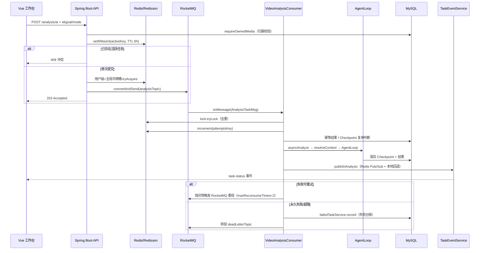

# DoVideoAI 后端只读审计

审计对象：`D:\VScodeProject\FrameRead\reference-project\DOVideo` 当前工作树的 `server/` 模块。

审计范围：`controller`、`consumer`、`service`、`config`、`entity`、`mapper`、`utils`，以及迁移、配置、Docker、后端测试和前端 SSE 对接。重点追踪任务提交、入队、消费、幂等、限流、并发、失败、重试、死信、结果一致性、MySQL/Redis/MinIO/Qdrant 的真实职责。审计日期为 2026-11-16。

证据状态：本文的路径和行号来自本次读取的源码与测试文件。测试文件已阅读但未执行；没有启动 MySQL、Redis、RocketMQ、MinIO、Qdrant、FFmpeg、Tesseract、模型或前端服务；没有联网。报告只读分析，没有修改 DOVideo 业务代码。

## 结论

DOVideo 的业务状态分三层：**MySQL 是持久真源**（用户、媒体、Agent Checkpoint、失败台账），**Redis 是协调与热缓存**（幂等锁、限流、分片上传状态、Checkpoint 热缓存、任务事件广播、追问历史），**MinIO 与 Qdrant 是媒体与向量的专项存储**。RocketMQ 只做异步投递，不承载业务终态。

核心链路是「提交即返回 → RocketMQ 异步消费 → 消费端用 Redis 锁与幂等键去重 → 构建 VideoContext → AgentLoop 生成结果 → MySQL 落 Checkpoint → SSE 推阶段事件」。与 VidLens 的关键差异在于：VidLens 用 PostgreSQL 的 durable outbox + `task_outbox` 表 + advisory lock 做执行状态机，DOVideo 用 RocketMQ 的消费重试 + Redis 幂等键做投递与去重，Checkpoint 才落到 MySQL。两者都坚持「异步任务移出请求线程、提交即返回、结果可恢复」，但 DOVideo 的投递可靠性依赖 RocketMQ 的 broker 重试，而非数据库级 outbox。

## 模块映射

| 层 | 主要路径与函数 | 真实职责 |
|---|---|---|
| 进程启动 | [ServerApplication.java](D:/VScodeProject/FrameRead/reference-project/DOVideo/server/src/main/java/com/example/server/ServerApplication.java) | Spring Boot 启动，Flyway 迁移、MyBatis-Plus、Undertow |
| HTTP/API | [AnalysisController.java:93](D:/VScodeProject/FrameRead/reference-project/DOVideo/server/src/main/java/com/example/server/controller/AnalysisController.java:93)、[MediaController.java:41](D:/VScodeProject/FrameRead/reference-project/DOVideo/server/src/main/java/com/example/server/controller/MediaController.java:41) | 鉴权（AuthInterceptor）、分析提交/查询/追问/证据检索/反馈/修订、媒体分片上传/导入/播放/删除 |
| 鉴权 | [AuthInterceptor.java](D:/VScodeProject/FrameRead/reference-project/DOVideo/server/src/main/java/com/example/server/config/AuthInterceptor.java)、[AuthService.java](D:/VScodeProject/FrameRead/reference-project/DOVideo/server/src/main/java/com/example/server/service/AuthService.java) | JWT 校验、`REQUEST_USER_ID` 注入、媒体归属校验 |
| 任务投递 | [AnalysisDispatchService.java:63](D:/VScodeProject/FrameRead/reference-project/DOVideo/server/src/main/java/com/example/server/service/AnalysisDispatchService.java:63) | 幂等键（setIfAbsent）、Redisson 令牌桶限流、RocketMQ 投递、失败回滚 |
| 任务消费 | [VideoAnalysisConsumer.java:83](D:/VScodeProject/FrameRead/reference-project/DOVideo/server/src/main/java/com/example/server/consumer/VideoAnalysisConsumer.java:83) | 毒消息收敛、Redisson 锁去重、结果复用、失败分类、重试与死信 |
| 状态查询 | [AnalysisStatusService.java](D:/VScodeProject/FrameRead/reference-project/DOVideo/server/src/main/java/com/example/server/service/AnalysisStatusService.java) | 从 Checkpoint/Redis 组装当前 TaskStatus 与 TaskStage |
| SSE | [TaskEventService.java:45](D:/VScodeProject/FrameRead/reference-project/DOVideo/server/src/main/java/com/example/server/service/TaskEventService.java:45) | SseEmitter 订阅、Redis Pub/Sub 跨实例广播、本地回退、终态关闭 |
| 结果落库 | [AiService.java:537](D:/VScodeProject/FrameRead/reference-project/DOVideo/server/src/main/java/com/example/server/service/AiService.java:537) | Agent 结果写 `media_files.ai_summary`、转写写 `transcript_text` |
| 失败台账 | [FailedAnalysisTaskService.java](D:/VScodeProject/FrameRead/reference-project/DOVideo/server/src/main/java/com/example/server/service/FailedAnalysisTaskService.java)、[failed_analysis_tasks 表](D:/VScodeProject/FrameRead/reference-project/DOVideo/server/src/main/resources/db/migration/V1__create_core_tables.sql:39) | 永久失败/毒消息/预算耗尽收敛到台账，可由管理接口重新投递 |
| Schema/迁移 | [V1__create_core_tables.sql](D:/VScodeProject/FrameRead/reference-project/DOVideo/server/src/main/resources/db/migration/V1__create_core_tables.sql:1) | `users`、`media_files`、`agent_checkpoints`、`failed_analysis_tasks` 四张表 |

## 链路 C：提交、投递与消费

### C1. 提交与幂等

`POST /analysis/ai` 在 [AnalysisController.java:101](D:/VScodeProject/FrameRead/reference-project/DOVideo/server/src/main/java/com/example/server/controller/AnalysisController.java:101) 先做媒体归属校验（`requireOwnedMedia`），再检查 Checkpoint 是否有可复用结果（有则返回 200 表示「已完成」，与异步受理的 202 区分），最后调 `dispatchService.submit`。

`AnalysisDispatchService.submit` 的幂等语义是「Redis setIfAbsent 活跃键」，[AnalysisDispatchService.java:72](D:/VScodeProject/FrameRead/reference-project/DOVideo/server/src/main/java/com/example/server/service/AnalysisDispatchService.java:72)：键为 `(mediaId, goalDigest(goal, mode))`，TTL 6 小时。同一视频 + 同一目标 + 同一模式在活跃期内重复提交直接返回 `DUPLICATE`（HTTP 409）。这个幂等是「进程内活跃期去重」，不是全局 URL 去重，也不保证外部 ASR/LLM 调用的 exactly-once——那由消费端的 Redisson 锁和 Checkpoint 复用进一步约束。

配额校验在幂等键通过后进行：用户级 5/min + 全局级 30/min 的 Redisson 令牌桶，[AnalysisDispatchService.java:130](D:/VScodeProject/FrameRead/reference-project/DOVideo/server/src/main/java/com/example/server/service/AnalysisDispatchService.java:130)。限流失败回滚幂等键并返回 `RATE_LIMITED`。这个顺序保证「被限流的请求不会残留活跃键阻塞后续重试」。

修订（revision）提交走同一入口，但 `action=REVISE_ANALYSIS`，且 `contentHash` 用 `media-{id}` 而非真实内容指纹，因为修订针对的是已存在结果而非新内容，[AnalysisDispatchService.java:69](D:/VScodeProject/FrameRead/reference-project/DOVideo/server/src/main/java/com/example/server/service/AnalysisDispatchService.java:69)。

### C2. 消费与去重

`VideoAnalysisConsumer.onMessage` 的防御层次比投递端更厚，[VideoAnalysisConsumer.java:83](D:/VScodeProject/FrameRead/reference-project/DOVideo/server/src/main/java/com/example/server/consumer/VideoAnalysisConsumer.java:83)：

1. **结构校验（毒消息收敛）**：`rejectionReason` 检查 mediaId、goal、action 合法性，非法消息直接 `discardPoisonMessage`——落失败台账 + 转投死信主题后 ACK。收敛的前提是「台账与死信主题至少一个写成功」，两个都失败则拒绝 ACK 让 RocketMQ 重投，避免消息静默丢失，[VideoAnalysisConsumer.java:264](D:/VScodeProject/FrameRead/reference-project/DOVideo/server/src/main/java/com/example/server/consumer/VideoAnalysisConsumer.java:264)。
2. **Redisson 锁去重**：任务级 `lock`（mediaId+goalDigest）防同一目标重复消费；内容级 `contentLock`（contentHash+goalDigest）防同一视频内容被不同 media 记录重复消费。内容锁用 `lockInterruptibly` 阻塞等待共享结果，无显式租约，靠 Redisson watchdog 续期，[VideoAnalysisConsumer.java:101](D:/VScodeProject/FrameRead/reference-project/DOVideo/server/src/main/java/com/example/server/consumer/VideoAnalysisConsumer.java:101)。
3. **结果复用**：非修订任务先查 `completedKey`，若同一 contentHash+goalDigest 已有完成结果，直接 `reuseResult` 绑定到当前 mediaId 并发布 `COMPLETED_REUSED` 事件，跳过整段 ASR+LLM。
4. **应用级投递上限**：`attemptsKey` 计数 + `maxReconsumeTimes=2`（重投 2 次 = 最多 3 次投递）。注释明确说明：若不设 `maxReconsumeTimes`，异常发生在 Redis 计数之前时会退化成 MQ 默认的 16 次重投空转，[VideoAnalysisConsumer.java:33](D:/VScodeProject/FrameRead/reference-project/DOVideo/server/src/main/java/com/example/server/consumer/VideoAnalysisConsumer.java:33)。

### C3. 失败分类与重试

`isPermanentFailure` 沿 cause 链（最多 16 层）判断失败是否「重投也不会成功」：`IllegalArgumentException`、`SecurityException`、`NoSuchElementException` 视为永久失败。这是必要的，因为 `AiService`/`VideoContextService`/`SegmentedTranscriptionService` 会把根因层层包进 `IllegalStateException`，只看最外层类型无法判断，[VideoAnalysisConsumer.java:334](D:/VScodeProject/FrameRead/reference-project/DOVideo/server/src/main/java/com/example/server/consumer/VideoAnalysisConsumer.java:334)。

失败处理分三支：

- **可重试且未超限**：抛异常触发 RocketMQ 重投，重试期间保留 activeKey（避免前端误判任务结束），发布 `RETRYING` 事件。
- **永久失败或已达投递上限**：落失败台账 + 转投死信主题 + 发布 `DEAD_LETTERED` 事件后 ACK，不再无限重放。
- **预算耗尽**：单独 catch `BudgetExceededException`，保存阶段为 `BUDGET_EXHAUSTED`，不重投（重投也只会再次超限）。

失败台账 `failed_analysis_tasks` 记录 mediaId、action、mode、contentHash、goal、attempt_count、error_type、error_message，可由管理接口（AdminController）重新投递。

### C4. 结果一致性与生命周期

Agent 结果写 `media_files.ai_summary`，转写写 `transcript_text`，[AiService.java:537](D:/VScodeProject/FrameRead/reference-project/DOVideo/server/src/main/java/com/example/server/service/AiService.java:537)。`persistResult` 有两个细节值得注意：

1. `ai_summary` 的写入不覆盖 `transcript_text`——转写可能在 Agent 运行期间被独立的转写任务完成，不能写回陈旧值，所以转写用「仅当为空时才写」的条件更新。
2. 写完结果后 `invalidateUserList` 使媒体列表缓存失效。

媒体删除 `deleteOwnedMedia` 触发 `purgeRuntimeArtifacts`，逐项清理证据帧（MinIO）、Redis 键、Checkpoint、遥测、向量（Qdrant），每一项独立 catch 失败不影响其他项，[MediaService.java:168](D:/VScodeProject/FrameRead/reference-project/DOVideo/server/src/main/java/com/example/server/service/MediaService.java:168)。消费端在 `asyncAnalyze` 返回后再查一次 `mediaService.exists`，若媒体已被删除则清理运行时产物，避免对已删除媒体继续写结果。

## SSE 与前端同步

`TaskEventService` 是阶段事件的中枢，[TaskEventService.java:45](D:/VScodeProject/FrameRead/reference-project/DOVideo/server/src/main/java/com/example/server/service/TaskEventService.java:45)：

- 订阅键为 `analysis:{mediaId}:{goalDigest}`，同实例直接推 `SseEmitter`，跨实例经 Redis Pub/Sub（`dovideo:task-events` 频道）广播后本地投递。Redis 发布失败或零接收者时回退本地投递。
- 订阅先注册再查初始状态，避免「查询期间完成」落入事件缺口，[TaskEventService.java:62](D:/VScodeProject/FrameRead/reference-project/DOVideo/server/src/main/java/com/example/server/service/TaskEventService.java:62)。
- 终态事件发送后自动关闭 emitter，`liveEventDelivered` 标志保证初始事件与首个 live 事件不重复。
- 慢订阅者由 `SseEmitter` 的 30 分钟超时兜底，与 VidLens 的 Hub 缓冲上限不同，DOVideo 未做每通道缓冲限制。

前端 [taskEvents.js](D:/VScodeProject/FrameRead/reference-project/DOVideo/client/src/taskEvents.js) 通过 `fetch` 读 SSE 流，[taskEventsPolicy.js](D:/VScodeProject/FrameRead/reference-project/DOVideo/client/src/taskEventsPolicy.js) 定义终态判定：4xx 中除 408/429 外不重连，网络错误和 5xx 继续退避重连。前端提交后先订阅事件流，再据事件状态刷新 Agent 元信息（plan/trace/evaluation）。

## MySQL / Redis / MinIO / Qdrant 的职责边界

| 数据/能力 | MySQL | Redis/Redisson | MinIO | Qdrant | 断点行为 |
|---|---|---|---|---|---|
| 用户、媒体、Checkpoint、失败台账 | 持久真源 | 热缓存（`agent:checkpoint:*`） | — | — | Redis 丢失回源 MySQL |
| 任务幂等与去重 | — | `setIfAbsent` 活跃键、`lock` 去重锁 | — | — | Redis 不可用提交失败，不回退 |
| 限流 | — | 令牌桶 `limit:ai:*` | — | — | 限流器不可用返回 503 |
| 分片上传状态 | — | `upload:chunked:*` 元数据与分片索引 | 分片对象 + 合并后媒体 | — | Redis 过期需重新上传 |
| 视频/证据帧对象 | `media_files.file_path` 引用 | — | 对象存储 | — | 对象丢失读失败 |
| 语义检索 | — | — | — | chunk 向量 | Qdrant 不可用退化本地向量 |
| 追问历史 | — | `followup:history:*` List | — | — | 丢失则丢失，非业务真相 |
| 事件广播 | — | Pub/Sub 频道 | — | — | 单实例退化本地投递 |

关键边界：DOVideo 的 Redis 承担了比 VidLens 更重的「任务幂等」职责（VidLens 用 PostgreSQL 的 idempotency 表和 outbox）。这带来一个权衡——Redis 不可用时 DOVideo 的分析提交直接失败（`setIfAbsent` 抛异常走 FAILED 分支），而 VidLens 的提交幂等由数据库保证、Redis 只做队列投递。FrameRead 的正式合同采用 MySQL Checkpoint、RocketMQ 和 Redisson，具体受理、确认、重投和执行代次以 [SPEC](../prototype/SPEC.md) 为准，不直接复制任一参考项目的 outbox 或 Redis 组合。

## 配置、Docker 与外部依赖

[application.properties](D:/VScodeProject/FrameRead/reference-project/DOVideo/server/src/main/resources/application.properties:1) 显示：

- Undertow 替代 Tomcat，`spring-boot-starter-tomcat` 被显式排除，[pom.xml:33](D:/VScodeProject/FrameRead/reference-project/DOVideo/server/pom.xml:33)。
- HikariCP 连接池 max 10、min 2、连接超时 3s。
- multipart 上限 2048MB，支持大文件直传。
- 模型超时默认 300s，用于避免长视频证据分析过早超时。
- 外部命令（FFmpeg、Tesseract、yt-dlp）通过 `ProcessBuilder` 调用，进程有 15 分钟超时与 `destroyForcibly` 兜底。

[docker-compose.yml](D:/VScodeProject/FrameRead/reference-project/DOVideo/docker-compose.yml) 编排 MySQL 8、Redis 7、MinIO、Qdrant、RocketMQ 5.3.4 五个中间件，与 README 的技术栈一致。所有中间件默认监听 127.0.0.1，不直接暴露到局域网。

## 对 FrameRead 的参考边界

DOVideo 的异步削峰、幂等、成本护栏、失败分类和管理员重放提供 Java/Spring 参照。FrameRead 使用 RocketMQ、Redis/Redisson 和 MySQL Checkpoint，具体合同以 [SPEC](../prototype/SPEC.md) 为准。

1. RocketMQ 负责分析消息投递和有限重投。Redis 活动键与缓存不能替代 MySQL 中的媒体、Checkpoint、失败记录和有效执行代次。发送确认未知时，状态查询和同作用域重发必须遵守 SPEC 的确认窗口。
2. 失败按可重试、永久失败、预算耗尽和调用结果未知分类。失败台账和管理员重放必须保留原媒体、目标、实际模式、来源和重放代次，不能把重放变成新业务作用域。
3. 分析身份贯穿提交、消费、Checkpoint、SSE 和报告读取。AUTO 先落定具体模式，普通重复提交查已有工作或结果，显式重分析按原语义进入新代次。
4. 内容级材料和目标级结果分层复用。相同媒体可复用已确认的字幕/ASR/OCR/帧材料，不同目标或模式不能串用计划和结果。
5. DOVideo 的死信主题、Redis TTL、DTO 和消费次数是参考实现事实，不自动成为 FrameRead 的新中间件或独立任务运行时。FrameRead 保持报告、追问、Checkpoint 和管理员重放的当前产品边界。
