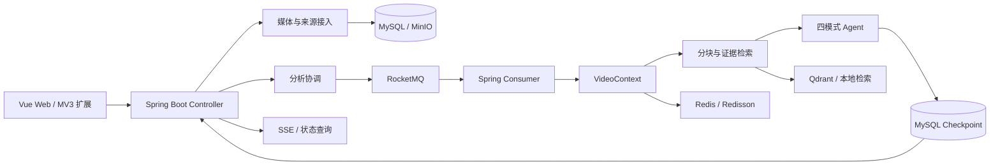

# FrameRead 架构与功能静态审查

审查日期：2026-11-18。本文记录 FrameRead 当前工程的源码与配置核对结果，用于补充 [PRD V3](../prototype/PRD.v3.md) 和 [SPEC](../prototype/SPEC.md)。需求和技术契约以这两份正式文档为准，本文不替代它们。

## 1. 结论与证据边界

FrameRead 是完整的 Java 后端与 AI Agent 视频理解应用。产品覆盖用户会话、媒体输入、上传续传、视频上下文、字幕与 ASR、OCR/关键帧、混合检索、四模式 Agent、结构化报告、证据核对、连续追问、反馈、计划修订、异步执行、失败恢复、导出、浏览器扩展和工程运行。

本次是静态审查。已读取服务端、Web、扩展、迁移、Compose、启动脚本、CI 和测试入口，没有启动应用、连接真实中间件、访问视频平台或调用模型/ASR。因此“待验”只表示源码路径存在，不能作为运行通过证明。后续实现和验收按 PRD 的 A3-01～A3-22 执行。

## 2. 技术栈与代码布局

| 领域 | 当前工程事实 |
| --- | --- |
| 服务端 | Java 21、Spring Boot 3.5.9、Spring MVC、Undertow、Validation，源码在 `server/src/main/java/com/example/server/` |
| 数据与迁移 | MySQL、MyBatis-Plus、Flyway，迁移在 `server/src/main/resources/db/migration/` |
| 异步与协调 | RocketMQ 消费者、Redis/Redisson、SSE，消费者与 HTTP 服务同一 Spring Boot 进程 |
| AI 与检索 | LangChain4j OpenAI 兼容客户端、Planner/Executor/Critic、Qdrant 与本地检索 |
| 媒体 | FFmpeg、yt-dlp、Tesseract OCR、配置的 ASR 服务、MinIO |
| Web 与扩展 | Vue 3 + Vite Web 工作区，Manifest V3 浏览器扩展 |
| 运行 | Compose 启动 MySQL、Redis、Qdrant、MinIO、RocketMQ，应用和媒体工具按启动脚本运行 |

主要目录职责如下。

| 目录 | 职责 |
| --- | --- |
| `controller/` | HTTP、SSE、用户、媒体、分析和管理员入口 |
| `consumer/` | RocketMQ 分析消息消费 |
| `service/` | 媒体、上下文、检索、Agent、状态、导出和恢复业务 |
| `service/mode/` | GENERAL、LEARNING、REVIEW、CREATION 与 AUTO 路由 |
| `repository/`、`mapper/`、`entity/` | Checkpoint、用户、媒体和失败记录持久化 |
| `dto/`、`common/`、`exception/` | 请求、结果、消息、响应和业务错误契约 |
| `config/`、`utils/` | 装配、鉴权、外部模型、媒体、对象存储和向量适配 |
| `client/src/` | 上传、媒体、分析工作区、SSE、报告和导出交互 |
| `extension/` | 当前页链接解析、导入、分析进度和时间定位 |

## 3. 功能核对

| 功能 | 静态结论 | 关键入口 |
| --- | --- | --- |
| 用户与权限 | 代码包含注册、登录、会话、媒体归属和管理员失败任务权限，待接口验证 | `UserController`、`AuthService`、`AuthInterceptor` |
| 上传与媒体 | 普通上传、分片续传、列表、播放、删除和 MinIO 清理已定位，待故障验证 | `ChunkUploadService`、`MediaService`、`MediaIngestService` |
| 视频链接 | 通用 URL 导入已定位。Bilibili/YouTube 单视频识别、规范化来源和来源诊断属于 PRD V3 输入增强，待实施与联调 | `MediaProcessingController`、`YtDlpUtils` |
| 字幕与 ASR | ASR 分片、部分失败和粗粒度时间已定位。平台字幕优先、类型/语言选择和来源固定属于 V3，待实施 | `VideoTranscriptionService`、`SegmentedTranscriptionService` |
| 画面与上下文 | 关键帧、去重、OCR、分块、摘要、Embedding、Checkpoint 和混合检索已定位，真实视觉输入需单独验证 | `VideoContextService`、`LongVideoContextService`、`VideoEvidenceRetrievalService` |
| Agent 分析 | 四模式、AUTO、Planner/Executor/Critic、结构校验、预算和结果保存已定位 | `AgentLoopService`、`ModeRouter`、`EvidenceVerificationService` |
| 报告与交互 | Markdown 报告、结果保存、追问、反馈和计划修订入口已定位。报告不是独立文章发布系统 | `AnalysisResult`、`AiService`、`AnalysisController` |
| 异步与恢复 | RocketMQ、Redis/Redisson、Checkpoint、SSE、有限消费重投、失败台账和管理员重放已定位，确认窗口和过时写回需实测 | `AnalysisDispatchService`、`VideoAnalysisConsumer`、`AgentCheckpointService`、`FailedAnalysisTaskService` |
| 导出与扩展 | Markdown、转写文本、MP3 和扩展入口已定位，沿用现行协议 | `App.vue`、`AudioExportService`、`extension/` |

## 4. 端到端数据流

媒体模块负责归属、来源和文件生命周期。上下文模块固定字幕/ASR、OCR、帧和时间信息，分析与追问通过统一上下文取得材料。Agent 只使用同源证据，结果、阶段和恢复所需过程写入 Checkpoint。Redis 用于会话、缓存、活动状态和协调，不能独立承载最终业务状态。媒体删除、结果写回和资源清理按 SPEC 的短事务及有效代次条件执行。

## 5. 平台来源与字幕

V3 增加 Bilibili、YouTube 单视频识别、来源元数据、平台字幕优先和 ASR 回退。该链路接入媒体和 VideoContext 主链，不新建独立文章模式、文章表、公开分享或全片导图发布流程。结构化报告仍按目标和实际模式生成，模式化 Section 继续转换为 Markdown。

字幕候选必须先验证同一媒体、非空文本和可确认时间。人工/自动类型和语言只记录可证实的信息，失败候选继续尝试其他轨道。没有可用字幕时调用 ASR，保留原始区间和回退原因。字幕有效时不为同一目的自动重复转写。

## 6. 直接影响实现的静态风险

| 编号 | 观察 | 需要验证或修复的边界 |
| --- | --- | --- |
| A01 | URL 初次校验不能自动证明子进程跳转安全 | 按 SPEC 验证每跳地址、重定向、进程回收和受控出网 |
| A02 | URL 导入可能在 HTTP 请求中持续较长时间 | 保留现行兼容接口，分别核对保存成功、断线、超时和重复提交 |
| A03 | ASR 分片失败可保留成功片段，时间可能是区间级 | 报告标明来源和精度，不能伪造逐句时间 |
| A04 | 帧上传失败不能产生可用图片证据 | 引用前验证 MinIO 对象、媒体归属和授权读取 |
| A05 | 文本中的图片地址不代表模型收到像素 | 对需要视觉理解的路径核对模型消息和能力配置 |
| A06 | Redis、MQ、Checkpoint 和摘要不是同一事务 | 按 SPEC 验证代次、重复消息、确认未知、重连和过时写回 |
| A07 | SSE 是即时通知，状态查询仍需作为恢复依据 | 刷新和断线只读同一媒体/目标/模式，不自动新建分析 |
| A08 | Compose 当前主要启动依赖 | 用启动脚本、实际依赖和日志验证独立部署，不能把配置文件当成运行证明 |

## 7. 交付与验证

实现按需求、模块 SPEC、跨模块集成契约、纵向切片和验收推进。先复现用户、媒体、分析、报告和恢复主链，再接入链接与字幕。必要测试覆盖权限、重复提交、同源复用、字幕回退、Checkpoint 恢复、失败重放、删除竞争、SSE 重连和浏览器路径。真实平台、真实模型、真实中间件和故障注入分别留证。

当前未验证应用启动、数据库迁移、平台下载、字幕候选、模型视觉输入、真实异步恢复、浏览器交互或性能基线。静态审查中的代码路径、测试存在和配置声明只作为定位依据。
