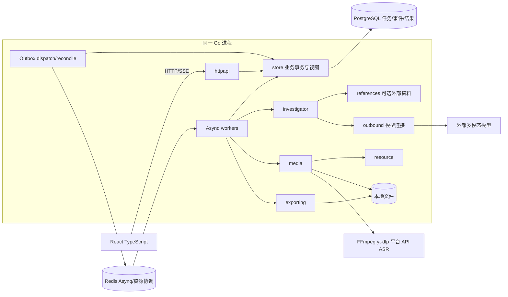
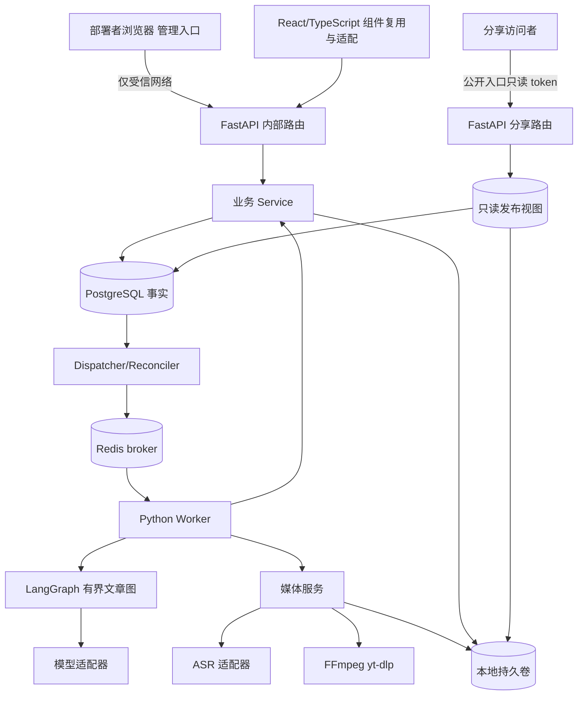
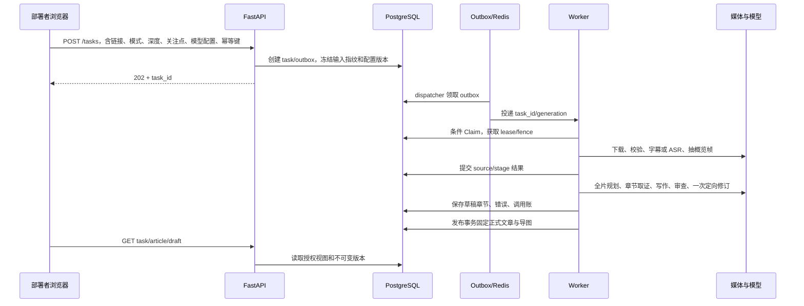
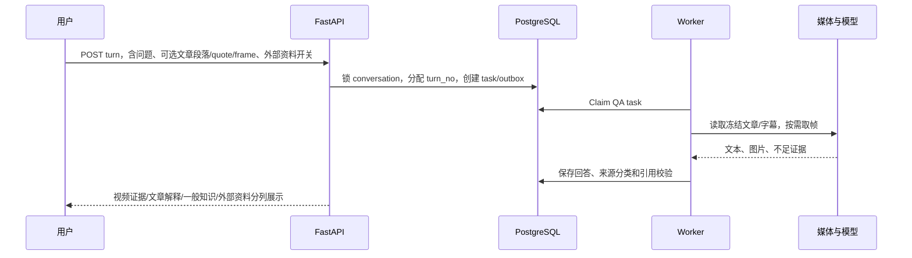
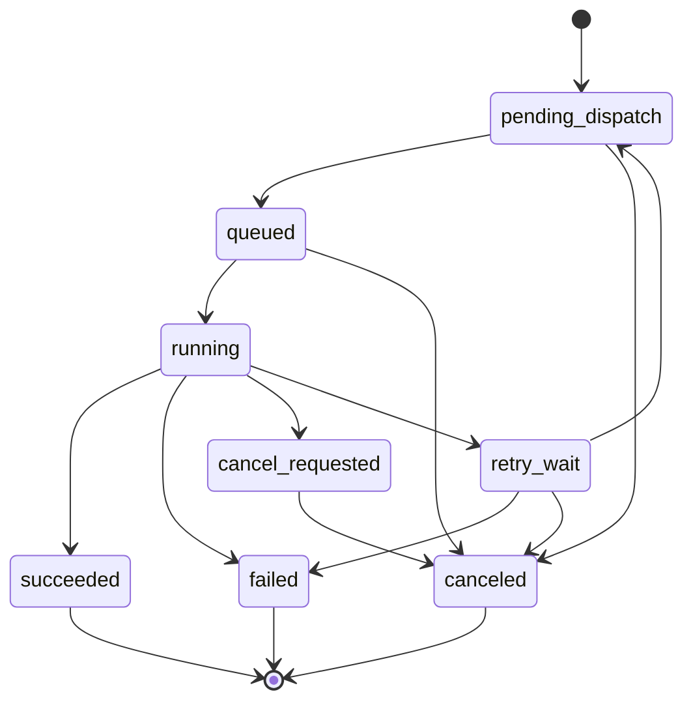

# FrameRead：按已确认需求复审后的架构与实施依据

复审日期：2026-10-25；2026-10-30 按项目归属与后端工程学习目标补充校验；2026-11-09 按 Python 后端技术选型与 VidLens 六条端到端链路再次复核；2026-11-14 同步已确认的参考版本、本地 Compose 交付、P1 验收与 SQL 查询规则。状态：**FrameRead 仍未开发、未运行、未部署；已初始化 Git。** 本文替代 2026-10-24 以 4～6 周工期为主约束的版本；仍有效的源码事实和岗位证据保留，不以旧工期和历史估算裁剪当前范围。

## 1. 一页结论

FrameRead 是一个由部署者自行 Docker 部署、免注册、免登录的个人视频理解实例。用户输入 B 站或 YouTube 链接，选择模型配置、完整解读或关注点专题、解读深度和可选关注点；系统在字幕缺失时使用 ASR，生成带真实画面、时间出处和全片导图的文章，支持围绕视频、文章选段和真实帧追问，并可导出 Markdown/图文 ZIP、创建可撤销的只读分享。

**首要目的为后端工程学习与面试展示。** 视频业务承载网络与流式通信、并发与任务状态机、数据库与缓存、故障恢复和可观测性的实际问题。先保证设计合理、业务正确和功能完整，再选择能产生可验证工程深度的机制；不要求把多线程、读写锁、熔断、两种限流算法等全部加入。具体取舍见第 7.4 节。

固定选择：Python 主导、FastAPI、PostgreSQL、Redis、React/TypeScript、单机 Docker Compose、FFmpeg/yt-dlp、B 站与 YouTube 双平台。2026-11-09 已显式裁决（见 7.1 选型裁决记录）：Celery+Redis 为 Worker/队列主方案，PG Outbox+SKIP LOCKED Worker 为可替换备选而非并列实现；LangGraph 只承担有界的文章生成图，不承担任务执行权或业务事实存储。

推荐架构是“模块化单体、多运行进程”：FastAPI 管理个人入口和只读分享入口；独立 Python Worker 执行媒体、文章和问答；PostgreSQL 保存任务、领取权、阶段结果、草稿、正式版本、配置、问答、导出和分享事实；Redis 承担队列及经场景论证的协调或缓存；本地持久卷保存媒体与导出文件。交付完整的 Docker Compose 配置和部署说明，由用户在自己的机器上运行。VidLens 为主要业务与架构参考，DoVideoAI 为辅助工程实践参考，当前参考版本见第 3 节；前端复用范围按组件耦合与适配成本判断，VidLens 的归属与直接参考规则以根目录 `AGENTS.md` 为准。

关键未知：双平台无 Cookie 实际成功率、所选模型的图像/工具/结构化输出能力、ASR 服务与费用、真实图文/导图质量、单机资源和恢复行为。这些只能配置后实测，不能预先写成事实。

## 2. 已确认需求与失效旧约束

### 2.1 已确认需求清单

1. GitHub 开源，提供 Docker Compose 配置供用户在自己的机器上部署完整应用及所需基础设施；不增加账号、多租户、计费或团队协作。
2. 无需注册登录。首次打开提供设置页，可保存多个模型配置；配置持久化，重启保留；ASR 独立配置；环境变量是可选入口。
3. 输入 B 站与 YouTube 单条链接；不要求平台 Cookie；字幕优先，缺失时 ASR；支持域、受限链接、下载失败和转写失败必须有明确错误。
4. 支持完整解读和关注点专题、解读深度、关注点。完整模式默认且不能静默省略其他重要内容；专题模式必须说明范围和省略。
5. 产物是带章节目录、时间出处、真实画面和全片内容导图的文章。真实截图必须进入模型视觉输入；不足处明确标注。
6. 支持一般提问、选段追问、选帧追问；区分视频证据、文章解释、一般知识和外部资料。外部资料默认关闭，开启后必须有可追溯来源；私人问答不随分享公开。
7. Markdown 至少含正文、时间来源和导图；图文 ZIP 含 Markdown 和本地图片，可离线阅读；导出使用已保存正式结果，不重新生成，缺图明确失败。
8. 网页只读分享指向部署者实例，可撤销；只公开正式文章、导图和正式引用图片；分享访问者不能管理任务、看配置、问答、草稿、原始字幕或触发模型调用。
9. 文章、导图、字幕、正式引用截图和问答长期保留；原视频、音频和临时文件可清理；追问需新画面时重新取得并验证同源，失败则明确不能补看。
10. 保留已完成章节、失败位置和错误；有效阶段按完整输入指纹复用；草稿和正式版本分离；重试不能改变既有正式分享内容。
11. 合理且可配置的资源上限按目标场景和实验确定，不继承“20分钟/300 MiB”的旧固定值。
12. 后端工程能力是主要学习和面试展示目标；技术机制必须对应真实业务问题、清晰的数据流和可验证结果，不能为了关键词破坏功能或引入无依据的复杂度。VidLens 归属与直接参考规则以根目录 `AGENTS.md` 为准，不重复审议。
13. 备份恢复、内部运行概览、版本内容缓存实验正式纳入 P1，并属于完整 V1 的验收范围；缓存实验无收益时可以不启用。可观察行为与通过条件以 [PRD：P1 工程强化验收](../prototype/PRD.md#p1-工程强化验收)为准。MinIO 保留为 P2 可选扩展。

### 2.2 旧约束处理

原报告按 4～6 周、单平台、可靠字幕输入、固定小媒体上限、导出分享后置和单模型端点裁剪范围。这是当时 prompt 下的方案收缩，不全部归为旧审计事实错误。当前需求已明确：没有开发截止日期，双平台和 ASR 回退属于最终验收，导图/Markdown/ZIP/分享属于成品功能，多模型配置属于设置页契约，阶段只按业务依赖和风险排序。

历史工时数字不再用于承诺或裁剪最终范围。后续可用“输入可用→任务与媒体→文章证据→问答→发布/导出/分享→清理恢复与部署”的依赖顺序安排，但每个已确认功能都必须进入最终验收。

## 3. 证据边界与版本

| 项目 | 当前结论 |
| --- | --- |
| FrameRead 实现 | 当前只有项目规则、研究文档和本地辅助目录，没有应用源码、迁移或测试。报告中的 `backend/`、`frontend/` 均为设计目录，不是现有代码。 |
| FrameRead Git | 2026-10-30 已在本目录初始化 Git，分支为 `main`；本轮未暂存、提交或推送，无可引用的 commit SHA。 |
| 当前参考版本 | 用户于 2026-11-14 确认以本地 [VidLens](../../reference-project/VidLens/) 和 [DoVideoAI](../../reference-project/DOVideo/) 代码作为当前参考版本。两个目录均无独立 `.git`；引用对应本地文件，后续本地源码变化时定向复核受影响结论。 |
| VidLens 规模 | 2026-10-24 审计记录的静态计数为 578 个文件；Go 实现 162 文件/35,475 行，Go 测试 184 文件/24,512 行；TS/TSX 实现 92 文件/15,115 行，测试 38 文件/2,221 行；SQL 迁移 28 个。本次未重做全量计数，计数不代表覆盖率或质量。 |
| 运行状态 | 本轮没有启动 VidLens 或 DoVideoAI、运行测试、下载视频、调用模型/ASR/搜索，也没有部署 FrameRead。“测试存在”不等于“测试通过”。 |
| 项目归属与参考范围 | 用户于 2026-10-30 明确 VidLens 为自己的项目，允许直接参考本地源码架构、功能与数据流。不再将项目使用授权列为风险或阻塞项。 |
| 证据标签 | 下文区分“源码确认”“文档声称”“静态推断”“设计建议”“已运行验证”“待运行验证”。本轮只有源码确认和静态检查，没有已运行验证。 |

版本线索：VidLens 声明 Go 1.26.0、Eino 0.9.21、Asynq 0.26.0、pgx/v5 5.11.0、go-redis/v9 9.23.0；前端锁定 React 18.3.1、TypeScript 5.9.3、Vite 5.4.21；Docker 配置含 PostgreSQL 17、Redis 7、FFmpeg、yt-dlp 2026.8.19。详见 [媒体/前端审计](VidLens_Media_Frontend_Audit.md)。

## 4. VidLens 实际实现到 FrameRead 目标

| 原机制与源码事实 | 解决的问题 | FrameRead 决定 | 理由与验证 |
| --- | --- | --- | --- |
| B 站公开 API 分支：`internal/media/bilibili.go:130`；YouTube yt-dlp：`internal/media/download.go:62`；默认平台含双平台：`internal/config/config.go:52` | 合法获取目标平台媒体 | 同时保留 B 站与 YouTube；不要求 Cookie | 双平台是最终要求。验证两类平台、多分区/长短链、受限与失败样本的真实下载和字幕结果 |
| 字幕候选、VTT/SRT/JSON 与覆盖检查：`internal/media/subtitle_selection.go:44`、`internal/media/subtitles.go:19`；ASR：`internal/media/asr.go:25` | 文本来源与时间精度 | 字幕优先，缺失时 ASR；ASR 输出必须带 origin 和精度标记 | 不能把 ASR 粗窗口写成逐句精确时间。验证有字幕、无字幕、混合质量和时间偏差 |
| 有界按需取帧与实际 PTS：`internal/media/frames.go:39`、`:156` | 真实视觉输入和时间出处 | 保留实际图片载荷、实际解码时间、按需补看 | 图片存在、已输入模型、视觉结论正确是三层。验证 provider 请求日志和人工抽查 |
| 完整 transcript 超限时拒绝：`internal/investigator/execution_context.go:137` | 防止把截断文本冒充全片 | 长视频先分块摘要并保留源 segment；超过模型能力时明确失败 | 支持十几至几十分钟目标场景，但不承诺无限长度。验证固定长样本的覆盖、重复和引用正确性 |
| 关注点 purpose 只影响优先调查，不删除全片：`internal/investigator/execution_context.go:105-111`；深度策略：`internal/domain/generation.go:65-80` | 关注点与展开程度 | 明确实现完整解读/关注点专题；完整模式仍覆盖全片，专题模式声明省略 | 关注点不是静默裁剪许可。验证专题文章的“范围说明”和完整模式的重要主题覆盖 |
| 导图是文章字段并有结构校验：`internal/domain/types.go:311-320`；导图校验：`internal/investigator/concept_map.go:15-56` | 全片结构化导航 | 全片导图成为必选产物；专题文章不缩小导图 | 导图节点除章节链接外还保存时间范围，避免专题省略造成失效章节引用 |
| 内容来源区分：`internal/domain/generation.go:11-17`；问答外部资料仅显式开启：`internal/investigator/references.go:46` | 区分视频证据、解释和外部资料 | 保留四类来源展示；一般知识不挂原视频时间戳；搜索摘要不算已读原文 | 外部资料默认关。验证来源标签、URL/标题/读取时间和逐字引用 |
| 文章草稿、candidate、review、revision、发布：`internal/investigator/article_loop.go:52`、`internal/investigator/article_loop_wire.go:685` | 草稿可恢复与发布门禁 | 保留草稿/正式分离、确定性校验+一次定向修订；完整运行时缩减为一条当前契约 | schema 通过不等于语义正确。验证非法引用、缺图、伪 quote、越界时间和修订收敛 |
| 任务、Outbox、Claim、lease/fence、Repair：`internal/store/execution.go:13`、`:338`、`:362`；worker：`internal/jobs/worker.go:175`、`:365` | 重复请求、崩溃、重复消息与旧 Worker 写覆盖 | 保留 PG 执行真相、Outbox、领取租约、generation/fence；不复制全局 advisory lock 和复杂共享图 | Worker/队列方案重新论证，最小实现 Celery+Redis dispatcher/reconciler |
| 发布事务校验 snapshot/frame：`internal/store/artifacts.go:255` | 防止无证据或错误版本发布 | 正式版本不可变；发布校验所有来源和资产；分享绑定版本 | 验证发布原子性、旧分享读取版本稳定性、图片 allowlist |
| Markdown/ZIP 导出读取已发布文章：`internal/exporting/service.go:51`、`:99-195` | 不重新生成、离线图片完整 | Markdown 与 ZIP 均纳入成品；缺图/校验失败不输出伪完整包 | 验证相对路径、导图、时间来源、manifest、解压离线阅读 |
| 分享 token、撤销、图片 allowlist：`internal/httpapi/shares.go:8-48`；`internal/store/shares.go:86-307` | 受限公开阅读 | 保留分享，但改为免登录个人实例的独立公开入口 | 分享不可暴露管理面、私人 QA、原视频或草稿。验证撤销后页面和图片均失效 |
| 媒体恢复比较原 snapshot video hash：`internal/store/artifacts.go:102-110` | 防止 URL 相同但内容已变 | 保留内容身份校验，并增加可配置清理与恢复策略 | 不同下载格式未必字节相同；恢复指纹需验证同源。验证 URL 不变内容变化、恢复失败、问答补看提示 |
| 配置 revision 冻结与凭据引用：`internal/store/store.go:224-256`；默认 profile：`internal/config/config.go:14-53` | 进行中任务模型身份不静默变化 | 设置页保存多个模型配置，任务冻结 config revision；密钥加密存储、脱敏返回 | 不复制原管理员运营后台。验证重启保留、密钥不进入日志/API/导出、模型能力检查 |
| 匿名 visitor 模型目录与 admin 后台并存：visitor 选模型入口 `frontend/src/app/useVisitor.ts:269`；管理后台 `internal/httpapi/server.go:65-98` | 原项目面向运营站点 | 改为个人设置页和受限分享入口；不复制站点运营后台 | 管理入口仅受信网络可达，分享入口只读且公网可单独代理，不只隐藏按钮 |

## 5. 两套架构

### 5.1 当前 VidLens 架构（源码确认）

该图表示职责，不表示微服务。原实现把文章契约、draft、ArticleLoop、staged workflow、旧 ADK 等多代路径并存；新实现不复刻这种历史兼容面。

### 5.2 推荐 FrameRead 架构（设计建议）

LangGraph 只编排“概览/规划/取证/章节生成/审查/定向修订”内部节点；任务能否执行、阶段是否完成、文章能否发布仍由 PostgreSQL 与业务 Service 裁决。Redis 不保存最终状态。

## 6. 三条主链路与关键数据流

### 6.1 链接到文章

**设置数据流**：设置页保存 provider URL、模型名、API key、能力探测结果和 ASR 配置。密钥只写入服务端凭据存储，普通 API 返回脱敏值。环境变量只用于首次种子或显式导入；数据库配置优先。新建任务冻结模型、ASR 与工作流的语义配置版本；重试沿用该语义版本，显式改模型或策略则创建新任务并重算复用指纹。凭据通过独立 credential ref 解析，密钥轮换不要求长期保存失效明文；不可用凭据导致明确配置错误，不能偷偷换模型或无限重试。

**输入与失败**：B 站、YouTube、字幕和 ASR 都有独立错误码。平台不支持、登录限制、地区限制、下载截断、无可用文本、ASR 失败和媒体校验失败均不能生成“成功文章”。字幕优先，ASR 只是文本来源回退。

### 6.2 视频追问

选段引用必须绑定不可变文章 block 和原文 quote；选帧必须绑定 source snapshot 与实际 frame ID。一般知识默认允许但不挂视频时间戳；外部资料只有用户明确开启才启用，必须保存 URL、标题、读取时间和原文 quote。私人 QA 只属于内部路由，分享 SQL/接口不读取对应表。

### 6.3 失败、草稿与恢复

`stage` 独立于任务终态：prepare/text/overview/plan/compose/review/revise/publish/answer。已完成章节和已验证阶段结果保存在 PG，草稿页显示完成章节、失败章节、错误和“未完成”标识。自动重试在原 task 下新增 attempt；用户对失败/取消任务重试时创建带 `retry_of` 的新 task，保留原错误及草稿，按完整输入指纹复用 completed 阶段。模型响应未知时对应 submission 状态为 `unknown`，用量不能记 0；是否重发由调用幂等支持、剩余预算和错误类型决定，不能因图恢复自动重发，允许重发时记录潜在重复计费。

**取消与发布竞争**：取消请求先持久化 `cancel_requested`；Worker 在阶段、工具和子进程边界检查取消，释放资源后进入 `canceled`，失联任务由 reconciler 收敛。发布与取消在同一任务行上以短事务和条件更新裁决：取消先成功则禁止发布，发布先完成则返回已完成状态。pending/queued 尚未领取可直接取消；运行中的 HTTP 返回“取消已请求”不代表外部模型已停止或费用可撤回。Celery revoke 不替代该状态机，`terminate` 不作为正常取消接口。[Celery revoke 语义](https://docs.celeryq.dev/en/stable/userguide/workers.html#revoke-revoking-tasks)

**问答顺序**：同一 conversation 只允许一个进行中的 turn。重试已有 turn 前检查后续对话与 active task，避免晚到回答覆盖新对话；需要基于新上下文提问时创建新 turn。重试与队列补投分别记录，不混成一次模型调用或无限重置总 deadline。

### 6.4 分享、导出与生命周期权限边界

**分享**：内部路由创建随机 token，数据库仅保存 token hash 并绑定 `article_version_id`。公开路由只提供对应正式文章、导图和 allowlist 图片。撤销更新状态、`revoked_at` 和版本，不物理删除审计记录；每次分享页面/API/图片读取先查有效状态，再读取可缓存的正式内容，敏感响应默认不允许绕过鉴权的公开缓存。撤销后拒绝新的读取请求；已经下载到对方设备的副本无法收回。

**导出**：导出任务读取 `article_version_id` 对应的已保存内容与正式图片。单个 `.md` 使用受管图片链接或说明其不能离线自包含；ZIP 将 `article.md`、`images/`、`sources.json`、`manifest.json` 打包，图片路径必须相对且可校验。任一幅正式配图缺失或 hash 不一致即失败，不能输出伪完整 ZIP。

**清理**：正式文章、导图、字幕、正式引用截图和 QA 长期保留；导出包可过期并从正式成果确定性重建。原视频、音频和临时文件可配置清理。持久 `asset_refs` 保护已发布文章和 QA 证据，短期读取租约保护进行中的取帧、导出与文件读取；优先复用已有资产/任务关系，仅在多读者租约无法表达时增加专用记录。清理先在 PG 事务中锁资产、确认无保留引用和有效租约，再标记 `deleting`，新读取/引用此后不得进入；事务外删文件，事务内记结果，失败可重试。不能先查一次引用数、稍后无条件删除。正式发布也必须检查资产仍为 ready，并在同一事务登记引用。

追问需新画面时触发 source restore，必须验证媒体内容身份并继续使用原 snapshot 的文本、时间和引用契约。基线优先恢复相同下载参数并比较 hash；字节不同不能仅凭 URL、时长或模糊相似度认定同源。只有经过验证的内容等价方案才能接受不同封装，否则明确无法补看或由用户新建来源版本。恢复不重新生成并替换历史字幕/ASR、截图或已有 QA 证据。

**免登录边界**：个人数据归属于当前实例，不增设多租户或匿名 session 所有权。推荐同一代码库提供两个路由集合独立的应用入口：管理入口包含配置/任务/私人数据，默认仅发布至宿主机 loopback；分享入口仅注册分享页面、必要静态资源和 token 约束的内容/图片路由。公开入口没有管理 handler，即使请求管理路径也不执行。局域网管理必须由部署者明确配置受信范围；Docker 内网地址或伪造的代理头不能自动视为授权。公网反代仅转发分享入口，管理写请求仍检查可信 Origin/防跨站请求。分享使用独立 capability，不将内部任务 ID、管理会话或游标当分享凭证。

## 7. 技术方案

### 7.1 后端与 Worker

#### 选型裁决记录（2026-11-09）

本节对上一轮只给结论的选型做显式裁决，评审对象是文档第 4、6、8 节已确认的需求，不是通用偏好。

**HTTP/API：FastAPI，不用 Django/DRF。** 决策理由是匹配度而非流行度：

- 本项目 API 面是"少量资源 + 长任务编排 + SSE 事件流"：提交任务、查询快照、分享只读路由、设置管理。没有 Django 的核心收益区（admin 后台、ORM 全栈、会话/表单/模板全家桶）。VidLens 原实现自带完整管理后台，FrameRead 已明确不复制运营后台，Django admin 这个最大卖点没有落点。
- FastAPI 的 Pydantic v2 契约直接支撑本项目最关键的两个工程点：接口 schema 与文章产物 schema 同源校验；OpenAPI 自动生成便于免登录场景下做契约验收。
- 异步边界清晰：API 进程用 async 处理 DB I/O 与 SSE 推送，阻塞媒体操作全部下沉 Worker。Django 已有异步视图和 ORM 异步查询接口，异步事务及同步中间件仍有适配边界；本项目选择 FastAPI 的依据是接口与依赖管理的匹配度，而非 Django 无法实现该链路。[Django 5.2 异步支持](https://docs.djangoproject.com/en/5.2/topics/async/)
- 代价如实记录：权限、后台、迁移生态不如 Django 成熟；本项目免登录 + 单一部署者，权限模型简单到不值得为此换框架。如果未来加多用户/管理后台，再评估 Django 迁移成本，当前不预留。

**任务队列：Celery + Redis broker，PG Outbox + SKIP LOCKED Worker 作为备选而非并列。** 逐项比较：

| 维度 | Celery + Redis | Dramatiq / arq / RQ | PG Outbox + SKIP LOCKED 自研 Worker |
| --- | --- | --- | --- |
| 持久投递语义 | Redis 支持 RDB/AOF；仍需 PG Outbox 闭合数据库受理与消息发送，并按任务状态修复丢失投递 | 持久性依赖具体 broker 配置；接单与投递的一致性仍需业务层保证 | 任务直接持久化于 PG；领取、执行隔离与恢复仍由应用实现 |
| 取消/租约/fence | 业务取消、执行权和结果写回规则由 Service/PG 保证，不能以队列控制命令替代 | 同左 | 同样需实现业务规则 |
| 定时/周期任务（reconciler） | 可用 beat 调度；恢复的业务规则和幂等仍由应用实现 | 按所选框架及版本核对重试和调度能力；不能笼统认定缺少重试 | 采用受进程管理的循环或外部定时调度 |
| 进程模型与阻塞 I/O | 提供不同执行池；本项目需在容器中验证执行池、FFmpeg 子进程、取消与资源上限的配合 | 按具体框架的执行模型评估阻塞媒体处理和 SDK 适配 | 进程管理、阻塞隔离与资源上限由应用设计 |
| 面试/工程证据 | 可验证 ACK、重复投递、prefetch、Broker 故障与业务状态之间的边界 | 同样需要实际行为和故障证据，不能按框架名称判断价值 | 可展示领取、进程执行与恢复设计，同时承担自研维护责任 |

裁决：采用 Celery + Redis，因为本项目的 Outbox、幂等、租约、取消与恢复由业务层保证，Celery 提供消息消费和 Worker 执行机制。应用仍需实现从 PG Outbox 投递消息的 dispatcher 和状态修复的 reconciler。任务入口保持薄适配层，业务逻辑留在 Service；若未来需要减少运行组件，再评估 PG SKIP LOCKED Worker 的替换代价，不并行实现两套方案。[Redis 持久化](https://redis.io/docs/latest/operate/oss_and_stack/management/persistence/)与 [RQ 重试](https://python-rq.org/docs/exceptions/)说明了持久化和重试能力不能仅按框架名称概括。

**LangGraph 边界保持 7.2 节不变**：只做有界文章生成图，不承担任务执行权。这一点直接回应"不要玩具 agent 项目"的要求：项目的工程深度放在任务状态机、Outbox/幂等、租约/栅栏、事务与版本上，Agent 图是业务逻辑的一部分，不是卖点本身。

#### 组件选型表

| 选择 | 推荐 | 理由与边界 |
| --- | --- | --- |
| HTTP/API | FastAPI + Pydantic v2 | 类型化契约、OpenAPI、明确错误；业务规则留在 Service，不把 ORM 模型直接暴露 |
| 数据库 | PostgreSQL + SQLAlchemy 2.x + Alembic | 已确定；承载事务、唯一约束、状态、版本和证据关系。ORM 不替代 SQL 设计；连接池按进程隔离配置 |
| 后台执行 | Celery + Redis broker；PG Outbox + SKIP LOCKED Worker 为备选（见裁决记录） | 消息投递、进程隔离和任务路由适合长任务；取消、幂等、执行权和业务恢复仍由 Service/PG 保证，不能由框架名称推断已可靠 |
| Redis | broker；P1 版本内容缓存实验；按供应商配额论证限流 | 缓存实验给出 key/TTL、版本、故障行为与对照测量，无收益时可不启用；不得缓存可绕过即时撤销的授权结论 |
| 文件 | 本地 Docker 卷 | 单机足够；写临时文件、校验、rename、DB 登记；DB 与文件不是原子系统，需孤儿清理和 unavailable 状态 |
| 媒体 | Python subprocess + FFmpeg/yt-dlp + ASR HTTP 适配 | 难点是平台边界、超时、进程组和实际时间，不是 Go 独有能力 |
| 部署 | 本地 Compose：API、Worker、beat、PG、Redis、前端及持久卷 | 提供应用镜像构建文件、配置示例、迁移与启动说明，用户可在本机运行完整应用；MinIO 为 P2，V1 使用本地持久卷 |

API 的异步数据库/网络 I/O 与 Worker 的执行池分别设计：API 不运行阻塞媒体操作；Celery Worker 优先同步任务入口和同步数据库连接，必要的异步图/HTTP 调用使用明确的单任务事件循环边界。连接在各进程内创建，不跨 fork/并发任务共享 Session，不把 `async def` 或线程安全队列当成跨进程可靠性机制。

### 7.2 LangGraph 的有限使用

推荐将 LangGraph 用于一个任务内的文章生成图，而非通用 Agent 平台：

- 节点：`overview`、`plan_map`、`section_compose`、`evidence_check`、`quality_review`、`targeted_revise`、`finalize_candidate`。
- 条件边：证据不足时回到取证；审查通过进入 finalize；审查失败进入一次定向修订；预算或上下文超限进入明确失败。
- State：当前 stage、章节草稿、审查问题、token/图片预算和简短节点中间结果。
- checkpoint：持久化图执行位置和内部状态；业务产物由受 lease/fence 保护的 `stage_results` 和正式版本决定。建议 graph thread 绑定 `task_id+attempt_no`，失联接管使用新 attempt/thread，只从有效 completed 阶段重建，避免旧 Worker 写入同一 thread 污染新执行。线程内 checkpoint 与业务阶段冲突时，以业务记录和版本校验为准，不重复维护两个可写的任务终态。

不要把 LangGraph checkpoint 当成任务队列、发布事实、文件系统或费用账本。节点恢复仍可能重做未确认的副作用：业务写入按 stage key+输入指纹去重；外部模型只有支持相应幂等协议时才可能避免重复请求，不能由本地唯一键推导“只收费一次”。图中的 `thread_id` 是持久化身份，不是 Python 线程。[LangGraph checkpoint 与重放](https://docs.langchain.com/oss/python/langgraph/checkpointers)

### 7.3 前端

React/TypeScript 保留，直接阅读 VidLens 现有组件及 API、状态同步、引用跳转数据流。展示组件可按适配成本复用；与原管理后台、Request/Run 契约、cookie 和事件模型耦合的部分按个人实例的新接口调整。保留提交、任务状态、草稿/失败、章节目录、导图、时间出处、帧查看、追问、设置、导出、分享的完整体验，不因项目归属问题要求重新设计整套 UI。

### 7.4 后端工程学习与面试证据的取舍

以下机制均尚未实现。2026-11-14 已确认备份恢复、内部运行概览、版本内容缓存实验属于 P1 与完整 V1 验收范围，具体契约以 [PRD：P1 工程强化验收](../prototype/PRD.md#p1-工程强化验收)为准。其余按业务需要采用的机制仍遵循“真实场景 → 机制与状态归属 → 失败边界 → 可复现实验”，学习价值允许影响同等合理方案的选择，但不替代正确性。

| 方向 | 当前取舍与业务位置 | 需要形成的证据 |
| --- | --- | --- |
| HTTP 与流式通信 | 推荐管理端采用 REST 写接口 + GET 权威快照 + SSE 阶段/草稿变更事件；进度单向推送适合本场景，暂不为关键词加入 WebSocket | `202 task_id`、错误码、游标/版本、断线与慢客户端恢复、代理缓冲/心跳；公开分享不复用私有事件流 |
| 并发与生产者消费者 | API 提交为生产者，durable outbox/broker/Worker 为后台消费链；网络 I/O 可用协程，FFmpeg/yt-dlp 用独立子进程，阻塞 SDK 必要时用有界线程池；队列和资源槽有容量限制 | 并发增加前后的排队时延、吞吐、内存与供应商错误；饱和时明确拒绝或受限等待，防止无限任务堆积 |
| 锁与线程安全 | 以 PG 条件更新/行锁/唯一约束保护跨进程状态；进程内共享状态才选择锁或线程安全容器，读写锁需确有读多写少共享资源再引入 | 同键提交、取消/发布、旧 Worker 晚到、文件读取/清理的冲突复现；解释为什么 GIL、协程锁或本地队列不能替代持久协调 |
| 数据库与缓存 | PG 承载事实和索引/事务；阶段结果是持久恢复材料，不是 Redis 缓存。P1 实验按 `article_version+render_version` 缓存正式内容渲染，授权先查 PG，TTL/内容版本控制失效，Redis 故障按显式策略回源并记录降级 | 同条件比较无缓存、冷缓存、热缓存的查询次数、延迟、命中率和内存；验证新版本、撤销与故障回源。实验无收益可关闭，保留结果，不凭缓存存在宣称提速 |
| 超时、退避与降级 | 下载/ASR/模型分别设超时和整体 deadline；短暂网络错误、429/5xx有限指数退避加抖动并考虑 Retry-After；鉴权/输入错误立即失败；SDK/Worker/图节点共用总预算 | 记录各层 attempt 与等待时长；模型 unknown 不盲重发；外部资料失败明确回答限制，视觉链路失败不能降为纯字幕后仍宣称完成图文 |
| 限流与资源隔离 | 用资源并发上限保护 FFmpeg/下载与模型；供应商实际存在请求速率配额时，采用一个作用域明确的令牌桶；漏桶仅在确需平滑固定速率时作替代，不同时实现两套 | 区分“同时运行多少”与“每秒允许多少”；多 Worker 共享配额需原子协调，不能把单进程 limiter 视为全局；协调失败时暂停新受限调用而非无限放行 |
| 熔断 | 有限重试和超时先落地。仅在同一 provider 持续失败且多个任务反复消耗资源时增加有界冷却/半开探测；不建通用熔断平台 | 关闭/打开/半开状态与恢复条件、减少无效请求的对照；熔断只影响新调用，不改写已发布结果，不擅自切换用户指定模型 |
| 结构化日志与链路关联 | 纳入主链设计。HTTP `request_id`、`trace_id` 与 `task_id/attempt_id/stage/call_id` 贯通队列和恢复；记录耗时、错误类别、资源等待和用量，默认不记密钥及完整视频/问答内容 | 能从一次用户提交定位下载、模型、写库及重试；只有真实跨组件 span 和上下文传播落地后才宣称分布式 tracing；集中式观测平台不是前置条件 |
| 内部运行概览 | P1 提供个人入口内的实例状态页，展示排队、待投递积压、Worker 心跳、磁盘和 unknown 调用，并关联排障记录；访问范围与字段边界以 PRD 为准 | 对照实际队列、持久化记录和受控故障检查显示；公开分享入口不可访问，密钥和私人问答内容不进入概览 |
| 故障恢复与高可用边界 | 必须完成幂等、重复投递、lease/fence、有限重试和持久成果恢复；P1 增加数据库、正式文件和密钥材料的配套备份恢复；单机多进程仍有宿主机、数据库等单点 | 停 Worker、断 broker、磁盘失败、重启与新数据卷恢复的记录；恢复后核对版本、文件、问答和分享撤销状态；不宣称多机高可用或零停机 |

### 7.5 事件同步与持久投递的最小闭环

管理端 GET 返回状态快照及同事务捕获的 `revision/event_seq`。SSE 从该游标继续发送已持久化事件；关键事件和业务状态在同一事务写入 `task_events`。事件包含作用域、序号和类型，前端拒绝旧版本，缺口/游标过期则重新 GET；慢客户端缓存有界，超限断开并要求重新同步，不在 API 内保留无限消息。心跳、连接超时、代理缓冲和回退轮询属于后续协议验收。模型 token 若流式显示，只能作为未校验草稿，正式成果仍以发布事务为准。

`outbox` 与 task 同事务创建，唯一键为 `(task_id, dispatch_generation)`；dispatcher 用短租约领取，到期可接管，消息仅携带身份而不携带权威业务状态。发出后落库前崩溃可能重复投递，由 Worker 条件 Claim 和 fence 拒绝重复执行；broker 丢失时由 reconciler 对过期排队记录受限补投。`delivered_at` 不代表任务完成；补投宽限必须考虑正常队列等待，不能因积压不断生成新 generation。自动重试不重置 task 总 deadline/预算，幂等记录不能只放短 TTL Redis key。

## 8. 数据模型草案

以下是最小职责模型，不沿用“11 张表”作为硬数字；是否合并由迁移和查询决定。按项目规则，新建表统一包含 `deleted_at`、`created_at`、`updated_at`、`version`，业务唯一约束与索引随表一起定义。查询设计遵循根目录 `AGENTS.md`：优先简单查询并避免 N+1，关联与代码组装按执行计划、查询次数、实际延迟及 I/O 判断。

| 实体 | 关键内容 | 一致性规则 |
| --- | --- | --- |
| `model_configs` | provider、base_url、model、能力探测结果、默认标记、revision；密钥放独立凭据存储 | URL+模型+revision 标识配置；密钥只在服务端解密；普通响应脱敏 |
| `sources` | canonical URL、平台、分区、当前状态 | URL 不等于内容版本；不同链接规范到同一来源时保留平台身份 |
| `source_snapshots` | content_fingerprint、video/text hash、duration、ingestion_version、元数据 | 同 URL 新内容产生新 snapshot；恢复必须匹配内容身份 |
| `transcript_segments` | snapshot、ordinal、start/end、text、origin、precision | `(snapshot_id,ordinal)` 唯一；ASR 精度不得伪装成逐句时间 |
| `assets` | snapshot、kind、storage_key、hash、bytes、actual/requested time、state、保留类别 | 正式引用图片 allowlist；清理与发布/导出/QA 有引用保护 |
| `tasks` | kind、status、stage、input_fingerprint、config_revision、retry_of、lease/fence、deadline | 幂等 scope/key 唯一；执行 generation 与 fence 匹配才可写结果 |
| `task_attempts` | attempt_no、lease_token、起止、错误、worker | 旧 attempt 保留，不覆盖失败历史 |
| `outbox` | task_id、dispatch_generation、available_at、claim_until、delivered_at、dispatch_attempts、last_error | 与任务同事务创建；`(task_id,dispatch_generation)` 唯一；投递与业务 attempt 分开，租约到期可接管 |
| `task_events` | task_id、seq、revision、event_type、payload | `(task_id,seq)` 唯一；关键事件与状态同事务提交，按游标读取，过期游标回快照 |
| `stage_results` | stage_key、输入指纹、policy/workflow 版本、状态、产物引用、usage、unknown 标记 | 只有 completed 且全部依赖有效才复用；usage unknown 不是 0 |
| `article_versions` | task、snapshot、schema_version、模式/深度/关注点、正式内容 JSON、导图、content_hash、published_at | 正式版本不可变；重跑生成新版本，不改旧版本 |
| `draft_states` | task、已完成章节、失败位置、错误、review issues | 明确草稿水印；不能作为分享/导出口径 |
| `asset_refs` 与必要的短期读取租约 | asset_id、引用对象类型/ID；短期使用者、lease_until 和代次 | 优先复用已有关系；正式引用保护长期成果，读取租约保护进行中的操作，登记/清理均核对资产状态 |
| `conversations`/`qa_turns` | 问题、上下文引用、来源分类、回答、task | 序号唯一；证据绑定 snapshot/article/frame；私人数据不出分享接口 |
| `exports` | article_version、格式、文件 hash/size、状态 | 只从正式版本导出；缺图/校验失败为明确失败 |
| `share_tokens` | article_version、token hash、状态、撤销时间 | 只公开 allowlist 图片；撤销使页面和缓存失效 |

## 9. 资源上限与质量契约

初始上限只作为可配置基线，不是已验证指标：目标场景为十几至几十分钟讲解视频；可参考 VidLens 当前默认 120 分钟、2 GiB 下载和 3 GiB 工作区（`internal/config/config.go:52-53`），但 FrameRead 应根据模型、ASR、磁盘和真实样本调整。必须同时限制下载字节、视频时长、工作区磁盘、FFmpeg/yt-dlp 超时、模型调用次数、输入/输出 token、图片数量和字节、任务 deadline。

质量判定分三层：

1. 确定性校验：schema、ID 归属、时间范围、字幕 quote 连续性、frame 存在和实际时间、来源 snapshot、导图结构。
2. 模型审查：对实际输入帧生成独立可见事实与不确定性；检查图文是否支持正文结论；一次定向修订。
3. 样本验证：固定有权限样本，人工报“支持/矛盾/无法判断/引用无效”并给分母。不能宣称语义完整率 100% 或通用准确率。

## 10. 实施阶段与最终验收

阶段按依赖和风险排列，不按周数承诺。下表是依赖任务的拆分；完成核心业务闭环不代表完整 V1 交付，最终须通过 [PRD 的 V1 验收](../prototype/PRD.md#v1-验收标准)，包括已确认的 P1 工程强化。前一阶段未通过门禁时，继续开发下游功能不能替代修复。

第 7.4 节的主链工程能力随对应阶段交付：事件同步、状态机、幂等/取消、有限重试、资源上限和结构化关联日志不能只留在收尾文档。P1 的备份恢复、内部运行概览与版本内容缓存实验必须完成验收，缓存最终是否启用由测量决定；供应商限流与熔断仍按实际配额/持续故障采用并记录理由。本轮只更新规划，不新增测试用例或业务实现。

| 阶段 | 内容 | 通过门禁 |
| --- | --- | --- |
| 0. 基线与设置 | Docker/PG/Redis/API skeleton、配置页、模型/ASR 适配、能力探测、密钥保护 | 首次设置可保存多配置；重启保留；密钥不出 API/日志；不兼容模型有明确错误 |
| 1. 双平台来源 | B 站/YouTube 获取、字幕/ASR、snapshot、媒体校验、明确失败 | 两类平台各有真实样本跑通；无字幕样本 ASR 可回退；无 Cookie 成功率、受限链接和失败分类有记录 |
| 2. 任务与媒体可靠性 | Outbox、Worker、lease/fence、取消/重试、文件生命周期 | 并发同键、Worker 中断、重复投递、Redis 故障、文件失败均有确定结果；阶段复用按完整指纹 |
| 3. 文章与导图 | 长文本分块、真实图片、完整/专题、深度/关注点、草稿、审查修订、正式版本 | 完整模式覆盖重要内容；专题声明省略；全片导图不受专题裁剪；伪引用/越界/缺图被拒绝 |
| 4. 问答 | 一般/选段/选帧/视觉/不足证据问题，外部资料开关，私人 QA | 来源分类正确；外部资料可追溯；证据不足明确；分享接口不泄露 QA |
| 5. 导出与分享 | Markdown、图文 ZIP、网页只读分享、版本固定与撤销 | ZIP 离线可读且缺图失败；分享只读 allowlist；撤销后页面和图片不可访问；旧分享不被新版本改写 |
| 6. 生命周期与交付 | 源媒体清理/恢复、草稿恢复、Docker 持久化、日志、故障实验、文档 | 清理后正式成果可读可导出；恢复能识别同源；重启后配置/DB/文件一致；待运行项有结果 |
| 7. P1 工程强化 | 备份恢复、内部运行概览、版本内容缓存实验 | 通过 PRD 的 P1 验收；缓存实验无收益可关闭并保留证据，其他两项交付可运行功能 |

## 11. 待运行验证清单

以下全部是待运行验证，不是已完成结果：

- B 站与 YouTube 在无 Cookie、无浏览器登录态下获取成功率和受限链接行为。
- 字幕、ASR、混合来源的时间精度和文本质量。
- 真实截图进入模型视觉输入、视觉结论正确率、图片与时间出处抽查。
- 完整解读/专题模式、深度与关注点语义效果；全片导图覆盖及节点跳转。
- 一般知识、外部资料、搜索/读取原文的来源可追溯性。
- 并发重复请求、重复队列消息、Worker 中断、模型超时但结果未知、取消/完成竞争、旧 Worker 晚到写。
- 分享撤销、图片 allowlist、缓存残留、公开接口触发任务或模型调用的负验证。
- Markdown/ZIP 相对路径、导图、时间来源、缺图失败和解压离线阅读。
- 清理源媒体后文章/导图/问答可读可导出；恢复 URL 相同但内容变化、格式差异和同源确认。
- Docker 重启后配置、密钥、数据库、正式文件、导出和分享状态一致性。
- SSE 游标连续性、断线/慢消费者、刷新恢复、代理缓冲与管理/分享事件隔离。
- 同条件并发基线、资源上限和排队行为；P1 缓存实验覆盖无缓存/冷缓存/热缓存、版本切换、撤销和 Redis 故障回源，记录最终启用或关闭的依据；若启用限流/熔断则有配额与失败恢复实验。
- 从一次 HTTP 请求关联到消息、attempt、媒体/模型调用和发布的完整记录，确认敏感配置不进入日志。
- 用户按完整 Compose 和说明在本地干净环境完成配置、迁移、启动与真实业务链路。
- P1 内部运行概览与实际任务、投递积压、心跳、磁盘和 unknown 调用一致；验证公开入口隔离与脱敏。
- P1 配套备份在新数据卷恢复后，配置、正式版本、文件、问答与分享撤销状态一致，密钥材料可用于恢复且不出现在日志中。

## 12. 本轮复审记录

| 原文位置 | 问题类型 | 问题及影响 | 核查证据 | 修订结果 | 剩余验证 |
| --- | --- | --- | --- | --- | --- |
| 旧主报告摘要、第10/11/15节 | 需求更新 | 4～6周、每周投入、单平台、可靠字幕、固定20分钟/300MiB 被用于裁剪最终范围 | `FrameRead_Review_Prompt.md` 第2.2、3.2节 | 全文改为依赖阶段；最终功能不以后置阶段名义移除 | 阶段实施时按门禁验收 |
| 旧主报告“AI工作流” | 需求更新/逻辑缺口 | LangGraph 被整体排除，未认真评估具体业务价值 | Review prompt `4` 与 `6.1` | 限定为文章生成有界图，PG/Worker保留执行权 | 实现后验证重放和费用边界 |
| 旧主报告功能表 | 需求更新 | 导图、Markdown/ZIP、分享、多模型配置、专题模式被后置或排除 | `domain/types.go:311-320`、`exporting/service.go:99-195`、`httpapi/shares.go:8-48` | 全部纳入最终验收，并补源码证据 | 对应成品验收 |
| 旧主报告 API/身份 | 逻辑缺口 | 匿名会话与个人免登录管理、公开分享入口未闭合 | Review prompt `3.1,3.5,6.3` | 改为监听/代理/API 三层隔离，不引入账号 | 部署样例和反代负验证 |
| 旧主报告媒体生命周期 | 需求更新 | 源媒体清理、恢复同源、草稿可见和正式版本稳定未完整覆盖 | `internal/store/artifacts.go:102-110`、Review prompt `3.6-3.7` | 增加长期成果、内容身份、恢复失败和版本固定契约 | 故障与恢复实验 |
| 旧主报告数据模型 | 逻辑缺口 | 建议表未体现项目公共字段规则，也未覆盖配置、导图、分享和草稿 | FrameRead `AGENTS.md`、Review prompt `6.4` | 改为职责模型并声明公共字段；11表不是硬约束 | 实际迁移与执行计划验证 |
| 三份 VidLens 审计 | 证据不足/需求更新 | 旧“FrameRead建议”受旧工期影响，部分内容易与源码事实混排 | 本轮定向源码复核 | 审计建议保持独立；新增“本轮复审”边界 | 后续实现不搬运历史 harness |
| 岗位报告 J09 | 事实标注遗漏 | 字节 Dev AI 后端明确 2027届，却只笼统写“需核对” | `docs/jobs/岗位证据与技术频率.md:90,263-269` | 已在岗位报告标明技术参考 | 投递时再核 HC |
| 多份报告链接 | 跨文档不一致 | 使用 `docs/Jobs`，实际目录为 `docs/jobs` | 本工作区目录枚举 | 统一为小写实际路径 | 后续链接检查 |
| 项目归属与前端限制 | 用户澄清，2026-10-30 | 仍将 VidLens 许可列为阻碍并要求独立重写前端 | 用户明确 VidLens 为自有项目；根 `AGENTS.md` 项目目的 | 移除该前提，直接参考源码和数据流，复用按技术收益判断 | 无需再次确认项目归属 |
| 后端学习深度 | 目标补充，2026-10-30 | SSE/缓存等被笼统归为可选增强，缺少按业务收益选择的工程路线 | 用户本轮要求 | 新增第7.4/7.5节，区分主链机制、条件采用与不引入项 | 真实协议、并发、故障和性能实验 |
| 任务、数据与文件一致性 | 设计缺口，2026-10-30 | 流程使用 Outbox 但实体缺失；运行取消直接到终态；文件保护和公开入口隔离不够具体 | 本报告流程/实体交叉核对；VidLens 后端审计；官方取消/重放资料 | 补 outbox/events、cancel_requested、短事务发布、引用与租约、独立分享路由集合 | 实现和故障实验待完成 |
| Git 状态 | 当前环境变更，2026-10-30 | 工作目录此前没有版本管理 | 本轮 `git init --initial-branch=main` | 已建本地仓库及忽略规则，未暂存/提交/推送 | 首次提交由用户另行决定 |
| 技术选型表述 | 决策依据不足，2026-11-09 | 7.1 节只列结论：FastAPI、Celery+Redis 均无"为什么不用 Django/DRF、Dramatiq/arq/RQ、自研 Worker"的显式比较，容易被读成凭印象选型 | 用户本轮要求"应该用 FastAPI 还是 Django 等等仔细审查" | 新增 7.1 选型裁决记录：FastAPI vs Django/DRF 按需求匹配度裁决；Celery vs 四类替代逐项比较并说明备选边界 | 实现后按裁决表验证 Celery 适配层确实可替换为 SKIP LOCKED 领取 |
| 六条端到端链路文档覆盖 | 证据缺口，2026-11-09 | 任务提交/查询、API-Worker 协作、媒体处理、LLM-工具协同、持久化与状态、前端进度展示六问分散在三份审计文档，无对照矩阵 | 2026-11-09 定向源码核查（12 份关键文件 SHA-256 全部一致） | 三份审计文档各增"2026-11-09 定向核查"小节并给出六问覆盖矩阵 | 实现 FrameRead 时按矩阵逐项核对，不以审计文档替代验收 |
| 参考版本、交付与工程强化 | 用户确认，2026-11-14 | 明确两份本地源码基线、本地 Compose 部署、P1 三项验收和基于测量的 SQL 规则 | 用户确认；PRD 与根目录 AGENTS.md | 原处同步上述契约，统一 V1 验收名称，缓存实验与是否启用分开；MinIO 保持 P2 | 全部功能与部署仍待实现和运行验收 |
| 选型依据的事实更正 | 文档错误，2026-11-14 | Django 异步 ORM、Redis 持久化、RQ 重试及应用 Outbox dispatcher 的职责被错误概括 | 第 7.1 节链接的官方文档；首次架构审查结果 | 在原处纠正事实和替代方案比较，保留 FastAPI、PostgreSQL、Celery/Redis 主选型 | 选型仍需通过项目实现与故障测试验证 |

## 13. 未解决不确定性

1. 模型、ASR、搜索、硬件和费用未确定，只能做参数化设计与后续验证。
2. 双平台无 Cookie 可达性和长视频模型能力仍需实际环境验证。
3. 本文是静态复审与架构依据，不代表 FrameRead 已实现或任何真实模型/视频链路已跑通；单机恢复设计不代表已具备多机高可用。

## 14. 历史文档校验记录

以下记录仅对应各次校验时的文档，不代表当前版本的功能或运行验收。

- 规则、五份报告、复审 prompt 与 `.gitignore` 共8份文件通过UTF-8、既有换行格式、代码围栏、冲突标记和尾随空白检查；`AGENTS.md` 原“协作”正文保持不变。
- 341个本地 Markdown 链接的目标文件存在；这是路径检查，不是对所有引用行内容的重新证明。
- VidLens 媒体审计记录的12个关键文件SHA-256全部匹配，本轮没有修改 VidLens 源码。
- Git 根目录为 `D:/VScodeProject/FrameRead`，分支 `main`，无提交、暂存和远端；忽略规则已验证覆盖本地历史、依赖、运行数据和 `.env`，配置示例仍可跟踪。
- 没有创建测试用例、启动应用、调用付费模型或测量性能；已补充的后端机制仍是设计建议和后续验收目标。
- 2026-11-09 本轮：定向复核 VidLens 六条端到端链路（12 份关键文件 SHA-256 与记录一致）；三份审计文档新增"2026-11-09 定向核查"小节；可行性报告 7.1 节新增选型裁决记录并在第 1/4/12 节同步结论；本轮四份文档改动通过 UTF-8、围栏、冲突标记与尾随空白检查，未运行前端或后端。
