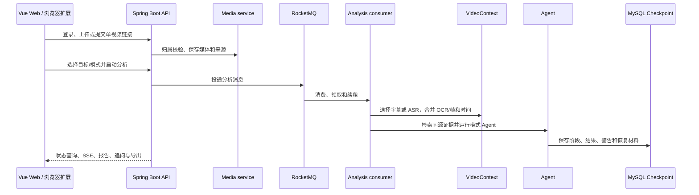

# FrameRead 架构与实施依据

审查日期：2026-11-18。本文是研究和实施依据，正式产品需求与技术契约分别见 [PRD V3](../prototype/PRD.v3.md) 和 [SPEC](../prototype/SPEC.md)。本文保留源码核对、技术取舍和验证边界，不重新定义正式产品。

## 1. 一页结论

FrameRead 是一个完整的 Java 后端与 AI Agent 视频理解 Web 应用，采用 Java 21、Spring Boot、MySQL、MyBatis-Plus/Flyway、Redis/Redisson、RocketMQ、MinIO、Qdrant、LangChain4j、Vue 3/Vite、FFmpeg、ASR、OCR 和浏览器扩展。用户可以注册登录，管理自己的媒体，上传视频或导入单视频链接，获得结构化 Markdown 分析报告，并继续检索、追问、反馈、修订和导出。

系统主链由 Spring Boot HTTP/SSE、媒体与上下文服务、RocketMQ 消费者、VideoContext、混合检索、四模式 Agent、MySQL Checkpoint 和 Vue 工作区组成。Redis/Redisson 负责会话、活动状态、缓存和协调，MinIO 负责媒体和派生文件，Qdrant 负责向量检索。Compose 启动依赖，应用和媒体工具按项目启动脚本运行。

V3 重点增强 Bilibili/YouTube 单视频识别、来源元数据、平台字幕自动选择和无可用字幕时的 ASR 回退。增强能力接入媒体与 VideoContext 主链，不新建独立文章运行时、文章发布、公开分享或全片导图发布系统。结构化报告、Markdown/TXT/MP3 导出、四模式和追问保持同一业务边界。

本文结论来自静态读取。没有用此文声称应用、真实平台、模型、数据库、消息队列或浏览器已经通过验收。

## 2. 工程事实

| 领域 | 源码和配置入口 | 静态核对结果 |
| --- | --- | --- |
| Web/API | `server/src/main/java/com/example/server/controller/` | 用户、媒体、分析、管理员、健康、SSE 和异常响应入口已定位 |
| 业务服务 | `server/src/main/java/com/example/server/service/` | 媒体接入、上下文、分块、检索、Agent、状态、导出和失败重放已定位 |
| 持久化 | `entity/`、`mapper/`、`repository/`、`src/main/resources/db/migration/` | 用户、媒体、Checkpoint 和失败记录路径已定位 |
| 异步 | `AnalysisDispatchService`、`VideoAnalysisConsumer`、`TaskEventService` | RocketMQ、Redis/Redisson、SSE 和有限重投路径已定位 |
| AI | `AgentLoopService`、`ModeRouter`、`DeepSeekUtils`、`EvidenceVerificationService` | 结构化结果、工具调用、预算、Critic 和证据核验路径已定位 |
| 客户端 | `client/src/`、`extension/` | 上传、媒体、分析工作区、SSE、报告、导出、当前页导入和时间定位已定位 |
| 运行 | `docker-compose.yml`、`scripts/dev-up.sh`、`.github/workflows/ci.yml` | 依赖编排、启动检查、Maven/Node 测试与 CI 入口已定位 |

## 3. 功能与验证矩阵

| 产品域 | 当前工程 | V3 需要核实或增加 |
| --- | --- | --- |
| 身份与媒体归属 | 注册、登录、会话、归属和管理员入口 | 跨用户、未登录、管理员边界的接口和页面负测 |
| 上传与续传 | 普通上传、分片初始化/上传/合并、列表、播放、删除 | 丢片、合并失败、响应丢失、并发删除和资源清理 |
| 视频链接 | 通用 URL 导入和 yt-dlp 执行器 | Bilibili/YouTube 单视频、短链、分 P、列表拒绝、来源元数据和错误分类 |
| 字幕与 ASR | ASR 分片和部分失败处理已定位 | 字幕候选排序、原文/时间保存、无可用字幕 ASR 回退和零重复转写 |
| VideoContext | ASR/OCR/关键帧、分块、摘要、Embedding、Checkpoint | 来源指纹、语言/类型精度、同源复用和旧材料恢复 |
| Agent 与报告 | GENERAL/LEARNING/REVIEW/CREATION、AUTO、Planner/Executor/Critic、Markdown | V3 来源一致、报告警告、预算失败、追问和计划修订回归 |
| 异步与恢复 | RocketMQ、Redis/Redisson、SSE、Checkpoint、失败台账和重放 | 202 受理、确认未知、执行代次、重连、重投和过时写回 |
| 配套交付 | TXT/Markdown/MP3、扩展、Compose、CI | 独立部署、真实依赖、浏览器交互和无阻断性缺陷证据 |

## 4. 业务链路与责任

媒体服务拥有媒体归属、来源和文件生命周期。VideoContext 拥有字幕/ASR、OCR、帧、时间和派生上下文。分析协调拥有目标、实际模式、受理代次、状态/SSE、结果保存和失败重放。Agent 不裁决媒体或任务终态。MySQL 是持久业务事实，Redis 是协调和热数据，MinIO 是文件事实，Qdrant 是派生向量索引。

## 5. 数据与恢复边界

分析作用域为 `(mediaId, normalizedGoal, actualMode)`，AUTO 在提交前确定具体模式。每个媒体的来源和采用材料需要可追踪，跨媒体复用必须核对用户归属、来源类型、内容指纹和规则版本。旧报告可读取，但缺少固定材料时，依赖来源的追问、检索和修订应按 SPEC 返回明确不可用。

短事务内核对媒体有效性、当前受理代次、来源和执行代次，再写上下文、结果、摘要或失败状态。媒体删除使后续读取和写回失效，并依据持久引用清理文件。Redis TTL、MQ 重投和应用重启不能替代 MySQL Checkpoint 的最终状态。

外部模型调用可能出现结果未知。未知不等于未执行，也不等于零费用。自动重试、消费重投和管理员重放都沿用原作用域、预算、阶段和代次，不能承诺外部服务 exactly-once。

## 6. V3 来源与字幕策略

1. 解析 Bilibili `/video/BV…`、`/video/av…`、`b23.tv` 以及 YouTube `/watch`、`/shorts`、`youtu.be` 的单视频身份。
2. 纯列表、频道、合集和不能确定单视频的输入明确拒绝，不启动批量任务。
3. 保存安全显示的原始输入、规范来源、平台/视频/分 P 身份、标题/时长和下载结果。
4. 候选字幕先按可证实的人工/自动/未知类型，再按可证实的语言排序。候选必须非空、可解析、同源并带时间信息。
5. 所有字幕轨道不可用时，走原 ASR。保留原文、区间、采用来源和回退原因。ASR 只有分片区间时按区间精度展示。
6. 平台字幕接入文本来源入口，不替代 OCR、关键帧、媒体权限和既有四模式 Agent。

## 7. 技术取舍

| 选择 | 采用边界 |
| --- | --- |
| Spring Boot 模块化单体 | HTTP、SSE、异步消费者和业务服务同进程，按实际负载再评估拆分 |
| MySQL + MyBatis-Plus/Flyway | 业务数据、Checkpoint、失败记录和迁移。新表先证明既有表不能复用，并带项目规定的逻辑删除、时间和乐观锁字段 |
| RocketMQ + Redisson | MQ 负责分析消息，Redisson 负责锁/租约/协调。Redis 不作为最终业务状态 |
| MinIO + Qdrant | 原始/派生媒体对象和向量索引。删除和重建按来源与媒体归属执行 |
| LangChain4j | 模型、结构化输出和工具适配。Agent 只编排分析，状态和终态由业务服务保存 |
| Vue 3 + SSE | 按客户端协议从状态查询恢复，SSE 只提供增量通知 |

不引入独立 Task Runtime、Outbox、Celery、LangGraph、文章表、分享平台或新中间件。若真实验证显示当前机制无法满足 PRD/SPEC 的确认、恢复或一致性要求，再依据证据调整对应模块。

## 8. 实施顺序与验收

按“需求/规格对齐 → 模块 SPEC → 跨模块集成契约 → 纵向切片 → 实现、测试、审查 → 切片验收”推进。顺序建议如下。

1. 复现用户、媒体、报告、追问、导出和异步恢复主链，记录运行基线。
2. 实现单视频来源识别和规范化元数据，覆盖正常、拒绝、超时和下载失败。
3. 接入字幕候选、原文和时间保存，覆盖零 ASR、ASR 回退、部分失败和来源诊断。
4. 复核来源变化对上下文、分块、检索、Checkpoint、追问和重分析的影响。
5. 完成 Vue/扩展的来源、阶段、错误和时间定位交互，按真实页面路径验收。
6. 进行真实依赖、故障恢复、浏览器和部署复现，形成 A3-01～A3-22 证据。

## 9. 未验证项

当前未完成真实应用启动、Flyway 迁移、双平台访问、字幕候选、模型视觉输入、RocketMQ/Redis 断连、Checkpoint 接管、删除竞争、SSE 重连、浏览器操作和性能基线。静态文件、测试代码、CI 配置和镜像标签不能替代这些验证。
